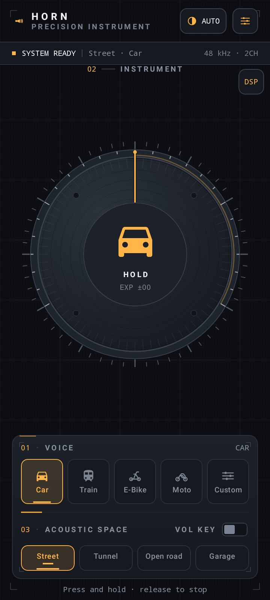
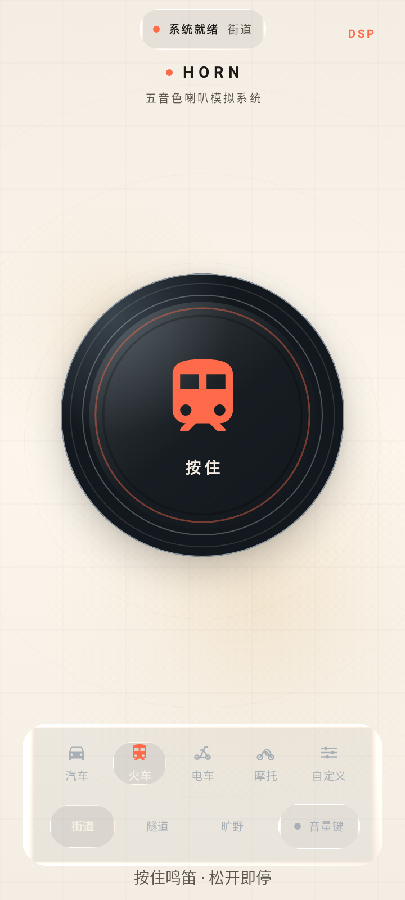
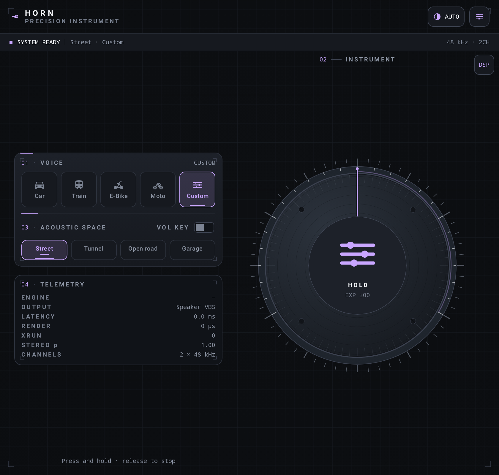
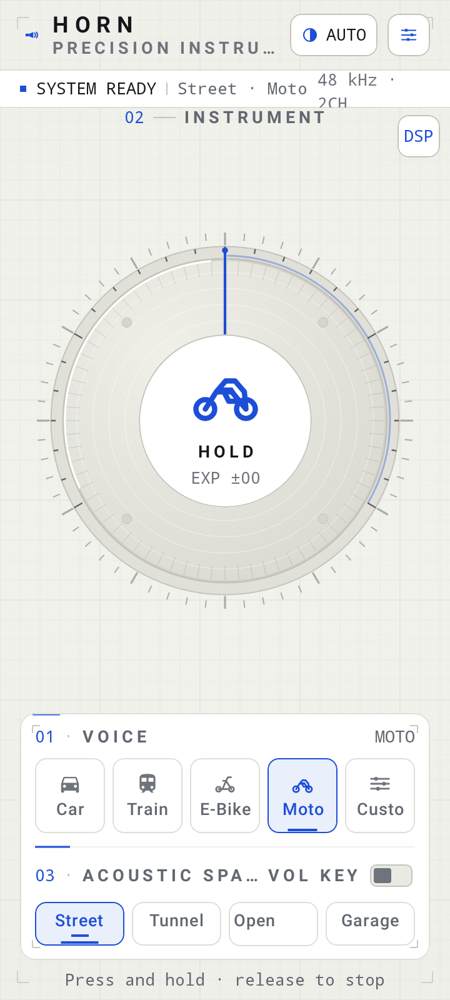
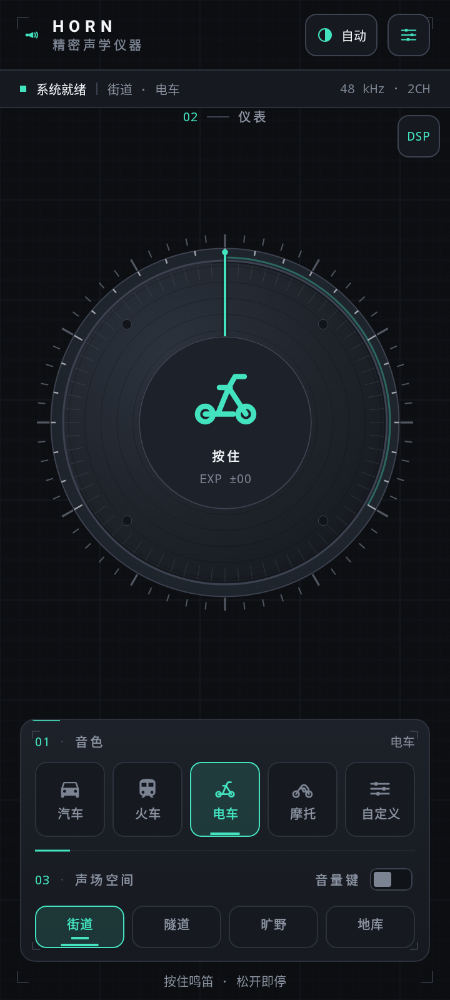
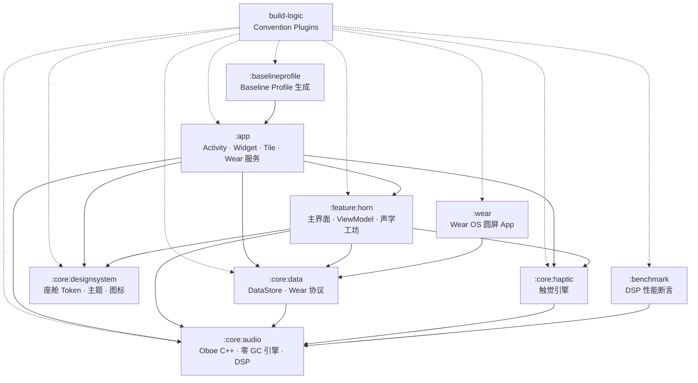
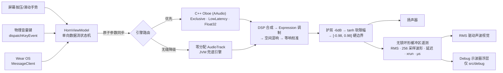

# Horn

**一款为了在过马路时优雅反击，而动用了 C++ AAudio 低延迟引擎的工业级赛博喇叭。**

[简体中文](README.md) · [English](README_EN.md)

---

## 为什么要做这个 App？

如果你在过马路时被其他车辆刺耳的喇叭声惊扰了，手里却手无寸铁、毫无反击之力——那么你肯定会对这款 App 感兴趣。

- 面对不耐烦催促的小轿车？掏出手机，用经典双音蜗牛喇叭礼貌回敬；
- 面对突然贴身狂按的电瓶车？当场切到**隧道回响模式**，拉响 311 Hz + 370 Hz + 494 Hz 美式重载火车三音气喇叭，完成声学维度的降维打击；
- 甚至懒得掏手机？抬起 Wear OS 手表按一下，或者盲按口袋里的物理音量键，深藏功与名。

素材？不存在的。所有声音都是实时算出来的——就像真正的愤怒，应当即兴发生。

## 战术反击装备库

### 五大声学武器

| 音色 | 声学构造（真实 DSP 参数） | 脾气点评 |
|---|---|---|
| 🚗 Car 汽车 | 400 Hz + 500 Hz 双基频，8/7 次谐波，6 kHz 低通，5.5 Hz 微幅摇摆，确定性气噪 | 城市通用语，礼貌而不失威严 |
| 🚂 Train 火车 | D#4 311.13 + F#4 369.99 + B4 493.88 三音和弦，±0.4% 双 Detune，155.56 / 123.47 Hz 低八度，1.8 kHz 带通气流噪声 | 隧道模式一开，声学巨兽出笼 |
| 🛵 E-Bike 电车 | 2740 + 2785 Hz 双脉冲发射器叠加 685 Hz 琴体，500 Hz 高通 + 4.2 kHz 低通 | 尖锐、清脆、穿透力极强的正义 |
| 🏍️ Motorcycle 摩托 | 444 Hz 单基频金属振膜，29 Hz / 18% 振幅颤动，tanh 2.0 饱和 | 颗粒感机械脉冲，一听就是狠角色 |
| 🎛️ Custom 自定义 | Pro Sound Lab：主频 150–3000 Hz、双音比例 0.5–2、谐波 0–1、起音 3–120 ms、尾音 5–250 ms、失真 0–1，DataStore 持久化 | 你的声音，你立法 |

所有波形在构造期生成 2048 点归一化谐波 Wavetable；音频渲染线程只做查表 / 滤波 / 包络，**零内存分配、零锁、零日志**。响度按人耳敏感度做了等响校准（2.7 kHz 的电车不能跟 400 Hz 的汽车按相同 RMS 蛮干），最终统一进入 `tanh` 软限幅器与 `[-0.98, 0.98]` 硬边界。

### 进阶物理手感

| 能力 | 说明 |
|---|---|
| Expression 气压调制 | 按住按钮上下滑动，实时弯音 ±8%、饱和驱动 +35%、气流噪声 +60%，逐采样平滑，绝不咔哒 |
| 三大声场 | 街道（干声为主）/ 隧道（长衰减回响，火车专用震撼）/ 旷野（远场预延迟）——Freeverb 拓扑：4 梳状 + 2 全通 + 预延迟 |
| 差异化触觉指纹 | 火车 255 振幅 120 ms 重脉冲、摩托 18 ms 颗粒脉冲、电车 7 ms 轻点、汽车平稳持续 |
| 物理音量键扳机 | 可选开关，开启后盲操鸣笛（ACTION_DOWN 起音 / ACTION_UP 止音），关闭即完全恢复系统音量行为 |

### 反差级人文关怀

- **零音量防尴尬**：按压时媒体音量为 0？顶部弹出内联胶囊提示，一键设为 60%，优雅不社死；
- **护耳软限幅**：检测到耳机且音量 > 70%，自动下发 -6 dB 保护并亮起低调徽章——反击别人可以，但不能先震聋自己；
- **防卡音生命周期**：退后台、来电、锁屏、音频焦点丢失、手势滑出按钮区，全部安全止音，绝不留下幽灵喇叭声。

### 全平台生态

- **精密汽车座舱视觉体系（Precision Automotive Cockpit）**：两套材质——**陶瓷日光**（哑光陶瓷底 + 白色机加工面板 + 石墨刻线）
  与**隐身碳纤**（碳黑底 + 阳极氧化面板 + 单侧高光）；工程网格基底、1 dp 高光缝 / 底缝、四角卡尺标记、刻线标尺、
  5 音色各自的仪表强调色（深浅双色板，全部经 JVM 对比度测试守住 WCAG AA 4.5:1）；
- **240° 动圈式 Expression 表盘 + 60 格 RMS 压力环**：指针与刻度在 `drawWithCache` 内逐帧直读，按住鸣笛不触发任何重组；
- 主题三挡 **AUTO / DAY / NIGHT**（DataStore 持久化，`ThemeMode` 枚举稳定字符串键），系统栏图标极性随解析后的主题翻转；
- 横屏 / 平板 / 折叠屏 **WindowSizeClass 座舱布局**（左：音色 + 声场 + 遥测仪表盘，右：超大机加工仪表按键）；
- **Jetpack Glance 桌面微件**（1×1 / 2×2 自适应，礼貌双鸣 Bi-Bi）与**快捷设置磁贴**；
- **Wear OS 手表远程引爆**：`MessageClient` 低延迟指令 `/horn/command`（START/STOP），手机端 `/horn/status` 回传状态，通信协议抽象可离线单测；
- Debug 包专属 **荧光双踪 DSP 示波器**：左/右声道真实波形（磷光绿 / 仪表琥珀）叠加在深绿示波管栅格上，实时延迟 / xrun / 单帧耗时全部等宽 tabular 数字；Release 包编译期零侵入剔除。

## 真实界面预览

> 以下均为 Roborazzi 无头渲染的真实基准图.

| 深色 · Car · English | 浅色 · Train · 简体中文 |
|:---:|:---:|
|  |  |

| 深色 · Custom 音色 · 横屏大屏 | 浅色 · Moto · 1.35x 大字体 |
|:---:|:---:|
|  |  |

| 深色 · E-Bike · 简体中文 |
|:---:|
|  |

## 技术架构揭秘（杀鸡用牛刀）

> 完整系统规约、不变量清单与 MADR 架构决策记录见 [`docs/spec/`](docs/spec/README.md)。

### 多模块拓扑

依赖方向严格单向：`:core:audio` 不知道 Compose 存在，`:feature:horn` 与 `:core:designsystem` 永远不碰 `android.media.*`——这不靠自觉，靠 Konsist 架构测试在每次 `testDebugUnitTest` 里机器执法。

### 零 GC 实时音频与遥测数据流

### 工程质量门禁

| 门禁 | 作用 |
|---|---|
| Spotless + ktlint 1.8.0 | `spotlessApply` 一键统一格式，`spotlessCheck` 卡住手滑 |
| Detekt 1.23.8 | 静态分析零 Error，配置在 `config/detekt/detekt.yml` |
| Konsist 0.17.3 | 架构防腐：模块边界 / ViewModel 归属 / 音频模块零全局可变状态 |
| Roborazzi 1.79.0 | 5 音色 × 2 主题 × 2 语言 × 2 字号 × 2 布局 = **80 张**主界面基准 + 8 张开屏定格帧（wake / focus / reveal / shutter）+ 6 张仪表状态帧（压力环点亮 / 表针偏转），全部像素级回归 |
| Baseline Profiles | `:baselineprofile` 实测生成冷启动/切换/鸣笛关键路径基线 |
| Skills 完整性闸门 | `check_skills.py`：结构 / frontmatter / 脱敏 / 相对链接 / `manifest.sha256` 逐字节校验，含正控与负控 |
| GitHub Actions | 5 个并行检查 Job + 单一 `ci-gate` 聚合门禁 + APK 体积追踪 |

## 快速上手

### 环境要求（本机实测版本）

| 项 | 版本 |
|---|---|
| JDK | 21（Temurin） |
| Android Studio | Ladybug 或更新 |
| Android SDK | platform 36 / build-tools 36.x |
| NDK | 27.0.12077973 |
| CMake | 3.22.1 |
| Gradle | 8.13（Wrapper） |

### 高频工程命令

| 命令 | 用途 |
|---|---|
| `./gradlew :app:assembleDebug` | 手机端 Debug 包 |
| `./gradlew :app:assembleRelease` | 手机端 Release 包（R8 + 资源压缩） |
| `./gradlew :wear:assembleDebug` / `:wear:assembleRelease` | Wear OS 端 |
| `./gradlew spotlessApply` | 一键格式化 |
| `./gradlew spotlessCheck detekt` | 格式 + 静态分析门禁 |
| `./gradlew testDebugUnitTest` | 全模块单测 + Konsist 架构测试 |
| `./gradlew recordRoborazziDebug` | 重录视觉回归基准图 |
| `./gradlew verifyRoborazziDebug` | 验证 UI 与基准 100% 一致 |
| `./gradlew lintDebug` | Android Lint，0 Error |
| `./gradlew :benchmark:assembleBenchmark` | DSP 性能基准模块构建 |
| `./gradlew :core:audio:testDebugUnitTest` | DSP 声学 + 渲染预算测试 |

### 彩蛋：呼出 DSP 实时示波器

安装 **Debug** 包后，主界面右上角有一个低调的 `DSP` 标签——点它展开极客调试抽屉。示波器画的是**真实音频环形缓冲区**的波形（假正弦波这种事我们做不出来，会被同行笑一年）。调完参数后点「复制为 Kotlin」，直接粘贴进 `CustomHornProfile` 代码。

### Wear OS 联调

1. 在 Android Studio 里启动 Wear OS 模拟器（API 30+）并配对手机模拟器；
2. 手机与手表都安装 Debug 包（两端共享 `applicationId = "com.industrial.horn"`）；
3. 手表端按住即鸣、松手即停；手机端显示引擎实时状态回传。

## 安全免责声明

本应用仅供娱乐、实时 DSP 声学实验与现代 Android 工程架构交流。过马路请严格遵守交通规则、礼让通行，切勿在真实车流中与钢铁巨兽正面对线——我们的 C++ Oboe 音频延迟可以做到 10 ms 以内，但大卡车的物理刹车距离不行。

请勿在图书馆、深夜住宅区、考场附近或他人耳边恶意使用。护耳限幅能保护你的听力，保护不了你的社交关系。一切因「反击过于优雅」导致的路人侧目、邻居敲门或自我感动，本项目概不负责，但会在 Issue 里给你点赞。

## 贡献与协议

- 贡献指南：[CONTRIBUTING.md](CONTRIBUTING.md)（含新增音色 SOP 与 Roborazzi 基准更新流程）
- 安全披露：[SECURITY.md](SECURITY.md)
- 架构规约：[docs/spec/](docs/spec/README.md)
- 协议：[MIT License](LICENSE)

> 咖啡免了，PR 请带测试。
