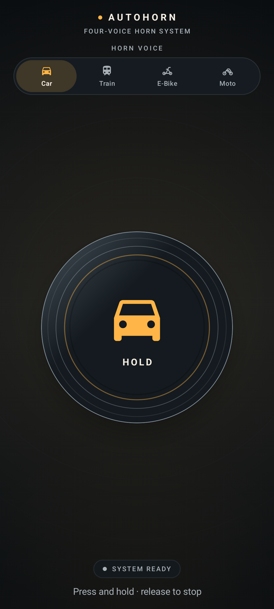
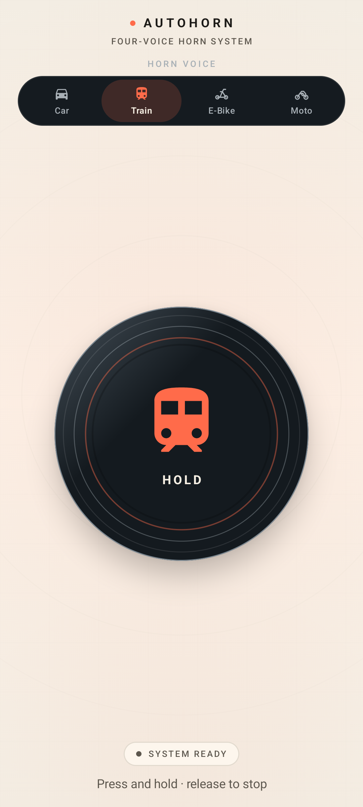

# AutoHorn 2.0

工业级、零外部音频素材的**四音色喇叭模拟器**：汽车、火车、电动车、摩托车。核心交互仍是中央超大圆形按钮的“按住发声、松手即停”，并新增车型声学策略、差异化触觉、声波视觉与 DataStore 偏好持久化。

- 包名：`com.industrial.autohorn`
- 版本：`2.0.0`（versionCode 2）
- 技术栈：Kotlin 2.2.21 / Jetpack Compose（BOM 2025.06.01）/ Material 3 / DataStore Preferences 1.2.1
- 构建：Gradle Kotlin DSL 8.13 + Version Catalog
- SDK：`minSdk 26`，`compileSdk 36`，`targetSdk 36`
- 项目路径：仓库根目录

| 深色：Car | 浅色：Train |
|---|---|
|  |  |

## 1. 四音色声学设计

| 音色 | DSP 结构 | 瞬态 | 校准增益 / 实测 RMS | 触觉签名 |
|---|---|---|---|---|
| Car 汽车 | 400 Hz + 500 Hz 双基频；8/7 次谐波；6 kHz 低通；5.5 Hz 微幅摇摆；确定性气噪 | 12 ms / 14 ms | 0.55 / 0.224 | 中强、平稳持续脉冲 |
| Train 火车 | D#4 311.13 + F#4 369.99 + B4 493.88 三音和弦；每音 ±0.4% 双 Detune；155.56 / 123.47 Hz 低八度；80 Hz 高通 + 5.6 kHz 低通；1.8 kHz 带通气流噪声 | 65 ms / 185 ms，起音 -1.8% → 0 的 180 ms Pitch Bend | 0.52 / 0.183 | 最高 255 振幅、120 ms 低频重脉冲 |
| E-Bike 电车 | 2740 + 2785 Hz 双脉冲发射器，叠加 685 Hz 琴体；500 Hz 高通 + 4.2 kHz 低通；带限脉冲谐波 | 4 ms / 6 ms | 0.18 / 0.080 | 轻量 7 ms 高频轻点 |
| Motorcycle 摩托 | 444 Hz 单基频金属振膜；强奇偶次谐波；29 Hz / 18% 振幅颤动；190 Hz 高通 + 4.8 kHz 低通；tanh 2.0 饱和 | 8 ms / 10 ms | 0.33 / 0.227 | 18 ms 颗粒机械脉冲 |

所有波形在构造期生成 2048 点归一化谐波 Wavetable，音频线程只做查表/滤波/包络，不分配内存。火车与摩托使用 RBJ Biquad，电车使用带限脉冲波，汽车保留 v1 的加法合成器并重新校准增益。

**响度与防破音**：每个音色有独立 Makeup Gain；最终统一进入 `tanh` 软限幅器与 `[-0.98, 0.98]` 硬边界，再转换 PCM16（峰值钳位 ±32112）。E-Bike 的 RMS 明显低于 Car/Moto，是刻意的等响校准：2.7 kHz 附近人耳敏感度远高于 400–500 Hz，不能按相同 RMS 播放。

## 2. 无锁音色切换

`HornRenderer` 是纯 JVM 实时渲染器：

- `requestType()` 只写 `AtomicReference<HornType>`，可从任意线程调用；
- 当前波形、包络、滤波器状态只归音频线程所有；
- 若在鸣笛中/AudioTrack 运行中切换类型，旧声部先走完 Release 包络并到达数字静音，随后重置新声部并 Attack，绝不把新波形直接换到非零样本上；
- `HornVoice` 预创建四种实现，切换时零分配；
- ViewModel 层还会先 `session.stop()`、将 UI 置为 Idle，再持久化选择，形成双层保证。

## 3. 工程结构

```text
app/src/main/java/com/industrial/autohorn/
├── audio/
│   ├── HornType.kt                 # Car / Train / E-Bike / Motorcycle
│   ├── HornVoice.kt                # 参数表、策略工厂、Makeup Gain
│   ├── HornRenderer.kt             # 纯 JVM 原子切换/包络/声部管理
│   ├── DualToneHornSynth.kt        # Car
│   ├── TrainHornSynth.kt           # Train：和弦 + 低八度 + 气流 + Pitch Bend
│   ├── EBikeHornSynth.kt           # E-Bike：2.7k 双脉冲 + 带通
│   ├── MotorcycleHornSynth.kt      # Motorcycle：444Hz + 29Hz 颤动
│   ├── AttackReleaseEnvelope.kt    # 1–250ms raised-cosine，按音色配置
│   ├── PcmRenderer.kt              # 统一增益/软限幅/硬边界/PCM16
│   ├── SynthAudioTrackEngine.kt    # LOW_LATENCY AudioTrack + 专用音频线程
│   ├── AudioFocusManager.kt        # GAIN_TRANSIENT / abandon
│   ├── HornSession.kt              # 会话接口与事件
│   └── DefaultHornSession.kt       # 焦点 + 引擎 + 触觉 + noisy 广播
│   └── dsp/                         # Wavetable / Biquad / Noise / Soft Saturate
├── data/
│   └── HornPreferencesRepository.kt # DataStore Preferences 抽象与实现
├── haptic/
│   ├── HapticPattern.kt             # 纯 Kotlin 四套可测试振动签名
│   ├── HornHaptics.kt
│   └── AndroidHornHaptics.kt        # VibratorManager/Vibrator 版本兼容
├── presentation/
│   ├── HornUiState.kt              # selectedHorn + Idle/Honking/Error + loaded
│   └── HornViewModel.kt            # UDF、持久化恢复、安全切换、生命周期
├── ui/
│   ├── HornScreen.kt               # 四音色主题、动态声波、响应式布局
│   ├── HornTypeSelector.kt         # Material 3 四档胶囊选择器
│   ├── HornButton.kt               # 底层按住手势 + 圆形越界取消
│   ├── HornVisuals.kt              # 每音色 Accent/Icon/WaveStyle
│   └── theme/
├── di/AppContainer.kt              # DataStore + Session 组合根
├── AutoHornApplication.kt
└── MainActivity.kt
```

## 4. 持久化与 UDF

- `HornPreferencesRepository` 基于 **Preferences DataStore**，文件 `horn_preferences.preferences_pb`；读写均在 IO 协程，主线程零阻塞。
- ViewModel 启动时 `selectedHorn.first()` 只读取一次并恢复，避免稍后到达的旧 DataStore 值覆盖用户刚做的选择。
- UI 在偏好加载完成前禁用选择器；`HornUiState` 始终包含 `selectedHorn: HornType`、`status` 与 `preferencesLoaded`。
- 点击已选音色不重复写入；鸣笛中切换会先 `stop()` 旧声部、状态回 Idle，再异步写入新选择。

## 5. 触觉签名

`HapticPattern` 把时间序列与振幅从 Android API 中解耦，四种签名均为独立波形：

- Car：190 振幅、24/12/9 ms 平稳脉冲；
- Train：255 振幅、120/50/45/55 ms 低频重脉冲；
- E-Bike：70 振幅、7/5/4/3 ms 快速轻点；
- Motorcycle：150 振幅、18/10/8/6 ms 颗粒脉冲。

无振幅控制设备使用各自的 `fallbackTimingsMs` 节奏降级；无马达设备直接空操作。

## 6. 构建与验证

```powershell
cd <你的克隆目录>\AutoHorn

.\gradlew.bat :app:testDebugUnitTest
.\gradlew.bat :app:lintDebug
.\gradlew.bat :app:assembleDebug
.\gradlew.bat :app:assembleRelease
.\gradlew.bat :app:connectedDebugAndroidTest
```

本机结果（API 35 x86_64 AVD）：

```text
:app:testDebugUnitTest         BUILD SUCCESSFUL  (58 tests)
:app:connectedDebugAndroidTest BUILD SUCCESSFUL  (7 tests)
:app:lintDebug                 0 errors, 0 warnings (warningsAsErrors=true)
:app:assembleDebug             BUILD SUCCESSFUL
:app:assembleRelease           BUILD SUCCESSFUL  (R8 + shrinkResources)
```

产物：

- Debug APK：`app/build/outputs/apk/debug/app-debug.apk`
- Release（未签名）：`app/build/outputs/apk/release/app-release-unsigned.apk`
- 单测报告：`app/build/reports/tests/testDebugUnitTest/index.html`
- Lint：`app/build/reports/lint-results-debug.html`

安装：

```powershell
adb install -r app\build\outputs\apk\debug\app-debug.apk
adb shell am start -n com.industrial.autohorn/.MainActivity
```

## 7. 测试覆盖

- **四音色 DSP**：`DualToneHornSynthTest`、`TrainHornSynthTest`、`EBikeHornSynthTest`、`MotorcycleHornSynthTest`、`HornSynthesizerContractTest`：NaN/Inf、峰值、RMS、双基频/和弦/低八度/2.7 kHz/444 Hz 频谱、AM 侧带、确定性、缓冲区边界。
- **渲染器**：`HornRendererTest`：四音色响度带、切换先 Release、Train 长尾、Panic 清零、4 个线程并发请求 12,000 次音色切换。
- **包络/极限**：`AttackReleaseEnvelopeTest`、`PcmRendererTest`：12/14、65/185、4/6、8/10 ms 包络、软限幅硬边界、PCM 不溢出。
- **状态/持久化**：`HornViewModelTest`、`HornPreferencesRepositoryTest`：冷启动恢复、默认值、读写、鸣笛中切换、同音色去重、错误/生命周期、异步加载防覆盖。
- **触觉/类型**：`HapticSignatureTest`、`HornTypeTest`：四套签名合法且差异明显、存储键回退。
- **Compose UI**：`HornScreenTest` 7 项：四档渲染与选择、TalkBack contentDescription/selected、主按钮动态描述、按住/松手、滑出取消、深/浅色非黑屏截图。

真实设备行为：选择 Train 后杀进程重启，UI 仍恢复 Train；按住 Train 时 AudioTrack 以 48 kHz / `USAGE_MEDIA` / `GAIN_TRANSIENT` 启动；按 HOME 后焦点 abandon、AudioTrack `paused`，进程存活且 crash buffer 为空。证据见 [`docs/VERIFICATION.md`](docs/VERIFICATION.md)。

## 8. Android Studio 打开

1. Android Studio → **Open** → 选择仓库根目录。
2. 等待 Gradle Sync（Wrapper 8.13，JDK 21 可用）。
3. 选择 `app` 运行配置，目标设备 API 26+。
4. 首次运行不需要麦克风、存储或通知权限；仅声明普通权限 `VIBRATE`。

## 9. 扩展新音色

1. 在 `HornType` 增加枚举值并补齐存储键。
2. 实现新的 `HornSynthesizer`。
3. 在 `HornSynthesizerFactory` 注册，并在 `HornVoiceCatalog` 标定 Attack/Release/Makeup Gain。
4. 在 `HornVisuals`、`HapticSignatures` 与中英文字符串补充对应表达。

`HornAudioEngine` 接口保持不变，Oboe/WAV 后端仍可通过 `AppContainer` 替换。
# Horn
