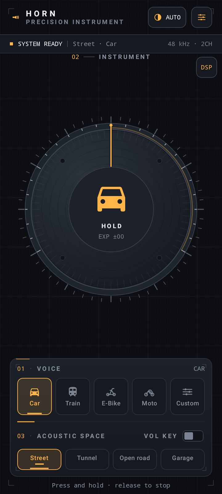
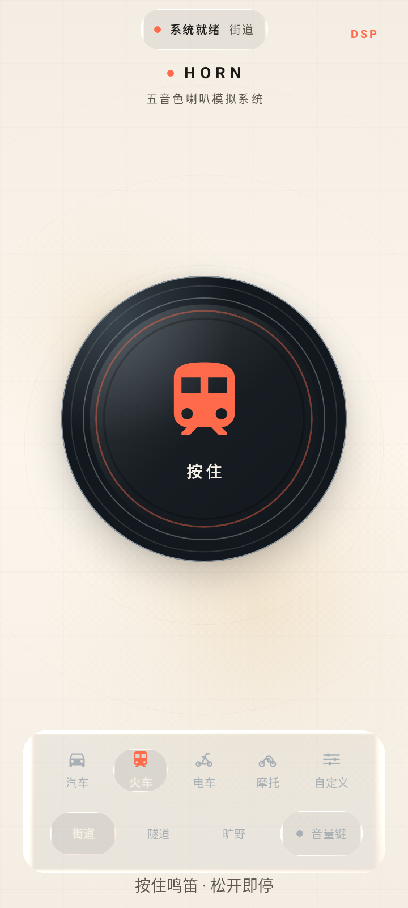
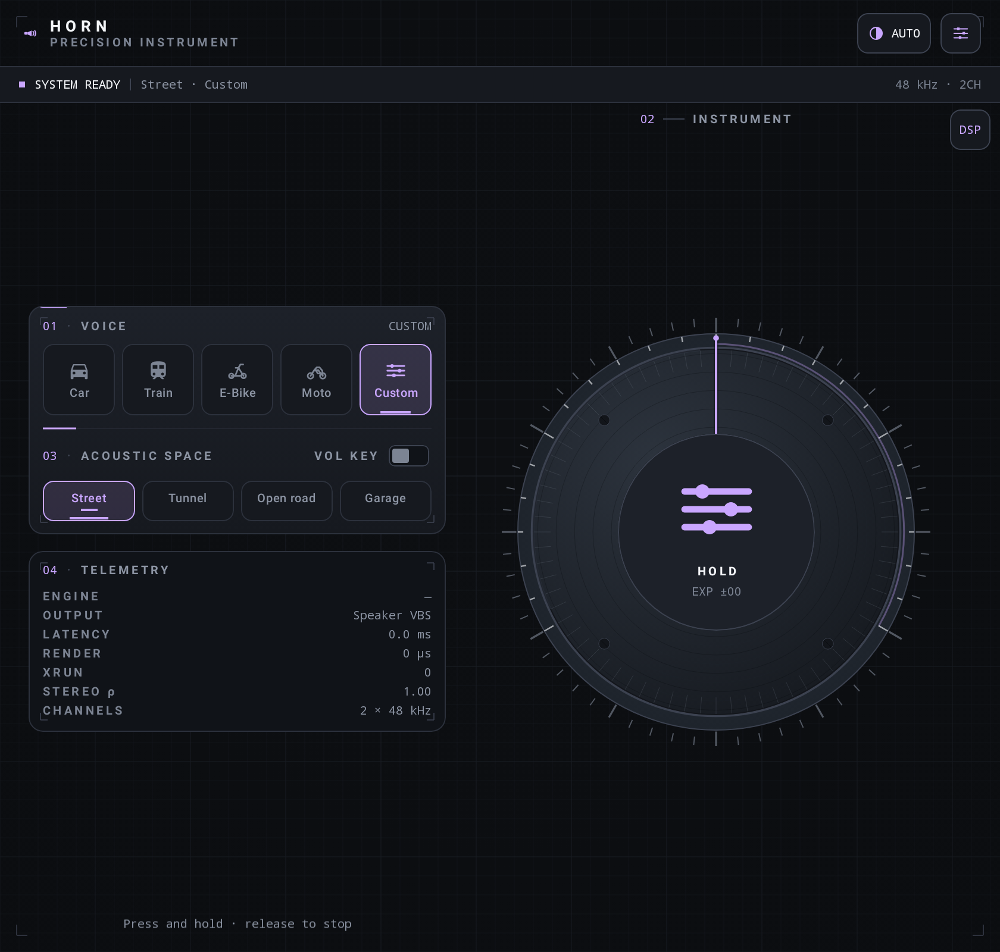
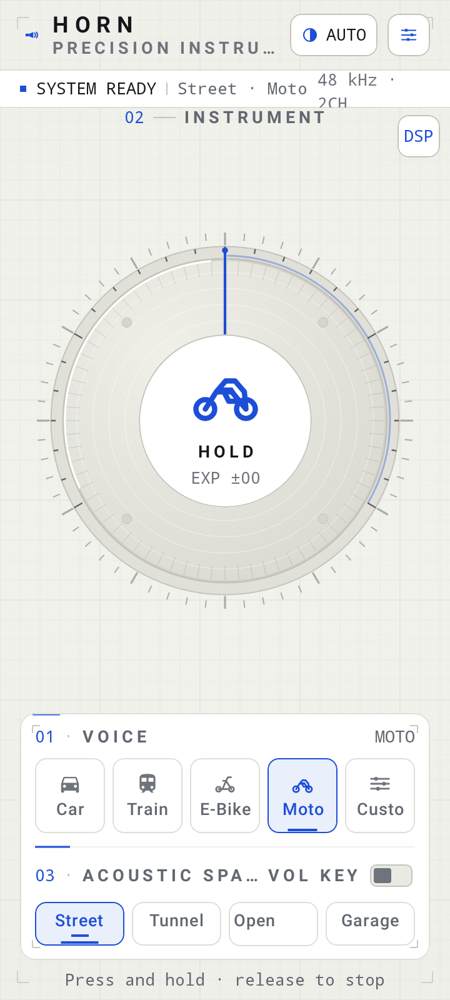
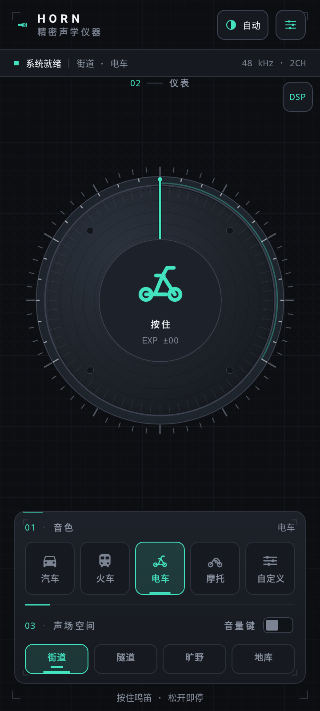
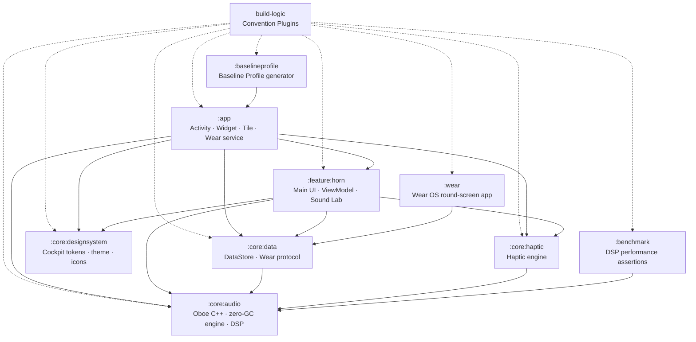
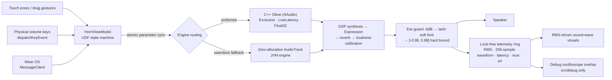

# Horn

**An industrial-grade cyber horn that ships a C++ AAudio low-latency engine so you can win the crosswalk with elegance.**

[简体中文](README.md) · [English](README_EN.md)

---

## Why does this exist?

If you have ever been startled mid-crosswalk by a car horn and realized you were completely unarmed — this app is for you.

- An impatient sedan? Pull out your phone and answer with a polite dual-tone snail horn.
- An e-bike rider honking from two centimeters away? Switch to **Tunnel mode** and fire the 311 Hz + 370 Hz + 493.88 Hz American heavy-haul train chime. That is not escalation; that is acoustic dominance.
- Too lazy to reach for the phone? Tap your Wear OS watch, or blindly press the physical volume key in your pocket. Nobody will ever know.

It started as "a `Button` that plays an MP3". Then engineering OCD kicked in, and somehow it grew a C++ audio core, a machined instrument UI, 80 pixel-perfect visual-regression baselines and a full CI pipeline. Sampled audio assets? None. Every sound is synthesized in real time — because true indignation should be improvised.

## The arsenal

### Five acoustic weapons

| Voice | Acoustic construction (real DSP parameters) | Personality |
|---|---|---|
| 🚗 Car | 400 Hz + 500 Hz dual fundamental, 8th/7th harmonics, 6 kHz low-pass, 5.5 Hz micro-wobble, deterministic air noise | The urban lingua franca: polite, yet authoritative |
| 🚂 Train | D#4 311.13 + F#4 369.99 + B4 493.88 chord with ±0.4% double detune, 155.56 / 123.47 Hz sub-octaves, 1.8 kHz band-passed air blast | With Tunnel reverb on, the beast is unleashed |
| 🛵 E-Bike | 2740 + 2785 Hz twin pulse emitters over a 685 Hz body, 500 Hz high-pass + 4.2 kHz low-pass | Sharp, crisp, surgically piercing justice |
| 🏍️ Motorcycle | 444 Hz metallic diaphragm, 29 Hz / 18% amplitude flutter, tanh 2.0 saturation | Granular mechanical pulse; instantly recognizable menace |
| 🎛️ Custom | Pro Sound Lab: 150–3000 Hz fundamental, 0.5–2 dual-tone ratio, 0–1 harmonics, 3–120 ms attack, 5–250 ms release, 0–1 saturation, persisted via DataStore | Your sound, your legislation |

All waveforms are built as 2048-point normalized harmonic wavetables at construction time. The audio render thread only does table lookup / filtering / envelopes: **zero allocation, zero locks, zero logging**. Loudness is equal-loudness calibrated (a 2.7 kHz e-bike must not shout at the same RMS as a 400 Hz car), then everything goes through a `tanh` soft limiter and a `[-0.98, 0.98]` hard bound.

### Physical feel

| Capability | Detail |
|---|---|
| Expression modulation | Slide vertically while holding: ±8% pitch bend, +35% saturation drive, +60% air noise, per-sample smoothed — no zipper artifacts |
| Three acoustic spaces | Street (dry) / Tunnel (long tail, train-certified awe) / Open Road (far-field pre-delay) — Freeverb topology: 4 combs + 2 all-passes + pre-delay |
| Per-voice haptic fingerprints | Train: 255-amplitude 120 ms heavy pulse; Moto: 18 ms granular; E-Bike: 7 ms tick; Car: steady pulses |
| Volume-key trigger | Opt-in blind-fire mode (ACTION_DOWN starts, ACTION_UP stops); when off, system volume behaves normally |

### Human care, unexpectedly

- **Zero-volume rescue**: pressing with media volume at 0 pops a pill prompt — one tap sets 60% and the crisis is averted.
- **Ear protection**: headphones detected at >70% volume? A −6 dB soft limiter engages with a discreet badge. Retaliation is fine; deafening yourself first is not.
- **Anti-stuck-audio lifecycle**: backgrounding, calls, lock screen, audio-focus loss and fingers sliding out of the button all stop playback safely. No ghost honks, ever.

### Ecosystem

- **Precision Automotive Cockpit design system**: two materials — *Ceramic Daylight* (matte ceramic
  canvas, white machined plates, graphite engraving) and *Stealth Carbon* (carbon black, anodised
  plates, single-side highlight). Engineering-grid substrate, 1 dp light seam / shadow seam, caliper
  corner marks, printed graduations, and one instrument accent per voice — every pair contrast-gated
  at WCAG AA 4.5:1 by a JVM test, not by taste.
- **240° moving-coil expression gauge + 60-tick RMS pressure ring**: needle, graduations and ticks are
  read inside `drawWithCache`, so holding the horn redraws at frame rate without a single recomposition.
- **Three-position theme**: AUTO / DAY / NIGHT persisted in DataStore (`ThemeMode` with stable string
  keys); system-bar icon polarity follows the resolved palette under edge-to-edge.
- Landscape / tablet / foldable **WindowSizeClass cockpit** (voice + room + telemetry plates left,
  oversized machined instrument pad right).
- **Jetpack Glance widget** (adaptive 1×1 / 2×2, polite bi-bi double honk) and a **Quick Settings Tile**.
- **Wear OS remote detonation**: low-latency `MessageClient` commands on `/horn/command` (START/STOP) with `/horn/status` telemetry back; the protocol is abstracted so both sides unit-test without Play Services.
- Debug-only **fluorescent dual-trace DSP scope**: real left/right channel samples (phosphor green /
  instrument amber) on a dark green graticule, with latency, xrun and per-frame µs in tabular figures —
  compiled out of release builds entirely.

## Real screenshots

> Rendered by Roborazzi on a headless JVM. These are real baselines, not designer mockups — the designer has left the building.

| Dark · Car · English | Light · Train · 简体中文 |
|:---:|:---:|
|  |  |

| Dark · Custom voice · expanded cockpit | Light · Moto · 1.35x font scale |
|:---:|:---:|
|  |  |

| Dark · E-Bike · 简体中文 |
|:---:|
|  |

## Architecture (a sledgehammer for a walnut)

> Full system specifications, invariants and MADR decision records live in [`docs/spec/`](docs/spec/README.md).

### Module topology

Dependency arrows only point downward: `:core:audio` does not know Compose exists, and `:feature:horn` / `:core:designsystem` never touch `android.media.*`. Not by discipline — by Konsist tests enforcing it on every `testDebugUnitTest` run.

### Zero-GC real-time audio and telemetry flow

### Quality gates

| Gate | Purpose |
|---|---|
| Spotless + ktlint 1.8.0 | `spotlessApply` for one-key formatting, `spotlessCheck` to catch slips |
| Detekt 1.23.8 | Static analysis, zero errors, config in `config/detekt/detekt.yml` |
| Konsist 0.17.3 | Architecture firewall: module boundaries, ViewModel placement, no mutable globals in the audio module |
| Roborazzi 1.79.0 | 5 voices × 2 themes × 2 locales × 2 font scales × 2 layouts = **80** pixel-level baselines + 6 frozen startup frames + 6 instrument-state frames (pressure ring lit, needle deflected) |
| Baseline Profiles | `:baselineprofile` generates cold-start / voice-switch / honk critical-path profiles on a real device |
| Skills integrity gate | `check_skills.py`: structure, frontmatter, sanitization, relative links and byte-exact `manifest.sha256` verification, with positive and negative controls |
| GitHub Actions | 5 parallel check jobs + single `ci-gate` aggregator + APK size tracking |

## Getting started

### Environment (versions verified locally)

| Item | Version |
|---|---|
| JDK | 21 (Temurin) |
| Android Studio | Ladybug or newer |
| Android SDK | platform 36 / build-tools 36.x |
| NDK | 27.0.12077973 |
| CMake | 3.22.1 |
| Gradle | 8.13 (wrapper) |

### Everyday commands

| Command | Purpose |
|---|---|
| `./gradlew :app:assembleDebug` | Phone debug APK |
| `./gradlew :app:assembleRelease` | Phone release APK (R8 + resource shrinking) |
| `./gradlew :wear:assembleDebug` / `:wear:assembleRelease` | Wear OS build |
| `./gradlew spotlessApply` | Format everything |
| `./gradlew spotlessCheck detekt` | Format + static analysis gate |
| `./gradlew testDebugUnitTest` | All unit tests incl. Konsist architecture tests |
| `./gradlew recordRoborazziDebug` | Re-record visual regression baselines |
| `./gradlew verifyRoborazziDebug` | Verify UI matches baselines exactly |
| `./gradlew lintDebug` | Android Lint, zero errors |
| `./gradlew :benchmark:assembleBenchmark` | Build the DSP performance benchmark module |
| `./gradlew :core:audio:testDebugUnitTest` | DSP acoustics + render-budget tests |

### Easter egg: the DSP oscilloscope

Install the **Debug** build and look for the understated `DSP` label in the top-right corner of the main screen. It expands into a geeky debug drawer whose oscilloscope draws **actual samples from the audio ring buffer** — drawing a fake sine wave would get us laughed out of any conference. Tweak parameters, hit "copy as Kotlin", paste into `CustomHornProfile`, done.

### Wear OS pairing

1. Launch a Wear OS emulator (API 30+) from Android Studio and pair it with the phone emulator.
2. Install debug builds on both (they share `applicationId = "com.industrial.horn"`).
3. Hold to honk on the watch; the phone mirrors engine state back in real time.

## Safety disclaimer

This app is for entertainment, real-time DSP experimentation and modern Android architecture discussions. Obey traffic rules, yield to actual vehicles, and do not pick fights with multi-ton steel objects — our C++ Oboe latency is under 10 ms, but a truck's braking distance is not.

Do not use it in libraries, residential areas at midnight, exam halls, or next to anyone's ears. The ear-protection limiter can save your hearing; it cannot save your relationships. Any raised eyebrows, neighbor complaints or self-congratulatory smugness resulting from overly elegant retaliation are not covered by the warranty — but we will upvote your issue.

## Contributing & license

- Contributing guide: [CONTRIBUTING.md](CONTRIBUTING.md) (includes the new-voice SOP and Roborazzi baseline workflow)
- Security policy: [SECURITY.md](SECURITY.md)
- Architecture specs: [docs/spec/](docs/spec/README.md)
- License: [MIT](LICENSE)

> Keep the coffee. Bring tests.
