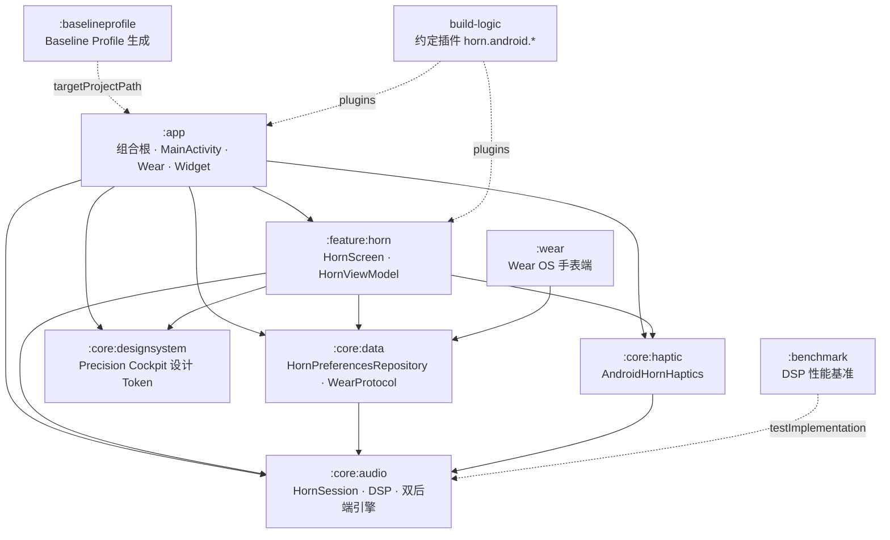
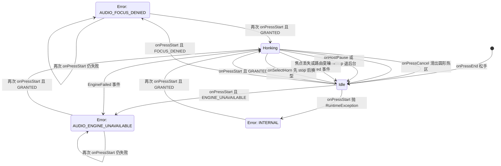
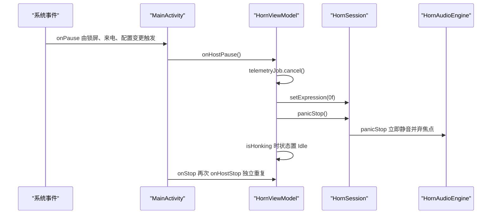

# 01 · 系统架构与模块契约

- 状态：Living Spec
- 日期：2026-11-22

> 关联 ADR：[ADR-0003 多模块工程结构、build-logic 约定插件与 Konsist 架构防腐](adr/ADR-0003-multi-module-build-logic-and-konsist.md)、
> [ADR-0005 以 debug/release 多 source set 编译期隔离调试示波器](adr/ADR-0005-compile-time-debug-release-isolation.md)、
> [ADR-0007 Wear OS 远程鸣笛采用 MessageClient 低延迟协议](adr/ADR-0007-wear-os-message-client-protocol.md)
>
> 本文约束 Horn（包名 `com.industrial.horn`，rootProject.name `Horn`）的多模块拓扑与依赖方向、
> 单向数据流（UDF）状态机、防"卡音"安全生命周期矩阵与 `:core:data` 持久化 Schema 契约。
> 修改任一契约 MUST 同步更新本文与相关测试。

## 0. 文档定位

- 读者：修改 Horn 任意模块的工程师；读完应能判断一次改动是否越界、应落在哪个模块、应更新哪条契约。
- 术语沿用 [docs/spec/README.md](README.md) 的 Glossary（UDF、Zero-GC、Prefab、RMS 等）。
- 关键词遵循 RFC 2119：MUST（必须）/ MUST NOT（严禁）/ SHOULD（应当）/ MAY（可以）。
- 本文只覆盖架构与数据契约；手势与触觉细节见 [03-ux-interaction-and-haptics.md](03-ux-interaction-and-haptics.md)，
  音频引擎与 DSP 见 [02-audio-dsp-engine.md](02-audio-dsp-engine.md)。

## 1. 多模块拓扑与依赖方向

`settings.gradle.kts` 声明 9 个模块。依赖方向 MUST 单向：`app` 与 `feature` 依赖 `core`，
`core` 之间仅允许指向 `:core:audio`；MUST NOT 出现反向依赖或 `core` 之间的横向依赖。

依赖方向逐条锚点（各模块 `build.gradle.kts` 的 `dependencies` 块）：

| 依赖边 | 声明位置 | 配置 |
|---|---|---|
| `:app` → `:feature:horn` `:core:audio` `:core:data` `:core:haptic` `:core:designsystem` | `app/build.gradle.kts` | `implementation` |
| `:feature:horn` → `:core:audio` `:core:data` `:core:haptic` `:core:designsystem` | `feature/horn/build.gradle.kts` | `implementation` |
| `:core:data` → `:core:audio` | `core/data/build.gradle.kts` | `implementation` |
| `:core:haptic` → `:core:audio` | `core/haptic/build.gradle.kts` | `implementation` |
| `:wear` → `:core:data` | `wear/build.gradle.kts` | `implementation` |
| `:benchmark` → `:core:audio` | `benchmark/build.gradle.kts` | `testImplementation` |
| `:baselineprofile` → `:app` | `baselineprofile/build.gradle.kts` | `targetProjectPath = ":app"` |

### 1.1 模块职责与 API 边界

| 模块 | 职责 | 暴露 API 边界（public） | 内部约束（internal / private） |
|---|---|---|---|
| `:app` | 组合根与单 Activity 宿主：`di/AppContainer` 手工装配、`MainActivity` 生命周期与音量键路由、Wear 消息服务、Glance 微件与 Quick Tile | `HornApplication`、`MainActivity` | `AppContainer` MUST NOT 向 feature 代码暴露可变全局单例；`wear/WearCommandBus` 仅进程内使用 |
| `:wear` | 手表端 UI 与 MessageClient 收发（`WearMainActivity`、`WearLink`）；与手机共享 `applicationId` `com.industrial.horn` | `WearMainActivity` | 不得依赖 `:core:audio`——音频只在手机侧渲染 |
| `:feature:horn` | 展示层：`HornScreen`、`HornInstrumentPad`、`HornTypeSelector`、`CustomLabSheet`、`SafetyUi`、`StartupOverlay` 与 `presentation/HornViewModel` | `HornScreen` composable、`HornViewModel`、`HornUiState` | MUST NOT 导入 `android.media.*`；MUST NOT 直接持有引擎 |
| `:core:audio` | 音频域：`HornSession` 会话边界、双后端引擎、程序化 DSP、遥测、安全策略 | `HornSession`、`HornSessionFactory`、`HornAudioEngine`、`HornType`、`AcousticSpace`、`CustomHornProfile`、`AudioTelemetry` | `DefaultHornSession` 为 `internal`；MUST NOT 依赖任何 UI 框架；MUST NOT 存在顶层 `var` |
| `:core:data` | 持久化与跨端协议：`HornPreferencesRepository`（接口）、`DataStoreHornPreferencesRepository`、`ThemeMode`、`WearProtocol` | `HornPreferencesRepository`、`HornSettings`、`ThemeMode`、`WearProtocol`、`HornPreferencesRepositoryFactory` | DataStore 文件名 `horn_preferences` 仅由 Factory 构造 |
| `:core:haptic` | 触觉反馈：`AndroidHornHaptics`、`HapticPattern` | `HornHapticFeedback` 实现 | 依赖 `:core:audio` 的音色枚举，不得反向 |
| `:core:designsystem` | Precision Cockpit 设计 Token 与仪表组件：`Color`、`Theme`、`Motion`、`CockpitCanvas`、`MachinedPanel`、`TactileKeycap`、`InstrumentDial`、`PrecisionExpressionGauge`、`InstrumentSlider` | 主题、Token 与组件 composable | MUST NOT 导入 `android.media.*`；MUST NOT 依赖任何业务模块 |
| `:benchmark` | `DspPerformanceTest`：DSP 渲染基准；专用 `benchmark` build type，产出 `assembleBenchmark` 供 CI 门禁 | 无运行时 API | 单元测试经 `testImplementation` 引用 `:core:audio` |
| `:baselineprofile` | `BaselineProfileGenerator`，`self-instrumenting` 测试模块 | 无 | `targetProjectPath = ":app"` |

`:app` 当前 `versionCode = 3`、`versionName = 3.0.0`（`app/build.gradle.kts`）；源码注释中的
"v4.0 Precision Cockpit" 指视觉世代命名（见 `feature/horn/src/main/java/com/industrial/horn/ui/HornScreen.kt`），
MUST NOT 与 Gradle 版本号混用。

### 1.2 build-logic 约定插件

构建样板的单一事实源是 included build `build-logic`（`settings.gradle.kts` 的
`pluginManagement { includeBuild("build-logic") }`）。约定插件位于
`build-logic/convention/src/main/kotlin/`：

| 插件 ID | 文件 | 契约 |
|---|---|---|
| `horn.android.application` | `build-logic/convention/src/main/kotlin/horn.android.application.gradle.kts` | compileSdk 36、minSdk 26、targetSdk 36、Java 17、`buildConfig = false`、lint `abortOnError` 且 `warningsAsErrors` |
| `horn.android.library` | `build-logic/convention/src/main/kotlin/horn.android.library.gradle.kts` | compileSdk 36、minSdk 26、Java 17、同上 lint 策略 |
| `horn.android.compose` | `build-logic/convention/src/main/kotlin/horn.android.compose.gradle.kts` | 按 application/library 开启 `buildFeatures.compose` 并应用 Kotlin Compose 编译器插件 |
| `horn.android.wear` | `build-logic/convention/src/main/kotlin/horn.android.wear.gradle.kts` | 手表基线：minSdk 30、targetSdk 36；设备特性声明留在 `:wear` manifest |

`build-logic/convention/build.gradle.kts` 固定 AGP 8.13.2、Kotlin 2.2.21 与 Compose 编译器插件 2.2.21；
升级 MUST 在该文件一次性完成，各模块 `build.gradle.kts` 严禁各自钉死版本。

静态检查：根 `build.gradle.kts` 应用 Spotless（ktlint 1.8.0 约束 `*.kt` 与 `*.gradle.kts`；
`format("misc")` 约束 `*.md` 等：`trimTrailingWhitespace()` + `endWithNewline()`）与 Detekt
（配置 `config/detekt/detekt.yml`，jvmTarget 17）。

### 1.3 Konsist 架构防腐（4 条规则）

执法位置：`app/src/test/java/com/industrial/horn/architecture/ArchitectureTest.kt`。任一规则失败即构建失败。

| 测试方法 | 规则 |
|---|---|
| `featureAndDesignSystemNeverImportAndroidMediaDirectly` | `:feature:horn` 与 `:core:designsystem` MUST NOT 出现 `android.media.*` import |
| `coreAudioNeverDependsOnCompose` | `:core:audio` MUST NOT 出现 `androidx.compose.*` import |
| `everyViewModelLivesInPresentationPackage` | 全工程 `*ViewModel` MUST 驻留 `..presentation..` 包且路径含 `/presentation/` |
| `realtimeAudioModuleHasNoTopLevelMutableState` | `:core:audio` MUST NOT 存在顶层 `var`（杜绝可变全局状态） |

## 2. 单向数据流（UDF）状态机

单一事实源是 `feature/horn/src/main/java/com/industrial/horn/presentation/HornViewModel.kt` 的
`HornUiState`（`feature/horn/src/main/java/com/industrial/horn/presentation/HornUiState.kt`）。
UI MUST 只读状态、只发事件；副作用（`HornSession`、`HornPreferencesRepository`）MUST 只发生在
ViewModel 内。`MainActivity` 通过 `collectAsStateWithLifecycle` 订阅，通过方法引用上行事件。

`HornUiState` 字段契约（不可变 data class，随状态整体替换）：

| 字段 | 类型 | 默认值 | 含义 |
|---|---|---|---|
| `selectedHorn` | `HornType` | `HornType.CAR` | 当前音色 |
| `acousticSpace` | `AcousticSpace` | `AcousticSpace.STREET` | 当前声学空间 |
| `customProfile` | `CustomHornProfile` | `CustomHornProfile.DEFAULT` | 自定义音色档案（已 `sanitized()`） |
| `volumeTriggerEnabled` | `Boolean` | `false` | 音量键触发开关 |
| `status` | `HornStatus` | `HornStatus.Idle` | 播放状态 |
| `preferencesLoaded` | `Boolean` | `false` | 持久化值是否已加载（冷启动闸门） |
| `audioSafety` | `AudioSafetyState` | `AudioSafetyState()` | 音量与护耳状态 |
| `showZeroVolumePrompt` | `Boolean` | `false` | 零音量提示 |

`HornStatus` 为密封三态：`Idle`、`Honking`、`Error(HornFailure)`；`HornFailure` 取值
`AUDIO_FOCUS_DENIED`、`AUDIO_ENGINE_UNAVAILABLE`、`INTERNAL`。`session.start()` 的
`HornStartResult` 映射 MUST 遵循下表：

| HornStartResult | HornStatus | 触发条件 |
|---|---|---|
| `GRANTED` | `Honking` | 焦点授予且引擎启动成功 |
| `FOCUS_DENIED` | `Error(AUDIO_FOCUS_DENIED)` | `AudioFocusManager.requestFocus()` 返回 false |
| `ENGINE_UNAVAILABLE` | `Error(AUDIO_ENGINE_UNAVAILABLE)` | 引擎 `start()` 失败或已 `release()` |
| （`RuntimeException`） | `Error(INTERNAL)` | 启动路径异常，ViewModel 先 `panicStop()` 兜底 |

状态机硬性契约：

- `onPressStart` 在 `preferencesLoaded == false` 或已处于 `Honking` 时 MUST 直接忽略（防冷启动竞态与重复触发）。
- 持久化值只在 `init` 中以 `preferencesRepository.settings.first()` 加载一次，
  MUST NOT 让迟到的 DataStore 发射覆盖在途用户选择。
- 遥测轮询（`TELEMETRY_INTERVAL_MS = 50L`）MUST 仅在 `onHostResume` 后运行，`onHostPause`/`onHostStop` MUST 取消之。
- `Error` 状态 MUST NOT 被生命周期清除（`forceStop()` 仅在 `isHonking` 时重置为 `Idle`）；
  离开 `Error` 的唯一途径是再次 `onPressStart`。
- 事件侧：`HornSessionEvent.Interrupted` MUST 将 `Honking` 置回 `Idle`；`HornSessionEvent.EngineFailed`
  MUST 置为 `Error(AUDIO_ENGINE_UNAVAILABLE)`。

## 3. 防"卡音"安全生命周期矩阵

安全不变量：一切使应用失去前台控制权的事件 MUST 安全止音；不存在"会话不活跃而声音仍在放"的代码路径
（`core/audio/src/main/java/com/industrial/horn/audio/DefaultHornSession.kt` 类注释）。

| # | 场景 | 行为（MUST） | 依据代码 |
|---|---|---|---|
| 1 | 退后台 / 锁屏 / 来电 / 最近任务 / 配置变更（`onPause`） | 取消遥测轮询，expression 归零，`panicStop()` 立即静音，状态回 `Idle` | `app/src/main/java/com/industrial/horn/MainActivity.kt` `onPause` → `HornViewModel.onHostPause`/`forceStop` |
| 2 | `onStop`（第二道独立保险） | 独立于 `onPause` 再执行一次同上流程 | `MainActivity.kt` `onStop` → `onHostStop` |
| 3 | 回前台（`onResume`） | 仅恢复 50 ms 遥测轮询；MUST NOT 自动恢复鸣笛，须重新按压 | `MainActivity.kt` `onResume` → `onHostResume` |
| 4 | 音频焦点丢失（`LOSS` / `LOSS_TRANSIENT` / `LOSS_TRANSIENT_CAN_DUCK`） | 会话 `panicSilently()`（停引擎、弃焦点、取消震动）并发出 `Interrupted(AUDIO_FOCUS_LOST)`，状态回 `Idle` | `core/audio/src/main/java/com/industrial/horn/audio/AudioFocusManager.kt`、`DefaultHornSession.kt` |
| 5 | 路由变噪（拔耳机 `ACTION_AUDIO_BECOMING_NOISY`） | 同上，`InterruptionReason.AUDIO_BECOMING_NOISY` | `DefaultHornSession.kt` `noisyReceiver` |
| 6 | 手势滑出圆形热区 | Initial pass 消费 move 使 `waitForUpOrCancellation` 返回 null → `onPressCancel` 立即平滑止音，MUST NOT 等到抬手 | `feature/horn/src/main/java/com/industrial/horn/ui/HornInstrumentPad.kt` `isInsideCircle`/`awaitEachGesture` |
| 7 | 协程取消 / 组合销毁 | `awaitEachGesture` 的 `finally` 兜底 `onPressCancel` + expression 归零（防"幽灵卡音"） | `HornInstrumentPad.kt` `finally` 块 |
| 8 | 鸣笛中切换音色 | 先 `setExpression(0f)` + `session.stop()`（释放包络），旧声部静默后引擎才换波形；新音色在下次 `start()` 生效 | `HornViewModel.kt` `onSelectHorn` 与类注释 "voice change during a held honk first calls stop"；`core/audio/src/main/java/com/industrial/horn/audio/HornRenderer.kt` `reconcileType` |
| 9 | Wear 远程指令 | 仅 `STARTED` 生命周期内生效：`repeatOnLifecycle(Lifecycle.State.STARTED)` 收集 `WearCommandBus`；后台命令 MUST NOT 触发鸣笛 | `MainActivity.kt` `onCreate`、`app/src/main/java/com/industrial/horn/wear/WearCommandBus.kt` |
| 10 | 音量键触发（可选） | `ACTION_DOWN`（`repeatCount == 0`）启动、`ACTION_UP` 停止；禁用时事件透传系统音量控制 | `MainActivity.kt` `dispatchKeyEvent` |
| 11 | 引擎运行时失败 | `HornAudioEvent.Failure` → `FallbackHornAudioEngine` 锁死兜底后端；`EngineFailed` → `Error(AUDIO_ENGINE_UNAVAILABLE)` | `core/audio/src/main/java/com/industrial/horn/audio/HornAudioEngineFactory.kt`、`HornViewModel.onSessionEvent` |
| 12 | 冷启动按压竞态 | `preferencesLoaded == false` 时 `onPressStart` 直接忽略 | `HornViewModel.kt` `onPressStart` |

退后台止音时序（两条独立保险之一）：

## 4. :core:data 持久化 Schema 契约

接口 `HornPreferencesRepository` 与实现 `DataStoreHornPreferencesRepository` 位于
`core/data/src/main/java/com/industrial/horn/data/HornPreferencesRepository.kt`；
DataStore 文件由 `core/data/src/main/java/com/industrial/horn/data/HornPreferencesRepositoryFactory.kt`
以 `preferencesDataStoreFile("horn_preferences")` 创建。

### 4.1 Key 契约

Key 常量声明在 `DataStoreHornPreferencesRepository` 的 `private companion object`，存储名一经发布 MUST NOT 更改：

| 常量 | Key 类型 | 存储名 | 值域与映射 | 缺省回退 |
|---|---|---|---|---|
| `SELECTED_HORN_KEY` | `stringPreferencesKey` | `selected_horn` | `HornType.storageKey`：`car`/`train`/`ebike`/`motorcycle`/`custom` | `HornType.CAR` |
| `ACOUSTIC_SPACE_KEY` | `stringPreferencesKey` | `acoustic_space` | `AcousticSpace.storageKey`：`street`/`tunnel`/`open_road`/`garage`（v3.6 新增；旧版本读到 `garage` MUST 回落 `STREET` 优雅降级） | `AcousticSpace.STREET` |
| `VOLUME_TRIGGER_KEY` | `booleanPreferencesKey` | `volume_trigger_enabled` | 音量键触发开关 | `false` |
| `CUSTOM_PRIMARY_KEY` | `floatPreferencesKey` | `custom_primary_hz` | 主频 Hz，`sanitized()` 钳至 150–3000 | `620f` |
| `CUSTOM_RATIO_KEY` | `floatPreferencesKey` | `custom_secondary_ratio` | 次频比，钳至 0.5–2 | `1.5f` |
| `CUSTOM_DUAL_KEY` | `booleanPreferencesKey` | `custom_dual_tone` | 双音开关 | `true` |
| `CUSTOM_RICHNESS_KEY` | `floatPreferencesKey` | `custom_richness` | 谐波丰富度，钳至 0–1 | `0.55f` |
| `CUSTOM_ATTACK_KEY` | `floatPreferencesKey` | `custom_attack_ms` | 起音 ms，钳至 3–120 | `20f` |
| `CUSTOM_RELEASE_KEY` | `floatPreferencesKey` | `custom_release_ms` | 释放 ms，钳至 5–250 | `90f` |
| `CUSTOM_SATURATION_KEY` | `floatPreferencesKey` | `custom_saturation` | 饱和度，钳至 0–1 | `0.35f` |

`toSettings` 映射规则：`HornType.fromStorageKey` 与 `AcousticSpace.fromStorageKey` 对未知值 MUST 回落
`CAR`/`STREET`；自定义档案七字段重组后 MUST 经 `sanitized()` 再入 `HornSettings`；
`volumeTriggerEnabled` 缺省 `false`。

### 4.2 HornSettings 默认值

`core/data/src/main/java/com/industrial/horn/data/HornSettings.kt`：

| 字段 | 默认值 |
|---|---|
| `selectedHorn` | `HornType.CAR` |
| `acousticSpace` | `AcousticSpace.STREET` |
| `customProfile` | `CustomHornProfile.DEFAULT`（620f / 1.5f / dualTone=true / 0.55f / 20f / 90f / 0.35f） |
| `volumeTriggerEnabled` | `false` |

### 4.3 CustomHornProfile.sanitized() 钳制范围

定义于 `core/audio/src/main/java/com/industrial/horn/audio/CustomHornProfile.kt`。写入与读取路径
MUST 双向经过 `sanitized()`，保证损坏的 DataStore 条目无法产生除零或非有限样本：

| 字段 | 钳制范围 | 非有限值（NaN/Inf）处理 |
|---|---|---|
| `primaryFrequencyHz` | 150–3000 Hz | 回落 `DEFAULT`（620f） |
| `secondaryFrequencyRatio` | 0.5–2 | 回落 `DEFAULT`（1.5f） |
| `harmonicRichness` | 0–1 | 回落 `DEFAULT`（0.55f） |
| `attackMillis` | 3–120 ms | 回落 `DEFAULT`（20f） |
| `releaseMillis` | 5–250 ms | 回落 `DEFAULT`（90f） |
| `saturation` | 0–1 | 回落 `DEFAULT`（0.35f） |

### 4.4 主线程零阻塞读取原则

- 读取 MUST 以 `Flow` 暴露（`dataStore.data`），MUST NOT 在主线程同步等待磁盘。
- IO 异常回落：`catch { if (failure is IOException) emit(emptyPreferences()) else throw failure }`，
  随后 `map(::toSettings)` + `distinctUntilChanged()`。非 IO 异常 MUST 原样上抛（不做静默吞没）。
- 写入 MUST 走 `dataStore.edit` 且在协程中执行；`setCustomProfile` MUST 先 `sanitized()` 再落盘。
- ViewModel MUST 以 `first()` 只消费一次初始值（见 §2 状态机契约）。

## 5. 非目标（Non-Goals）

- 不做多用户 / 多配置档案管理；单进程单 DataStore 语义。
- 不做跨进程、跨设备设置同步；`WearProtocol` 只传鸣笛指令与状态快照。
- 不做动态 feature 模块或插件化加载；模块拓扑编译期固定。
- Konsist 只约束 import、包位置与顶层可变性；不验证运行时行为（反射、序列化等绕过不在执法范围）。
- 本文不定义微件 / Tile / Wear 视觉与协议细节（归 04 篇），也不定义手势与触觉（归 03 篇）。
- `:wear` 不承载音频渲染；手表 MUST NOT 直连 `:core:audio`。

## 6. 已知局限与权衡（Known Limitations / Trade-offs）

- `onPause` 与 `onStop` 双保险在配置变更（如横竖屏切换）时也会强制止音并要求重新按压。
  这是有意取舍：安全止音优先于播放连续性。
- `WearCommandBus` 是进程内 `MutableSharedFlow`（`extraBufferCapacity = 8`、`DROP_OLDEST`）。
  后台命令被丢弃是特性而非缺陷；极端连发下最旧命令会被覆盖，远程指令不保证逐条送达。
- `Error` 状态不随生命周期清除（§2），用户须再次按压才能离开错误态；该行为换取了错误可见性。
- Konsist 的 4 条规则覆盖不了 core 模块间的未来横向依赖；若新增 core 模块，SHOULD 增补规则防止依赖环。
- 遥测 50 ms 轮询面向 UI 展示，不是实时控制回路；MUST NOT 被当作精确时序源。
- `:benchmark` 的基准跑在主机 JVM，与真机 ART 行为存在差异（详见 02 篇 §7）。
