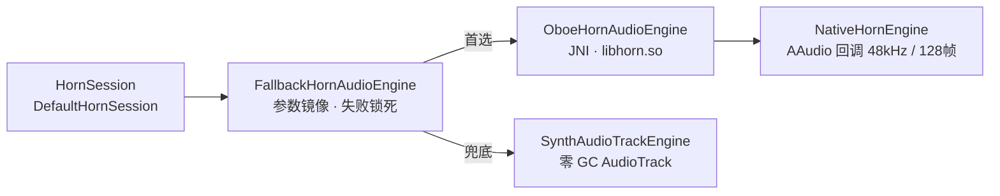

# 02 · 实时音频引擎与 DSP 声学规约

- 状态：Living Spec
- 日期：2026-11-22

> 关联 ADR：[ADR-0001 采用实时程序化 DSP 合成而非内置采样音频素材](adr/ADR-0001-procedural-dsp-over-sampled-assets.md)、
> [ADR-0002 C++ Oboe Prefab 主引擎与零 GC Kotlin AudioTrack 兜底的双引擎架构](adr/ADR-0002-dual-audio-backend-oboe-and-audiotrack.md)、
> [ADR-0004 多音色感知响度校准、软限幅与耳机自动 -6 dB 护耳策略](adr/ADR-0004-equal-loudness-calibration-and-ear-protection.md)
>
> 本文约束 `:core:audio` 的双后端引擎契约、完整 DSP 信号链、五大音色声学参数、空间混响参数、
> 实时遥测协议与实时性能预算。修改任一常量 MUST 同步更新本文与对应测试。

## 0. 文档定位

- 读者：修改 `:core:audio` DSP、引擎后端或遥测的工程师；读完应能判断一次声学参数改动的影响面与验证方式。
- 所有数值以源码常量为准；本文列出的每个数字均给出源码锚点，MUST NOT 凭记忆修改。
- 关键词遵循 RFC 2119：MUST（必须）/ MUST NOT（严禁）/ SHOULD（应当）/ MAY（可以）。

## 1. 双后端架构

输出后端为双引擎：C++ Oboe（AAudio）主引擎 + 零 GC Kotlin AudioTrack 兜底引擎，
由 `FallbackHornAudioEngine` 统一路由。两者共享同一套声学参数镜像，任一后端失败 MUST NOT 导致无声。



### 1.1 路由与降级契约

实现在 `core/audio/src/main/java/com/industrial/horn/audio/HornAudioEngineFactory.kt`：

- `HornAudioEngineFactory.create()`：`OboeHornAudioEngine.isSupported()`（`System.loadLibrary("horn")` 成功）
  且构造成功时取为 primary，`SynthAudioTrackEngine` 恒为 fallback；原生不可用时直接返回 fallback。
- 参数镜像：`selectHorn`/`setExpression`/`setAcousticSpace`/`setProtection`/`setCustomProfile`
  MUST 同时写入两个后端，保证降级起点状态一致。
- 失败锁死：primary 发出 `HornAudioEvent.Failure` 或 `start()` 失败时 MUST 置 `fallbackLocked = true`、
  释放原生引擎，此后该会话永远走兜底后端，MUST NOT 再次尝试原生路径。
- `telemetrySnapshot`/`readWaveform` 按 `active` 路由；无 active 时按 `fallbackLocked` 选择后端。

### 1.2 C++ Oboe 主引擎

Kotlin 门面 `core/audio/src/main/java/com/industrial/horn/audio/OboeHornAudioEngine.kt`
（`ENGINE_NAME = "Oboe C++"`，`@Keep`）通过 JNI 委托 `NativeHornEngine`
（`core/audio/src/main/cpp/native_engine.h`、`core/audio/src/main/cpp/native_engine.cpp`）。

音频流配置（`native_engine.cpp` 的 `openStreamLocked`）：

| 项 | 值 | 锚点 |
|---|---|---|
| 采样率 | 48000 Hz（`kSampleRate`） | `native_engine.h` |
| 回调帧数 | 128（`kFramesPerCallback`），缓冲容量 512 帧（`kFramesPerCallback * 4`） | `native_engine.cpp` `setBufferCapacityInFrames` |
| 声道 / 格式 | 单声道 / Float32（`AudioFormat::Float`） | `native_engine.cpp` |
| 性能模式 | `PerformanceMode::LowLatency` | `native_engine.cpp` |
| 共享模式 | `SharingMode::Exclusive` 优先，失败降级 `SharingMode::Shared` | `native_engine.cpp` `build()` 两次尝试 |
| CMake | 3.22.1，C++17，`find_package(oboe REQUIRED CONFIG)`（Prefab 引入） | `core/audio/src/main/cpp/CMakeLists.txt` |
| 构建 | `add_library(horn SHARED …)`，链接 `oboe::oboe android log`，`-Wl,-z,max-page-size=16384` | `CMakeLists.txt` |
| NDK / ABI | 27.0.12077973；`arm64-v8a` `armeabi-v7a` `x86_64`；`-DANDROID_STL=c++_shared` | `core/audio/build.gradle.kts` |

JNI 符号（`core/audio/src/main/cpp/native_jni.cpp`）形如
`Java_com_industrial_horn_audio_OboeHornAudioEngine_<name>`；类与 native 方法均标注 `@Keep`，
R8 下符号 MUST NOT 改名：

| 符号后缀 | 职责 |
|---|---|
| `nativeCreate` / `nativeRelease` | 构造 / 释放 `NativeHornEngine` 句柄 |
| `nativePrepare` / `nativeStart` / `nativeStop` / `nativePanic` | 开流、起播、平滑止音、立即静音 |
| `nativeSetType` / `nativeSetExpression` / `nativeSetSpace` | 音色序号、Expression、声学空间序号 |
| `nativeSetProtection` / `nativeSetCustomProfile` | 护耳开关、自定义档案七参数 |
| `nativeReadTelemetry` / `nativeReadWaveform` | 读 6 槽遥测、读 256 采样波形环 |

参数与遥测跨线程 MUST 无锁：`native_engine.h` 以 `std::atomic` 发布
`expression_`、`requestedType_`、`requestedSpace_`、`protection_` 与 `custom*` 七项
（缺省 620.0f / 1.5f / dual 1 / 0.55f / 20.0f / 90.0f / 0.35f，与 Kotlin 默认值一致）；
遥测以 `rmsBits_`、`latencyBits_`、`xrunCount_`、`renderMicros_` 与 256 槽
`waveform_` 原子数组发布。C++ 侧 Makeup Gain 常量与 Kotlin 完全一致（0.47 / 0.52 / 0.18 / 0.30 / 0.22），
护耳系数 `0.501f`，限幅 `std::clamp(softLimit(sample), -0.98f, 0.98f)`。

### 1.3 零 GC Kotlin AudioTrack 兜底

实现在 `core/audio/src/main/java/com/industrial/horn/audio/SynthAudioTrackEngine.kt`
（`ENGINE_NAME = "AudioTrack JVM"`），渲染器为 `HornRenderer`（纯 JVM，同一 DSP 链）：

| 项 | 值 |
|---|---|
| 输出 | 48000 Hz、单声道、`ENCODING_PCM_16BIT`、`MODE_STREAM` |
| 延迟策略 | `AudioTrack.PERFORMANCE_MODE_LOW_LATENCY`，块 240 帧（5 ms），缓冲 4 块 |
| 写线程 | `Horn-AudioTrack`，`Process.setThreadPriority(THREAD_PRIORITY_URGENT_AUDIO)`，`WRITE_BLOCKING` |
| 止音 | `stop()` 平滑释放（包络）；`panicStop()` 以 `panicGeneration` 代际计数使写循环立即 `pause`+`flush` |
| 延迟估算 | `latencyMs = bufferSizeInFrames / 48000 * 1000 + frames / 48000 * 1000` |
| xrun | `track.underrunCount` |

### 1.4 线程模型

| 线程 | 职责 | 约束 |
|---|---|---|
| 主线程 | 发布原子参数、读遥测快照 | MUST NOT 等待音频线程；`start`/`stop`/`panicStop` 调用本身 MUST 不阻塞 |
| AAudio 回调线程 | `onAudioReady` 渲染 128 帧 | Zero-GC、无锁、无日志、无 I/O |
| `Horn-AudioTrack` 线程 | `renderBlock` → `AudioTrack.write` | 同上；写阻塞只发生在输出缓冲 |
| `Dispatchers.Default`（`DefaultHornSession` / `FallbackHornAudioEngine`） | 收集引擎事件、焦点与广播回调 | 只做状态转发，不做渲染 |

`HornRenderer` 线程契约（`core/audio/src/main/java/com/industrial/horn/audio/HornRenderer.kt`）：
`requestType`/`setExpression`/`setAcousticSpace`/`setProtection`/`setCustomProfile` 可从任意线程调用（仅发布原子值）；
`renderBlock` 及其余变更方法仅属于单一音频线程。

## 2. 完整 DSP 信号链

以下为生产 AudioTrack 路径（`HornRenderer.renderBlock` → `PcmRenderer`）的逐级信号链；
C++ 路径镜像同一拓扑（`native_engine.cpp` `renderVoice` + `applyLimiter`）。

```mermaid
flowchart LR
    OSC["多振子合成<br/>HornSynthesizer 五实现"]
    EXPR["Expression 逐样本调制<br/>音高 ±8% · Drive 0.35 · Noise 0.6"]
    ENV["升余弦包络<br/>AttackReleaseEnvelope"]
    GAIN["增益级<br/>Makeup × 护耳 0.501 × Master 0.9"]
    LIM1["软限幅一<br/>tanh drive 1.1 + 硬边界 ±0.98"]
    REV["空间混响<br/>SpatialReverb Freeverb 拓扑"]
    LIM2["软限幅二<br/>tanh drive 1.0 + 硬边界 ±0.98"]
    OUT["16-bit PCM 输出<br/>AudioTrack / Oboe"]
    TEL["无锁遥测分流<br/>AudioTelemetryBuffer"]

    OSC --> EXPR
    EXPR --> ENV
    ENV --> GAIN
    GAIN --> LIM1
    LIM1 --> REV
    REV --> LIM2
    LIM2 --> OUT
    OUT -.->|"pushWaveform / calculateRms"| TEL
```



逐级契约与常量：

| 级 | 实现 | 关键常量 | 契约 |
|---|---|---|---|
| 合成 | `HornSynthesizerFactory` 五实现（`core/audio/src/main/java/com/industrial/horn/audio/HornVoice.kt`） | 各 Synth `OUTPUT_GAIN`、`DRIVE`、`MAX_OUTPUT 0.95f` | 输出归一化 `[-1, 1]`；渲染函数内 MUST 零分配 |
| Expression 调制 | `core/audio/src/main/java/com/industrial/horn/audio/dsp/ExpressionModulator.kt` | `MAX_PITCH_BEND 0.08`、`DRIVE_RANGE 0.35`、`NOISE_RANGE 0.6`、`SMOOTHING 0.0025f` | 逐样本平滑：`pitchScale = 1 + cur×0.08`、`driveScale = 1 + cur×0.35`、`noiseScale = 1 + cur×0.6`，杜绝滑动拉链噪声 |
| 包络 | `core/audio/src/main/java/com/industrial/horn/audio/AttackReleaseEnvelope.kt` | 各音色 attack/release（见 §3） | 升余弦；释放中重触发从当前电平起步，快速连点无爆音 |
| 增益级 | `HornRenderer.renderBlock` 计算 `voiceGain` | `makeupGain` × 护耳 `PROTECTION_GAIN 0.501f`（约 −6.0 dB）× `PcmRenderer` `DEFAULT_MASTER_GAIN 0.9` | 等响校准与护耳 MUST 在限幅前施加 |
| 软限幅一 | `core/audio/src/main/java/com/industrial/horn/audio/PcmRenderer.kt` | `softSaturate(v, LIMITER_DRIVE 1.1)` → `coerceIn(±HARD_CEILING 0.98f)` | 后乘法唯一入口，MUST NOT 存在绕过限幅的增益路径 |
| 空间混响 | `core/audio/src/main/java/com/industrial/horn/audio/SpatialReverb.kt` | 见 §4 | 4 梳状 + 2 全通 + 预延迟，输出 `dry×(1−wetMix×0.5) + wet×wetMix` |
| 软限幅二 | `HornRenderer.writeLimitedPcm` | `softSaturate(v, REVERB_LIMITER_DRIVE 1.0)` → `coerceIn(±HARD_CEILING 0.98)` | 混响能量增量再次受限，最终样本 MUST NOT 超出 ±0.98 |
| 输出 | `outputBuffer: ShortArray` | `PCM_MAX = round(0.98 × 32767) = 32112` | 16-bit PCM 交付后端 |
| 遥测分流 | `AudioTelemetryBuffer` | 见 §5 | 音频线程只写原子，观察端才分配 |

软限幅定义（`core/audio/src/main/java/com/industrial/horn/audio/dsp/DspMath.kt`）：

```kotlin
internal fun softSaturate(
    value: Double,
    drive: Double,
): Double = tanh(value * drive) / tanh(drive)
```

渐近有界，任何输入组合 MUST NOT 溢出。护耳触发条件
（`core/audio/src/main/java/com/industrial/horn/audio/AudioSafetyState.kt` 的 `AudioSafetyPolicy.evaluate`）：
耳机已连接且媒体音量比例 > 0.7 时 `earProtectionActive = true`，经 `HornSession.setProtection`
落到 `PROTECTION_GAIN = 0.501f`（`HornRenderer.kt`，`20×log10(0.501) ≈ −6.0 dB`）。

等响校准 Makeup Gain（`HornVoiceCatalog`，C++ 侧镜像同值；设计依据见 ADR-0004 与 `HornVoice.kt` 类注释：
密集三音和弦频谱能量远高于单膜片喇叭，2.7 kHz 邻域人耳更敏感，故 RMS 配比刻意不等）：

| 音色 | Makeup Gain |
|---|---|
| CAR | 0.47 |
| TRAIN | 0.52 |
| EBIKE | 0.18 |
| MOTORCYCLE | 0.30 |
| CUSTOM | 0.22 |

## 3. 五大音色精确声学参数

五大音色是五套不同的 DSP 实现（`HornSynthesizerFactory`），MUST NOT 退化为单一振荡器换频率。

| 音色 / 实现 | 基频与谐波结构 | 滤波 | 特征调制 | 包络 attack / release | Makeup | Synth 内部增益 |
|---|---|---|---|---|---|---|
| CAR `DualToneHornSynth` | 400 + 500 Hz 大三度双音；谐波栈 8 项 `{1, .62, .44, .30, .20, .14, .10, .07}` 与 7 项 `{1, .55, .42, .28, .18, .12, .08}`（归一化 0.43）；权重 0.52 / 0.48 | 一阶低通 6 kHz | 噪声底 `NOISE_LEVEL 0.0055`（LCG 白噪 + 单极平滑 0.35）；5.5 Hz 幅度摇摆 ±0.018；`DRIVE 1.55` | 12 / 14 ms | 0.47 | `OUTPUT_GAIN 0.82`，峰值钳 ±0.95 |
| TRAIN `TrainHornSynth` | 和弦 311.13 / 369.99 / 493.88 Hz（D#4/F#4/B4）各双振子 ±0.4% 微失谐（×0.996 / ×1.004，权重 0.18/0.14、0.16/0.13、0.14/0.11）；低八度 155.56 Hz（0.10）与 123.47 Hz（0.06）；CHORD_HARMONICS 8 项 / SUB_HARMONICS 4 项 | 高通 80 Hz → 低通 5.6 kHz（Q 0.707） | 气流噪声带通 1.8 kHz（Q 0.7，`AIR_LEVEL 0.055`）；起音 0.18 s 音高弯音 0.982 → 1.0；`DRIVE 1.6` | 65 / 185 ms | 0.52 | `OUTPUT_GAIN 0.88`，±0.95 |
| EBIKE `EBikeHornSynth` | 2740 + 2785 Hz 脉冲波双发射器（权重 0.50 / 0.32）+ 685 Hz 本体（0.13）；PULSE_HARMONICS 8 项 / BODY_HARMONICS 3 项 | 高通 500 Hz → 低通 4.2 kHz（Q 0.707）※ | 双发射器 45 Hz 拍频；`DRIVE 1.85` | 4 / 6 ms | 0.18 | `OUTPUT_GAIN 0.88`，±0.95 |
| MOTORCYCLE `MotorcycleHornSynth` | 444 Hz 单音膜片；DIAPHRAGM_HARMONICS 8 项 `{1, .50, .36, .25, .17, .11, .07, .045}` | 高通 190 Hz → 低通 4.8 kHz（Q 0.707） | 29 Hz 幅度颤动 `FLUTTER_DEPTH 0.18`；`DRIVE 2.0` | 8 / 10 ms | 0.30 | `OUTPUT_GAIN 0.88`，±0.95 |
| CUSTOM `CustomHornSynth` | 主频 150–3000 Hz（缺省 620）；次频 = 主频 × 0.5–2（缺省 1.5），`dualTone` 开启时混合 0.72 / 0.42；12 谐波衰减 `1/(n+1)^1.45 × (0.22 + 0.78×richness)` | 高通 80 Hz → 低通 `3800 + 6000×richness` Hz（缺省 7100 Hz） | `drive = 1.2 + saturation×5.2`（saturation 0–1） | 用户可调 3–120 / 5–250 ms（缺省 20 / 90） | 0.22 | `OUTPUT_GAIN 0.82`，±0.95 |

※ E-Bike 注释写 "5.2 kHz low-pass"（`EBikeHornSynth.kt` 类注释），代码常量实为
`BiquadFilter.lowPass(sampleRate, 4_200.0, 0.707)`。以代码为准：4.2 kHz。

补充契约：

- 各 Synth 在 `render` 内 MUST 零分配；协程、闭包捕获、装箱一律禁止进入该路径。
- Expression 的 noise 通道仅 CAR（噪声底）与 TRAIN（气流噪声）消费；EBIKE/MOTORCYCLE/CUSTOM
  只消费 pitch 与 drive 通道。
- `HornRenderer.applyPendingCustomProfile` 仅在 CUSTOM 声部静默边界重建合成器，
  MUST NOT 在活跃样本下换波形。

## 4. 空间混响

`SpatialReverb`（零分配 Kotlin）与 `NativeHornEngine::Reverb`（C++ 镜像）同为
Freeverb / Schroeder 拓扑：4 阻尼梳状滤波 → 2 全通扩散 → 与干声混合，入口带预延迟。

| 参数 | STREET | TUNNEL | OPEN_ROAD |
|---|---|---|---|
| `storageKey` | `street` | `tunnel` | `open_road` |
| `wetMix` | 0.10 | 0.38 | 0.22 |
| `feedback` | 0.58 | 0.84 | 0.66 |
| `damping` | 0.35 | 0.22 | 0.52 |
| `preDelayMillis` | 8 ms | 18 ms | 34 ms |
| `tailBlocks`（Kotlin，240 帧/块） | 12 | 240 | 80 |
| 尾音时长（240 帧/块 = 5 ms） | 60 ms | 1.2 s | 400 ms |

拓扑参数（`SpatialReverb.kt`，延迟按 44.1 kHz 基准随采样率缩放）：

| 元件 | 基准延迟（44.1 kHz） | 48 kHz 实际（Kotlin `scaleDelay` 截断） |
|---|---|---|
| 梳状 ×4 | 1116 / 1188 / 1277 / 1356 | 1214 / 1293 / 1390 / 1476 采样 |
| 全通 ×2 | 556 / 441（系数 0.5） | 605 / 480 采样 |
| 预延迟缓冲 | 2000 | 2176 采样 |

处理契约：梳状以一极阻尼插值（`state = delayed×(1−damping) + state×damping`）并钳 ±4 防溢出；
梳状输出求和后 ×0.25 归一；混音公式 `dry×(1−wetMix×0.5) + wet×wetMix`。
`tailBlocks` 以块计数：包络释放后渲染器继续渲染该数量的纯混响尾块，之后允许 AudioTrack 暂停。

C++ 镜像差异（MUST 知悉，详见 §8）：48 kHz 梳状延迟为 1215 / 1293 / 1390 / 1476（四舍五入），
预延迟缓冲容量 2400 采样，`tailBlocks` 以 `msPerBlock = 3` 折算（128 帧回调 ≈ 2.667 ms/块）得
20 / 400 / 133 块，对应尾音约 53 ms / 1.07 s / 355 ms。

## 5. 实时遥测协议

数据对象 `AudioTelemetry` 与无锁缓冲 `AudioTelemetryBuffer`
（`core/audio/src/main/java/com/industrial/horn/audio/AudioTelemetry.kt`）：

| 字段 | 类型 | 语义 |
|---|---|---|
| `engineName` | `String` | `"Oboe C++"` 或 `"AudioTrack JVM"` |
| `rms` | `Float` | 块 RMS，`0..1`（`calculateRms`：`sqrt(mean((pcm/32768)^2))` 后钳制） |
| `latencyMs` | `Float` | 输出延迟估算（缓冲 + 块时长） |
| `xrunCount` | `Long` | 欠载计数；AudioTrack 路径取 `track.underrunCount` |
| `renderTimeMicros` | `Int` | 单块渲染耗时（微秒） |
| `isPlaying` | `Boolean` | 是否在响 |

无锁环形设计（音频线程写、观察端读，MUST 零锁零分配）：

- 标量槽位：`AtomicInteger`（rms / latency 以 `floatToRawIntBits` 存储，杜绝装箱）、
  `AtomicLong`（xrun）、`AtomicInteger`（renderMicros / playing）。
- 波形环：`AtomicIntegerArray(256)`（`WAVEFORM_SIZE = 256`；C++ 侧 `kWaveformSize = 256`）+
  `AtomicInteger` 写游标；`pushWaveform(pcm, frames, stride)` 写入，`readWaveform` 拷贝最近 N 采样并归一化 `/32768`。
- `snapshot()` 是唯一分配点，且仅发生在观察端。
- Oboe 路径经 `nativeReadTelemetry` 填充 Kotlin 预分配 `FloatArray(6)` 刮槽（`telemetryScratch`），
  JNI 层 MUST NOT 在遥测路径分配数组。


消费约束：`HornViewModel` 仅在 `onHostResume` 后轮询，且间隔自适应——鸣笛时
`TELEMETRY_INTERVAL_ACTIVE_MS = 50L`（20Hz 实时反馈），空闲时 `TELEMETRY_INTERVAL_IDLE_MS = 500L`
（数值静态，避免无谓唤醒耗电）；策略为纯函数 `telemetryIntervalMs(isHonking)` 并有单测锁定
（`HornViewModelTest.telemetryPollingIsTightWhileHonkingAndRelaxedWhileIdle`）。
Debug 示波器经 `readWaveform` 读真实波形环，编译期隔离于 `src/debug`
（`feature/horn/src/debug/java/com/industrial/horn/ui/DebugAudioOverlay.kt`，见 ADR-0005）。

## 6. 实时性能预算

预算推导：48 kHz 下 128 帧回调周期 = `128 / 48000 ≈ 2.667 ms`，即单块渲染 MUST 远低于 2.66 ms，
为调度抖动留出安全裕量。AudioTrack 路径 240 帧/块对应 5 ms 周期。

Zero-GC 审计规则（渲染回调内 MUST 全部成立）：

- 严禁 `new`、数组分配、装箱、Lambda 捕获分配、字符串拼接。
- 严禁锁、日志、I/O、系统调用与 JNI 数组分配。
- 跨线程参数 MUST 经原子量发布（Kotlin `AtomicInteger`/`AtomicReference`/`@Volatile`；C++ `std::atomic`）。
- 全部工作缓冲预分配：`HornRenderer` 的 `output: ShortArray` 与 `floatBlock: FloatArray`、
  `PcmRenderer.workBuffer`（容量不足时也仅允许在无声边界重建）、`SpatialReverb` 全部延迟线、
  C++ `mixBuffer_` 与 `waveform_`。

测试执法（`core/audio/src/test/java/com/industrial/horn/audio/`）：

| 测试 | 常量 | 断言 |
|---|---|---|
| `RenderBudgetTest.kt` | `SAMPLE_RATE 48000`、`FRAMES_PER_BLOCK 128`、`SECONDS 10`、`TRIALS 3`、`WARMUP_BLOCKS 256`、`REALTIME_BUDGET_MILLIS 2.66` | 每轮渲染 5 音色共 10 s 音频，3 轮取最快均值，单块均值 MUST < 2.66 ms；复用生产 `HornRenderer` |
| `ZeroGcAudioPathTest.kt` | `WARMUP_BLOCKS 500`、`MEASURED_BLOCKS 2400`（12 s 音频）、`ALLOCATION_BUDGET_BYTES 64×1024` | 热身后以 `com.sun.management.ThreadMXBean` 反射计量当前线程分配，稳态 2400 块分配 MUST < 64 KB |
| `AudioTelemetryBufferTest.kt` | — | 环形缓冲并发读写语义 |

## 7. 非目标（Non-Goals）

- 不做立体声、空间音频或头相关传输函数；输出为单声道。
- 不做真实房间脉冲响应（RIR）卷积混响；Freeverb / Schroeder 是轻量近似。
- 不携带采样素材、不做解码回放（ADR-0001）；MUST NOT 在 APK 内新增 WAV/MP3 音色资产。
- 不做插件式效果器链、动态 EQ 或多段压缩；DSP 拓扑编译期固定。
- 不承诺 Kotlin 与 C++ 两套 DSP 逐位（bit-exact）一致。
- `latencyMs` 不覆盖蓝牙编解码与系统混音延迟，仅含本进程缓冲估算。
- `benchmark` 模块不追求统计学微基准精度（取最快轮均值以抗 CI 噪声，见 §6）。

## 8. 已知局限与权衡（Known Limitations / Trade-offs）

- JVM 单测无法覆盖真机 AAudio 行为：xrun 实测、线程调度抖动、`Exclusive` 降级 `Shared` 后的真实延迟
  均未在 `RenderBudgetTest`/`ZeroGcAudioPathTest` 中验证。
- 模拟器通常无 AAudio，自动落兜底 AudioTrack 引擎（特性而非缺陷）；此时 `latencyMs` 为缓冲估算值，
  `xrunCount` 语义为 `AudioTrack.underrunCount`，与 AAudio 流的 xrun 计数口径略有差异。
- Zero-GC 测试是统计性审计而非形式化证明：64 KB 预算容忍 JIT 噪声；反射读取
  `com.sun.management.ThreadMXBean` 依赖主机 JDK，换 JDK 大版本 MAY 需复核。
- Kotlin 与 C++ 双实现的数值镜像靠人工同步，无自动对拍测试。已知差异：
  梳状延迟取整（Kotlin 1214 vs C++ 1215 @ 1116 基准）、预延迟缓冲容量（2176 vs 2400 采样）、
  Custom 谐波权重公式写法不完全一致（`CustomHornSynth.kt` 对比 `native_engine.cpp`）。
  听感一致性依赖人工标定，MUST NOT 假设两端输出可对齐。
- `tailBlocks` 以块计数而非毫秒：AudioTrack 路径（240 帧/块）尾音精确为 60 ms / 1.2 s / 400 ms；
  Oboe 路径以 `msPerBlock = 3` 近似折算（实际 2.667 ms/块），尾音较目标值短约 11%。
- E-Bike 低通的类注释（5.2 kHz）与代码常量（4.2 kHz）不一致；文档与实现一律以代码为准，
  注释修订 SHOULD 随下次改动完成。
- 每个 Synth 内部已有 tanh 饱和与 ±0.95 峰值钳，其后还有两级 ±0.98 软限幅；
  这是刻意的多重防线，代价是极端参数下动态余量受限（有意取舍，见 ADR-0004）。
