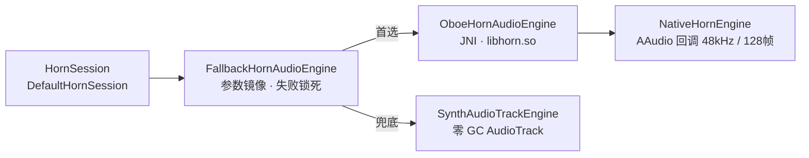

# 02 · 实时音频引擎与 DSP 声学规约（v3.6 立体声物理管线）

- 状态：Living Spec（v3.6 立体声物理管线升级）
- 日期：2026-11-22

> 实现状态：C++/Kotlin 双端实现进行中，以 research/00 契约为唯一真源。
> 本文 v3.6 章节以 [research/00 冻结契约](research/00-stereo-pipeline-contract.md) 描述**目标态**，
> 与其逐条一致；与现有代码的差异以"实现进行中"标注。实现期间发现的契约缺陷 MUST 走契约修订，
> 严禁单端私自偏离。
>
> 关联 ADR：[ADR-0001 采用实时程序化 DSP 合成而非内置采样音频素材](adr/ADR-0001-procedural-dsp-over-sampled-assets.md)、
> [ADR-0002 C++ Oboe Prefab 主引擎与零 GC Kotlin AudioTrack 兜底的双引擎架构](adr/ADR-0002-dual-audio-backend-oboe-and-audiotrack.md)、
> [ADR-0004 多音色感知响度校准、软限幅与耳机自动 -6 dB 护耳策略](adr/ADR-0004-equal-loudness-calibration-and-ear-protection.md)、
> [ADR-0009 采用实时程序化物理建模 + 正交 FDN 立体声场 + 手机外放虚拟低音（VBS）声学架构](adr/ADR-0009-stereo-physical-modeling-fdn-vbs.md)
>
> 关联研究规约（数学真源，引用其方程结论与参数表，不在此复抄全量推导）：
> [research/00 立体声物理管线冻结契约](research/00-stereo-pipeline-contract.md)、
> [research/01 号筒物理声源建模](research/01-horn-physical-modeling.md)、
> [research/02 3D 立体声场与场景传播](research/02-spatial-scene-acoustics.md)、
> [research/03 心理声学与移动扬声器适配](research/03-psychoacoustics-transducer-adaptation.md)
>
> 本文约束 `:core:audio` 的双后端引擎契约、完整 DSP 信号链、立体声物理引擎（v3.6）、
> 五大音色声学参数、四场景声场参数、实时遥测协议与实时性能预算。修改任一常量 MUST 同步更新本文与对应测试。

## 0. 文档定位

- 读者：修改 `:core:audio` DSP、引擎后端或遥测的工程师；读完应能判断一次声学参数改动的影响面与验证方式。
- 所有数值以源码常量为准；本文列出的每个数字均给出源码锚点，MUST NOT 凭记忆修改。
  v3.6 新增常量在实现落地前以 [research/00 契约 §3](research/00-stereo-pipeline-contract.md) 的冻结值为准
  （本文 §3.7 全量收录，为本文 normative 内容）。
- 关键词遵循 RFC 2119：MUST（必须）/ MUST NOT（严禁）/ SHOULD（应当）/ MAY（可以）。

冻结契约裁决对照（C1–C8，本文 v3.6 章节与契约逐条一致）：

| 裁决 | 内容摘要 | 本文落点 |
|---|---|---|
| C1 | 立体声胜出：双端 2ch 交错 Float32 @48 kHz；旧"不做立体声"表述作废 | §1.2 / §1.3 / §7 |
| C2 | 谐波激励动态带限 `N_max = floor(0.45·fs/f_max)` | §3.1 / §3.8 |
| C3 | 常量单源 + 双端同拓扑，逐样本对拍容差 1e-5 | §3.7 / §6 |
| C4 | Train 起音弯音并入气阀 pitch sag：阀开 -1.8% → 一阶回 0，总范围 [-1.9%, +1.5%] | §3.1 / §3.7 / §3.8 |
| C5 | 双层包络：合成器内部物理微瞬态 + 共享主包络，attack/release 数值不变 | §3.1 / §3.8 |
| C6 | ExpressionModulator 常量单源化，Kotlin 与 C++ 逐值镜像 | §3.7 |
| C7 | E-Bike 低通以代码为准：canonical 4.2 kHz，修正注释 | §3.8 / §8 |
| C8 | 两级 tanh 合并为单级 StereoOutputStage（真峰值→前瞻软限幅→tanh(1.0)→±0.98） | §2 / §3.6 |

## 1. 双后端架构

输出后端为双引擎：C++ Oboe（AAudio）主引擎 + 零 GC Kotlin AudioTrack 兜底引擎，
由 `FallbackHornAudioEngine` 统一路由。两者共享同一套声学参数镜像，任一后端失败 MUST NOT 导致无声。



### 1.1 路由与降级契约

实现在 `core/audio/src/main/java/com/industrial/horn/audio/HornAudioEngineFactory.kt`：

- `HornAudioEngineFactory.create()`：`OboeHornAudioEngine.isSupported()`（`System.loadLibrary("horn")` 成功）
  且构造成功时取为 primary，`SynthAudioTrackEngine` 恒为 fallback；原生不可用时直接返回 fallback。
- 参数镜像：`selectHorn`/`setExpression`/`setAcousticSpace`/`setProtection`/`setCustomProfile`
  MUST 同时写入两个后端，保证降级起点状态一致；v3.6 新增的 `setOutputMode` 同样 MUST 双端镜像。
- 失败锁死：primary 发出 `HornAudioEvent.Failure` 或 `start()` 失败时 MUST 置 `fallbackLocked = true`、
  释放原生引擎，此后该会话永远走兜底后端，MUST NOT 再次尝试原生路径。
- `telemetrySnapshot`/`readWaveform`/`readWaveformStereo` 按 `active` 路由；无 active 时按 `fallbackLocked` 选择后端。

### 1.2 C++ Oboe 主引擎

Kotlin 门面 `core/audio/src/main/java/com/industrial/horn/audio/OboeHornAudioEngine.kt`
（`ENGINE_NAME = "Oboe C++"`，`@Keep`）通过 JNI 委托 `NativeHornEngine`
（`core/audio/src/main/cpp/native_engine.h`、`core/audio/src/main/cpp/native_engine.cpp`）。

音频流配置（`native_engine.cpp` 的 `openStreamLocked`）：

| 项 | 值 | 锚点 |
|---|---|---|
| 采样率 | 48000 Hz（`kSampleRate`） | `native_engine.h` |
| 回调帧数 | 128（`kFramesPerCallback`），缓冲容量 512 帧（`kFramesPerCallback * 4`） | `native_engine.cpp` `setBufferCapacityInFrames` |
| 声道 / 格式 | 立体声（`ChannelCount::Stereo`，C1 目标态）/ Float32（`AudioFormat::Float`） | `native_engine.cpp`（现为 `setChannelCount(1)`，重构进行中） |
| 性能模式 | `PerformanceMode::LowLatency` | `native_engine.cpp` |
| 共享模式 | `SharingMode::Exclusive` 优先，失败降级 `SharingMode::Shared` | `native_engine.cpp` `build()` 两次尝试 |
| CMake | 3.22.1，C++17，`find_package(oboe REQUIRED CONFIG)`（Prefab 引入） | `core/audio/src/main/cpp/CMakeLists.txt` |
| 构建 | `add_library(horn SHARED …)`，链接 `oboe::oboe android log`，`-Wl,-z,max-page-size=16384` | `CMakeLists.txt` |
| NDK / ABI | 27.0.12077973；`arm64-v8a` `armeabi-v7a` `x86_64`；`-DANDROID_STL=c++_shared` | `core/audio/build.gradle.kts` |

JNI 符号（`core/audio/src/main/cpp/native_jni.cpp`）形如
`Java_com_industrial_horn_audio_OboeHornAudioEngine_<name>`；类与 native 方法均标注 `@Keep`，
R8 下符号 MUST NOT 改名：

| 符号后缀 | 职责 |
|---|---|
| `nativeCreate` / `nativeRelease` | 构造 / 释放 `NativeHornEngine` 句柄 |
| `nativePrepare` / `nativeStart` / `nativeStop` / `nativePanic` | 开流、起播、平滑止音、立即静音 |
| `nativeSetType` / `nativeSetExpression` / `nativeSetSpace` | 音色序号、Expression、声学空间序号（case 3 = GARAGE） |
| `nativeSetProtection` / `nativeSetCustomProfile` | 护耳开关、自定义档案七参数 |
| `nativeSetOutputMode`（v3.6 新增） | 输出模式：SPEAKER_VBS / HEADPHONE_FULL_RANGE |
| `nativeReadTelemetry` / `nativeReadWaveform` | 读 6 槽遥测、读 256 采样波形环 |
| `nativeReadWaveformStereo`（v3.6 新增） | 读 L/R 独立 256 采样波形环 |

参数与遥测跨线程 MUST 无锁：`native_engine.h` 以 `std::atomic` 发布
`expression_`、`requestedType_`、`requestedSpace_`、`protection_` 与 `custom*` 七项
（缺省 620.0f / 1.5f / dual 1 / 0.55f / 20.0f / 90.0f / 0.35f，与 Kotlin 默认值一致）；
遥测以 `rmsBits_`、`latencyBits_`、`xrunCount_`、`renderMicros_` 与 256 槽
`waveform_` 原子数组发布。C++ 侧 Makeup Gain 常量与 Kotlin 完全一致（0.47 / 0.52 / 0.18 / 0.30 / 0.22），
护耳系数 `0.501f`，出口硬边界 ±0.98。v3.6 起上述常量收敛为双端逐值镜像的单一常量表（C3/C6，见 §3.7）：
Kotlin 落点 dsp/DspConstants.kt（已落地）、C++ 落点 dsp_constants.h（v3.6 契约规划路径）。

### 1.3 零 GC Kotlin AudioTrack 兜底

实现在 `core/audio/src/main/java/com/industrial/horn/audio/SynthAudioTrackEngine.kt`
（`ENGINE_NAME = "AudioTrack JVM"`），渲染器为 `HornRenderer`（纯 JVM，同一 DSP 链）：

| 项 | 值 |
|---|---|
| 输出 | 48000 Hz、`CHANNEL_OUT_STEREO`、`ENCODING_PCM_FLOAT`、`MODE_STREAM`（C1/C8 目标态；现为单声道 `ENCODING_PCM_16BIT`，重构进行中） |
| 延迟策略 | `AudioTrack.PERFORMANCE_MODE_LOW_LATENCY`，块 240 帧（5 ms），缓冲 4 块 |
| 写线程 | `Horn-AudioTrack`，`Process.setThreadPriority(THREAD_PRIORITY_URGENT_AUDIO)`，`WRITE_BLOCKING` |
| 止音 | `stop()` 平滑释放（包络）；`panicStop()` 以 `panicGeneration` 代际计数使写循环立即 `pause`+`flush` |
| 延迟估算 | `latencyMs = bufferSizeInFrames / 48000 * 1000 + frames / 48000 * 1000` |
| xrun | `track.underrunCount` |

块级缓冲 MUST 同时支持 128 / 240 帧两种块长（预分配按最大块长，research/03 §3）。

### 1.4 线程模型

| 线程 | 职责 | 约束 |
|---|---|---|
| 主线程 | 发布原子参数、读遥测快照 | MUST NOT 等待音频线程；`start`/`stop`/`panicStop` 调用本身 MUST 不阻塞 |
| AAudio 回调线程 | `onAudioReady` 渲染 128 帧 | Zero-GC、无锁、无日志、无 I/O |
| `Horn-AudioTrack` 线程 | `renderBlock` → `AudioTrack.write` | 同上；写阻塞只发生在输出缓冲 |
| `Dispatchers.Default`（`DefaultHornSession` / `FallbackHornAudioEngine`） | 收集引擎事件、焦点与广播回调 | 只做状态转发，不做渲染 |

`HornRenderer` 线程契约（`core/audio/src/main/java/com/industrial/horn/audio/HornRenderer.kt`）：
`requestType`/`setExpression`/`setAcousticSpace`/`setProtection`/`setCustomProfile`/`setOutputMode`
可从任意线程调用（仅发布原子值）；`renderBlock` 及其余变更方法仅属于单一音频线程。

### 1.5 v3.6 接口变更冻结（目标态，冻结见 research/00 §5）

```kotlin
interface HornSynthesizer {
    val sampleRate: Int
    /** 交错立体声：写满前 2*frameCount 个 Float；线程契约不变。 */
    fun render(buffer: FloatArray, frameCount: Int)
    fun setExpression(expression: Float) = Unit
    fun reset()
}

interface HornAudioEngine {
    // 既有方法不变……
    fun setOutputMode(mode: OutputMode)            // 新增
    fun readWaveformStereo(left: FloatArray, right: FloatArray): Int  // 新增
}
```

- `HornSession` 同步新增 `setOutputMode`/`readWaveformStereo` 透传；`FallbackHornAudioEngine`
  参数镜像 MUST 覆盖新方法。
- `AcousticSpace` 末位追加 `GARAGE(storageKey = "garage")`（ordinal 3；前三档 ordinal/storageKey
  不动；`fromStorageKey` 未知键回退 STREET）；DSP 参数从枚举迁移至 SceneSpecCatalog（v3.6 契约规划路径，取值即 §4 四张表）。
- `AudioTelemetry`/`AudioTelemetryBuffer` 立体声契约见本文 §5.1（已实现）。
- JNI 面新增 `nativeSetOutputMode(jint)`、`nativeReadWaveformStereo(jfloatArray, jfloatArray)`；
  `nativeSetSpace` case 3 = GARAGE。

## 2. 完整 DSP 信号链（v3.6 立体声全管线）

以下为 v3.6 目标态逐级信号链（双端 MUST 同拓扑同顺序，冻结契约 §4）；
现状（实现进行中）的单声道两级 tanh 形态见本节末尾迁移说明。

```mermaid
flowchart LR
    EXC["物理激励器<br/>动态带限 + 瞬态 + Brassiness"]
    PAN["多喇叭立体声摆位<br/>幅度声像 + 有界 ITD"]
    ENV["主包络与声部增益<br/>AttackReleaseEnvelope"]
    ISM["ISM 早反射<br/>镜像源 N=1~3 · ITD/ILD"]
    FDN["正交 FDN 晚混响<br/>M=4/8 素数延迟"]
    GRD["地面微梳状 / 隧道染色<br/>公共滤波"]
    AIR["ISO 9613-1 大气吸声<br/>级联一阶 shelf"]
    MIX["场景干湿混合 + 宽度<br/>dry×(1-w/2)+wet×w"]
    MODE["双模式输出<br/>VBS 外放 / 耳机全频"]
    LOUD["响度前馈 G<br/>makeup × g_scene × g_mode × 0.9"]
    EAR["护耳<br/>PROTECTION_GAIN 0.501"]
    STO["单级 StereoOutputStage<br/>真峰值 → 前瞻软限幅 → tanh(1.0) → ±0.98"]
    OUT["交错 Float32 输出<br/>2ch · 48kHz · 128帧"]
    TEL["遥测分流<br/>L/R RMS · corr · mode · 波形环"]

    EXC --> PAN
    PAN --> ENV
    ENV --> ISM
    ISM --> FDN
    FDN --> GRD
    GRD --> AIR
    AIR --> MIX
    MIX --> MODE
    MODE --> LOUD
    LOUD --> EAR
    EAR --> STO
    STO --> OUT
    OUT -.->|"pushWaveformStereo / updateStereo"| TEL
```



逐级契约与常量（v3.6 目标态）：

| 级 | 实现（目标态） | 关键常量 | 契约 |
|---|---|---|---|
| 物理激励器 | 五实现 `HornSynthesizerFactory`（`HornVoice.kt`）+ 物理瞬态/Brassiness（§3.1） | `EXPR_*` 系列、`TRAIN_PITCH_SAG_ONSET`（§3.7） | 动态带限波表 + 幅度依赖分数延迟变陡 + 非对称整形；渲染函数内 MUST 零分配 |
| 多喇叭立体声摆位 | §3.2 | CAR (g_L, g_R) = (0.42, 0.58)；ITD ≤ 12 样本 | 直达声纯幅度声像（cos/sin 等延迟）；差异化 MUST 满足折叠预算（§4.6） |
| 主包络 | `core/audio/src/main/java/com/industrial/horn/audio/AttackReleaseEnvelope.kt` | 各音色 attack/release（§3.8，数值不变） | 双层包络（C5）：物理微瞬态叠加于升余弦主包络之上 |
| ISM 早反射 | research/02 §3.1（Allen-Berkley 镜像源） | N = 1~3，M(N) = 6N 镜像源 | 早反射簇 4~48 ms；通道间延迟差 MUST ≤ 0.66 ms；单反射 ≤ −10 dB 相对直达 |
| 正交 FDN 晚混响 | research/02 §3.2（Jot-Chaigne） | M = 4/8 素数延迟表 A/B/C；g 见 §4 | 正交矩阵 + 阻尼，ρ(A·G) ≤ g < 1；宽度 W ≤ 0.7 |
| 地面微梳状 / 隧道染色 | research/02 §3.4 | c/(2h) 陷波基频、flutter 周期 46.6 ms | 公共滤波（折叠红线 C4）：L/R 系数 MUST 相同 |
| ISO 9613-1 大气吸声 | research/02 §3.3 | T = 20 °C、RH = 50 %（常量） | 级联一阶 shelf（2 kHz / 8 kHz 两点拟合）；系数对 L/R 相同 |
| 场景干湿与宽度 | `dry×(1−w/2) + wet×w` | w、preDelay、尾音（§4） | 场景切换 30–80 ms 等功率交叉淡化，延迟线内容 MUST 保留 |
| 双模式输出 | research/03 §1 / §2.1 | `VBS_WE/WO/GMIX`、`VBS_HP_FC`（§3.7） | SPEAKER_VBS 外放链 / HEADPHONE_FULL_RANGE 耳机链；切换 20–50 ms 等功率交叉淡化 |
| 响度前馈 G | research/03 §2.2 / §4 | Makeup（下表）× `MASTER_GAIN 0.9` | `G = makeup[v]×g_scene[s]×g_mode[v][m]×(护耳?0.501:1)×0.9`，全前馈，MUST NOT 引入 AGC |
| 护耳 | `AudioSafetyPolicy.evaluate`（`AudioSafetyState.kt`） | `PROTECTION_GAIN 0.501` | 耳机已连接且媒体音量比例 > 0.7 触发（约 −6.0 dB）；扬声器场景 MUST NOT 触发 |
| 单级 StereoOutputStage | research/03 §2.4（§3.6） | `HARD_CEILING 0.98`、`LIMITER_DRIVE 1.0` | 真峰值检测 → 前瞻软限幅(T = 0.98) → `tanh(1.0)` → ±0.98 硬边界唯一出口（C8） |
| 输出缓冲 | 交错 `FloatArray(2*frames)`（`buffer[2i]=L`、`buffer[2i+1]=R`） | 2ch / 48 kHz / 128 帧 | 值域经出口硬边界 ±0.98；PCM16 转换仅存在于遥测镜像 |
| 遥测分流 | `AudioTelemetryBuffer` | 见 §5 | 音频线程只写原子，观察端才分配 |

软限幅原语（`core/audio/src/main/java/com/industrial/horn/audio/dsp/DspMath.kt`，
v3.6 中以 `LIMITER_DRIVE 1.0` 唯一出现于 StereoOutputStage 尾段，Synth 内部饱和为音色染色而非安全出口）：

```kotlin
internal fun softSaturate(
    value: Double,
    drive: Double,
): Double = tanh(value * drive) / tanh(drive)
```

渐近有界，任何输入组合 MUST NOT 溢出。

等响校准 Makeup Gain（`HornVoiceCatalog`，C++ 侧镜像同值；设计依据见 ADR-0004 与 `HornVoice.kt` 类注释：
密集三音和弦频谱能量远高于单膜片喇叭，2.7 kHz 邻域人耳更敏感，故 RMS 配比刻意不等）：

| 音色 | Makeup Gain |
|---|---|
| CAR | 0.47 |
| TRAIN | 0.52 |
| EBIKE | 0.18 |
| MOTORCYCLE | 0.30 |
| CUSTOM | 0.22 |

现状与迁移（实现进行中）：v3.0 形态为 `PcmRenderer`（`softSaturate(v, LIMITER_DRIVE 1.1)` → ±0.98）
→ `SpatialReverb` → `HornRenderer.writeLimitedPcm`（`softSaturate(v, REVERB_LIMITER_DRIVE 1.0)` → ±0.98）
→ 16-bit `ShortArray`（`PCM_MAX = round(0.98 × 32767) = 32112`）。按 research/03 §2.4.4 四步迁移合并为
单级 StereoOutputStage（每步保持不变量 I4）；`SpatialReverb` 的 Freeverb/Schroeder 拓扑由
ISM + 正交 FDN 替换（ADR-0009）。迁移期间现有防削波断言 MUST 全程保持。

## 3. 立体声物理引擎（v3.6）

本章为 v3.6 声学核心的工程指针：每级给出要点方程与关键数值，全量推导、稳定性证明与文献出处
见 research/01（声源）、research/02（声场）、research/03（心理声学与换能器适配）。
共享常量单源表（§3.7）为本文 normative 内容。

### 3.1 物理激励器（动态带限 · 物理瞬态 · Brassiness）

- 带限振荡（research/01 §2.1.1，裁决 C2）：2048 点谐波波表（PolyBLEP 备选），
  `N_max = floor(0.45 * fs / f_max)`、`f_max = f0_max * pitchScale_max`（含 +8% 弯音）；
  超限谐波构造期剔除，修复 EBIKE（8 次谐波 24.06 kHz）与 CUSTOM（12 次谐波 36 kHz）混叠缺陷。
- 一阶参数平滑（research/01 §2.1.2）：`y[n] = y[n-1] + a(x[n] - y[n-1])`、`a = 1 - exp(-1/(tau*fs))`，
  tau 5–30 ms；`EXPR_SMOOTHING 0.0025` 等效 tau ≈ 8.32 ms。MUST NOT 逐样本重算滤波器系数。
- 防次正规数（research/01 §2.1.3）：C++ 流开启置 FPCR FZ + 块级零吸附；Kotlin 块级零吸附 + DC 偏置 1e-20。
- Brassiness 激波变陡（research/01 §2.3，L1/L4/L7 物理来源）：
  - 方案①（主算法，幅度依赖分数延迟）：`d_eff = d0 * (1 + beta * s[n])`、`y[n] = x_lin[n - d_eff]`，
    `d0` 0.5–1.5 ms、`beta <= 0.35`、包络平滑 tau_s 2–5 ms（研究规约 §2.3.1）；
  - 方案②（预级，带限非对称整形）：`w = tanh(k*(u + alpha_asym*(u*u - 1/3))) / W_b`，
    `k` 1.2–3.0、`alpha_asym` 0.1–0.25（研究规约 §2.3.2）；
  - 五通道 Expression 联动（研究规约 §2.3.3）：`brassBeta = 0.05 + 0.30*max(0, e)`、
    `brassAsym = 0.10 + 0.15*max(0, e)`，与 driveScale 共用 tau = 5 ms 平滑。
- 物理微瞬态（裁决 C5：合成器内部层，叠加于主包络之上）：12V 继电器吸合冲击 2–4 ms（研究规约 §2.4.1）、
  EBIKE DC 咔哒 1 ms（§2.6）、TRAIN 气阀 ODE（§2.5.2）、断电自由阻尼余振 ζ 0.01–0.05 / tau_off 30–60 ms。
- TRAIN pitch sag（裁决 C4）：阀开瞬间 sag 置 **-1.8%**（`TRAIN_PITCH_SAG_ONSET = -0.018`），
  随气压趋稳一阶回到 0，允许总范围 **[-1.9%, +1.5%]**（`kappa` 0.005–0.015，起音偏置单独叠加）；
  删除独立 `BEND_START` 机制（研究规约 §2.5.3）。

### 3.2 多喇叭立体声摆位

- 直达声 MUST 纯幅度声像（`g_L = cos(phi)`、`g_R = sin(phi)`，等延迟），MUST NOT 对直达声施加 ITD
  （research/02 §5 C1）。
- 差异化摆位（research/01 §2.4.2）：CAR 高频体偏右 `(g_L, g_R) = (0.42, 0.58)`、低频体偏左对称；
  两体微失谐 0.3–0.6 Hz 产生慢摆，总幅度摆动 MUST ≤ 0.03。TRAIN 前向喇叭口 r = 0.50（窄、直达:反射
  0.8:0.2）/ 后向 r = 0.70（宽、0.5:0.5）。
- 有界 ITD：每体通道间延迟 `Delta <= 12 样本（0.25 ms）`，仅幅度差 ≥ 3 dB 时启用；
  早反射 ITD 化通道间延迟差 MUST ≤ 0.66 ms（Woodworth 90° 上限，research/02 §3.1）。
- EBIKE/MOTORCYCLE/CUSTOM 直达声 MUST 同相居中（Delta = 0、50/50，research/01 §2.9 实施规则）。

### 3.3 场景处理链（ISM → FDN → 地面/隧道染色 → 大气吸声）

- ISM 早反射（research/02 §3.1）：矩形镜像源截断 "恰一个分量非零"，M(N) = 6N（N = 1/2/3 → 6/12/18）；
  增益 `g_n = rho^k_n * (r0 / R_n)`；±x 轴（左右墙）反射系数/距离/延迟 MUST 独立配置形成不对称早反射簇。
- 正交矩阵 FDN（research/02 §3.2）：M 条延迟线 + 一阶阻尼 + 正交反馈矩阵
  （Hadamard `A = H_M / sqrt(M)` 或 Householder `A = I - (2/M)*J`），`rho(A*G) <= g < 1`；
  素数延迟表：表 A（M=8 长，隧道，T̄ 45.35 ms）/ 表 B（M=8 紧凑，车库，T̄ 28.88 ms）/
  表 C（M=4，街道/旷野，T̄ 31.24 ms）；反推公式 `g = 10^(-3*T̄/RT60)`；
  场景 g 冻结值 **STREET 0.567 / TUNNEL 0.914 / OPEN_HIGHWAY 0.375 / GARAGE 0.853**（详表见 §4）。
- 地面微梳状（research/02 §3.4）：`H(f) = 1 + rho_g * L(f) * exp(-j*2*pi*f*dt)`，
  陷波基频 `c/(2h)`（h = 0.75 m → ≈ 229 Hz；车库层高 2.2–2.6 m → 66–78 Hz、2–5 次模态 132–390 Hz）；
  隧道侧墙 flutter 梳状周期 2W/c ≈ 46.6 ms（21.4 Hz 间隔）。
- ISO 9613-1 大气吸声（research/02 §3.3）：`A(f, d) = alpha(f)*d/1000` dB（T = 20 °C、RH = 50 %）；
  以两级一阶 shelf（2 kHz / 8 kHz 两点拟 G1/G2）实现，距离档 20/40/…/300 m 冻结常量、线性插值 + 逐块平滑。
- 干湿混合：`dry*(1 - w/2) + wet*w`，w 为场景 wetMix（§4）；场景切换 30–80 ms 等功率交叉淡化。

### 3.4 双模式输出（VBS 外放 / 耳机全频）

- SPEAKER_VBS 外放链（research/03 §2.1）：保护性高通 fc 90 Hz（`VBS_HP_FC`，80–100 可配，Butterworth 2–4 阶）
  → 低频抽取带通 80–280 Hz → 复合 NLD → 谐波带限 250–900 Hz → 群延迟对齐（线性相位 FIR 63 抽头，
  tau ≈ 0.646 ms）→ 单声道核混音。
- 复合 NLD 选型（research/03 §2.1.3）：`y_raw = w_e*(|x| - m) + w_o*x*|x|`，再 HP20 双重 DC 阻断；
  冻结值 **`VBS_WE = 0.70` / `VBS_WO = 0.25` / `VBS_GMIX = 0.45`**；偶次通道 2/4 次谐波随 A 线性、
  奇次通道 3 次谐波；有界性 `|y_raw| <= 1.11`（输入预限幅 0.95），尾段硬边界兜底。
- 单声道核混音：`L' = Mv + e*S`、`R' = Mv - e*S`（e 0.1–0.2），折叠后恒等于 Mv（折叠安全）。
- HEADPHONE_FULL_RANGE 耳机链（research/03 §1）：VBS 旁路（完整低频）+ M/S 宽度 w 0.8–1.0 +
  ILD 高频倾斜（S 通道 2 kHz 高架 +1~3 dB）+ ITD 微延仅施加于 S 通道 ≤ 0.6 ms（≤ 28 样本）；
  `L+R = 2M` 不变，折叠安全。
- 模式判定复用 `AndroidAudioSafetyMonitor` + `AudioSafetyPolicy.evaluate`；切换 20–50 ms 等功率交叉淡化，
  全部参数一阶平滑（tau 20 ms，mode 切换 30 ms）。

### 3.5 响度前馈 G 与护耳

- 总增益（全前馈，research/03 §2.2）：`G_total(v, s, m, p) = makeup[v] * g_scene[s] * g_mode[v][m] * (p ? 0.501 : 1) * 0.9`；
  `g_scene × g_mode` 修正表以 research/03 §4 表为唯一真源（40 组合，前馈初始标定）。
- 护耳（ADR-0004 不变量保持）：`PROTECTION_GAIN = 0.501`（约 −6.0 dB），触发条件
  耳机已连接且媒体音量比例 > 0.7；扬声器场景 MUST NOT 触发。
- 等响校准与护耳 MUST 在限幅前施加；实时路径 MUST NOT 做 LUFS 归一化 / AGC（ADR-0004 否决延续）。
  BS.1770 K 加权测量仅用于离线标定复算与 Debug 遥测（research/03 §2.3）。

### 3.6 单级 StereoOutputStage（裁决 C8）

research/03 §2.4 定义的单级真峰值前瞻软限幅，取代 v3.0 两级 tanh：

1. 真峰值检测：4× 多相 FIR 内插（4 相 × 12 抽头，BS.1770-5 附件 2 口径），
   `tp[n] = max(|x[n]|, max_p |interp_p[n]|)`、`dBTP = 20*log10(tp)`；
2. 前瞻软限幅：`T = 0.98`、`g_t = min(1, T/tp)`，attack tau 1–2 ms / release tau 50–120 ms，
   前瞻延迟 tau_L 1–2 ms（128 帧 2 块环形缓冲实现）；
3. 软饱和：`tanh(y * 1.0) / tanh(1.0)`（`LIMITER_DRIVE 1.0`）；
4. 硬边界：`clamp(y, -0.98, +0.98)`，`HARD_CEILING 0.98` 为唯一出口（不变量 I4）。

代价与红线：端到端附加延迟 ≤ 2.7 ms（前瞻 1–2 ms + FIR 群延迟 ≈ 0.65 ms，与 128 帧回调周期同量级）；
迁移 MUST 分步、每步保持 I4（research/03 §2.4.4 四步：先遥测 → 插增益级 → 合并单级 → 回归）。

### 3.7 共享常量单源表（normative，冻结契约 §3 全量收录）

落地为 Kotlin 与 C++ 逐值镜像（Kotlin 侧 dsp/DspConstants.kt 已落地；C++ 侧 dsp_constants.h 为 v3.6 契约规划路径），
MUST 逐值一致（C3/C6），QA 以逐样本容差 1e-5 双端对拍：

| 常量 | 值 | 语义 |
|---|---|---|
| `MAKEUP_CAR/TRAIN/EBIKE/MOTORCYCLE/CUSTOM` | 0.47 / 0.52 / 0.18 / 0.30 / 0.22 | 等响校准（ADR-0004） |
| `MASTER_GAIN` | 0.9 | 主增益 |
| `PROTECTION_GAIN` | 0.501（≈-6dB） | 护耳 |
| `HARD_CEILING` | 0.98 | 唯一硬边界出口 |
| `LIMITER_DRIVE` | 1.0 | 单级软饱和 tanh |
| `EXPR_PITCH_BEND` | 0.08 | ±8% 音高 |
| `EXPR_DRIVE_RANGE` | 0.35 | 饱和驱动 |
| `EXPR_NOISE_RANGE` | 0.6 | 气流噪声 |
| `EXPR_BRASS_BETA_BASE/RANGE` | 0.05 / 0.30 | `beta = base + range·max(0,e)` |
| `EXPR_BRASS_ASYM_BASE/RANGE` | 0.10 / 0.15 | `alpha = base + range·max(0,e)` |
| `EXPR_SMOOTHING` | 0.0025（≈τ 8.32ms） | 表达通道平滑（保留现值） |
| `TRAIN_PITCH_SAG_ONSET/RANGE` | -0.018 / [-0.019, +0.015] | 阀开 sag（C4 裁决） |
| `VBS_WE/WO/GMIX` | 0.70 / 0.25 / 0.45 | 整流主导复合 NLD（03 选型） |
| `VBS_HP_FC` | 90Hz（80–100 可配） | 保护性高通 |
| `CORR_SILENCE_EPS` | 1e-12 | 相关系数静音判据 |

场景参数（ISM/FDN/大气/干湿/宽度）以本文 §4 四张表为唯一真源
（STREET g=0.567 / TUNNEL g=0.914 M=8 / OPEN_HIGHWAY g=0.375 / GARAGE g=0.853 M=8）；
响度对齐 `G = makeup[v]×g_scene[s]×g_mode[v][m]×(护耳?0.501:1)×0.9` 以 research/03 §4 表为唯一真源。

### 3.8 五大音色物理建模参数

五大音色是五套不同的 DSP 实现（`HornSynthesizerFactory`），MUST NOT 退化为单一振荡器换频率。
下表为既有参数表（v3.6 保持基频/谐波/滤波/包络/Makeup 数值不变），物理建模扩展列见第二表
（节号如无特别说明均指 research/01）：

| 音色 / 实现 | 基频与谐波结构 | 滤波 | 特征调制 | 包络 attack / release | Makeup | Synth 内部增益 |
|---|---|---|---|---|---|---|
| CAR `DualToneHornSynth` | 400 + 500 Hz 大三度双音；谐波栈 8 项 `{1, .62, .44, .30, .20, .14, .10, .07}` 与 7 项 `{1, .55, .42, .28, .18, .12, .08}`（归一化 0.43）；权重 0.52 / 0.48 | 一阶低通 6 kHz | 噪声底 `NOISE_LEVEL 0.0055`（LCG 白噪 + 单极平滑 0.35）；5.5 Hz 幅度摇摆 ±0.018；`DRIVE 1.55` | 12 / 14 ms | 0.47 | `OUTPUT_GAIN 0.82`，峰值钳 ±0.95 |
| TRAIN `TrainHornSynth` | 和弦 311.13 / 369.99 / 493.88 Hz（D#4/F#4/B4）各双振子 ±0.4% 微失谐（×0.996 / ×1.004，权重 0.18/0.14、0.16/0.13、0.14/0.11）；低八度 155.56 Hz（0.10）与 123.47 Hz（0.06）；CHORD_HARMONICS 8 项 / SUB_HARMONICS 4 项 | 高通 80 Hz → 低通 5.6 kHz（Q 0.707） | 气流噪声带通 1.8 kHz（Q 0.7，`AIR_LEVEL 0.055`）；起音音高弯音由气阀 pitch sag 取代（C4，见下表）；`DRIVE 1.6` | 65 / 185 ms | 0.52 | `OUTPUT_GAIN 0.88`，±0.95 |
| EBIKE `EBikeHornSynth` | 2740 + 2785 Hz 脉冲波双发射器（权重 0.50 / 0.32）+ 685 Hz 本体（0.13）；PULSE_HARMONICS 8 项 / BODY_HARMONICS 3 项 | 高通 500 Hz → 低通 4.2 kHz（Q 0.707）※ | 双发射器 45 Hz 拍频；`DRIVE 1.85` | 4 / 6 ms | 0.18 | `OUTPUT_GAIN 0.88`，±0.95 |
| MOTORCYCLE `MotorcycleHornSynth` | 444 Hz 单音膜片；DIAPHRAGM_HARMONICS 8 项 `{1, .50, .36, .25, .17, .11, .07, .045}` | 高通 190 Hz → 低通 4.8 kHz（Q 0.707） | 29 Hz 幅度颤动 `FLUTTER_DEPTH 0.18`；`DRIVE 2.0` | 8 / 10 ms | 0.30 | `OUTPUT_GAIN 0.88`，±0.95 |
| CUSTOM `CustomHornSynth` | 主频 150–3000 Hz（缺省 620）；次频 = 主频 × 0.5–2（缺省 1.5），`dualTone` 开启时混合 0.72 / 0.42；12 谐波衰减 `1/(n+1)^1.45 × (0.22 + 0.78×richness)` | 高通 80 Hz → 低通 `3800 + 6000×richness` Hz（缺省 7100 Hz） | `drive = 1.2 + saturation×5.2`（saturation 0–1） | 用户可调 3–120 / 5–250 ms（缺省 20 / 90） | 0.22 | `OUTPUT_GAIN 0.82`，±0.95 |

※ E-Bike 低通注释写 "5.2 kHz low-pass"（`EBikeHornSynth.kt` 类注释），代码常量实为
`BiquadFilter.lowPass(sampleRate, 4_200.0, 0.707)`。裁决 C7：以代码为准，canonical 4.2 kHz。

物理建模扩展列（v3.6，数值以 research/01 为准）：

| 音色 | 激励器瞬态 | Brassiness（变陡 / 非对称） | 摆位 / 声像 | 气阀时序 |
|---|---|---|---|---|
| CAR | 12V 继电器吸合冲击：A_r 0.03–0.07、tau 2–4 ms、BPF 1.5 kHz Q1.2（noteOn 前 1 ms 预冲击 + 同步一次）；断电自由余振 zeta 0.01–0.05、tau_off 30–60 ms（§2.4.1） | 方案① d0 = 0.8 ms、`beta = 0.05 + 0.30·max(0,e)`；方案② `k = 1.55·driveScale`、`alpha = 0.10 + 0.15·max(0,e)`（§2.3.3） | 双体：高频体偏右 (0.42, 0.58)、低频体偏左对称；ITD ≤ 12 样本（0.25 ms）仅幅度差 ≥ 3 dB 启用；微失谐 0.3–0.6 Hz（§2.4.2） | 无气阀（继电器时序：1 ms 预冲击 + noteOn 同步一次） |
| TRAIN | 气阀一阶 ODE `dp/dt = (p0 - p)/tau_v`，tau_v 15–45 ms；高压紊流带通 1–3 kHz，`L_air = 0.055·(0.5 + 0.5p/p0)·noiseScale`（§2.5.2/§2.5.3） | `brassBeta_eff = brassBeta·(p/p0)`（气压足→变陡足）；`beta = 0.05 + 0.30·max(0,e)`、`alpha = 0.10 + 0.15·max(0,e)` | 五音微失谐 ±0.4%；前向喇叭口 r = 0.50（直达:反射 0.8:0.2）/ 后向 r = 0.70（0.5:0.5）；音名/声像表见 §2.5.1 | 错峰窗 15–45 ms：t_on 0/12/24/36/45 ms、tau_open 15–28 ms、tau_close 30–40 ms（§2.5.2）；pitch sag 阀开 **-1.8% → 0**（`TRAIN_PITCH_SAG_ONSET = -0.018`，范围 [-1.9%, +1.5%]，kappa 0.005–0.015） |
| EBIKE | DC 开关咔哒 1 ms（A_dc 0.02–0.05 + 一阶高通 2 kHz）；"极陡"起音由激励瞬态补足（C5：主包络保持 4 / 6 ms，目标 ~2 ms 瞬态层）（§2.6） | 方案② `k = 1.85·driveScale`、`alpha_asym = 0.08`；谐波动态带限 `N_max = 7`（C2，§2.1.1） | 直达声同相居中（Delta = 0、50/50，折叠红线）；双发射器 45 Hz 拍频同相 | 无气阀 |
| MOTORCYCLE | 点按包络 8 / 10 ms；25–38 Hz AM 颤振 `d_am` 0.12–0.18 + FM 微偏 ≤ 0.3%（§2.7） | 方案② `k = 2.0·driveScale`、`alpha_asym = 0.12` | 同相居中（Delta = 0） | 无气阀 |
| CUSTOM | `tau_open = attack/3`（1–40 ms）；继电器 `A_r = clamp(0.05·(20/attack), 0, 0.05)`（§2.8） | `k = 1.2 + 5.2·sat`、`beta = 0.05 + 0.30·sat`、`alpha = 0.10 + 0.15·sat`（§2.8） | `dualTone` 开启走双体声像（§2.4.2），单体居中 | 气压惯性 tau_open ∈ [1, 40] ms；释放 `zeta = 0.01 + 0.04·(release/250)`、tau_off = release/2（§2.8） |

补充契约：

- 各 Synth 在 `render` 内 MUST 零分配；协程、闭包捕获、装箱一律禁止进入该路径。
- Expression 的 noise 通道仅 CAR（噪声底）与 TRAIN（气流噪声）消费；EBIKE/MOTORCYCLE/CUSTOM
  只消费 pitch 与 drive 通道；brassBeta/brassAsym 通道按 §3.1 五通道映射消费。
- `HornRenderer.applyPendingCustomProfile` 仅在 CUSTOM 声部静默边界重建合成器，
  MUST NOT 在活跃样本下换波形。
- CUSTOM 的统一物理参数映射（主频/次频/谐波丰富度/attack/release/saturation → 号筒 fc、brassiness、
  阻尼、气压惯性）以 research/01 §2.8 映射表为单一事实源，双端同表实现。

## 4. 空间声场与场景参数（v3.6 四场景）

v3.6 声场由 ISM 早反射 + 正交 FDN 晚混响 + 地面/层高染色 + ISO 9613-1 大气吸声构成
（ADR-0009；数学与稳定性见 research/02 §3）。本节四张表为场景常量的**唯一真源**（冻结契约 §3），
实现落点为 SceneSpecCatalog（v3.6 契约规划路径）；`AcousticSpace` 迁移见 §4.5。
`AcousticSpace` 末位追加 `GARAGE(storageKey = "garage")`（ordinal 3，展示名"地下车库"）。

### 4.1 城市街道 STREET（storageKey: "street"）

| 组 | 参数 |
|---|---|
| ISM 几何 | 街道峡谷 12(宽)×40(长)×15(高) m；听者距左立面 6.5 m / 右立面 5.5 m（非对称）；声源前 8 m、高 0.75 m |
| ISM 反射 | 左立面 rho_L 0.62 / 右立面 rho_R 0.70（一阶低通拐点 3.2 kHz）；地面沥青 rho_g 0.40 |
| ISM 阶数/窗 | N=2（12 镜像源）；早反射簇 12~48 ms；单反射 ≤ −10 dB 相对直达 |
| 地面微梳状 | h=0.75 m，c/(2h) ≈ 229 Hz 上限；按实际 Δr 计算 |
| FDN | M=4（表 C）；g=0.567（RT60 0.38 s，容许 0.25~0.5）；d=0.204（RT60_HF 0.22 s） |
| 大气吸声 | 距离档 15~60 m，2~8 kHz 轻衰减 |
| 干湿比 | wetMix w=0.10；preDelay 8 ms；尾音 60 ms |
| 声像宽度 | W=0.5 |

### 4.2 混凝土隧道 TUNNEL（storageKey: "tunnel"）

| 组 | 参数 |
|---|---|
| ISM 几何 | 等效矩形 8(宽)×40(长)×5.5(高) m（拱顶等效）；听者偏左 3.4 m；声源前 10 m、高 0.75 m |
| ISM 反射 | 拱顶 rho 0.94 / 侧墙 0.90 / 地面 0.88（一阶低通拐点 5 kHz）；拱顶强反射拍打簇 4~35 ms（N=2，12 镜像源） |
| 隧道染色 | 侧墙 flutter 梳状周期 2W/c ≈ 46.6 ms（21.4 Hz 间隔 → 低中频轰鸣），公共滤波实现 |
| FDN | M=8（表 A）；g=0.914（RT60 3.5 s，容许 2.5~4.5）；d=0.262（RT60_HF 0.5 s） |
| 大气吸声 | 距离档 20~120 m（高湿弱衰减） |
| 干湿比 | wetMix w=0.38；preDelay 18 ms；尾音 1200 ms |
| 声像宽度 | W=0.7（上限值） |

### 4.3 旷野公路 OPEN_HIGHWAY（storageKey: "open_road"）

| 组 | 参数 |
|---|---|
| ISM 几何 | 开阔地；远山/路侧屏障等效镜像面距 60~150 m；声源高 0.75 m、听者高 1.2 m |
| ISM 反射 | 稀疏远距回声 80~220 ms 交错（地面 + 远山两路），增益 −18~−30 dB（远山等效 rho 0.08~0.16）；N=1（6 镜像源） |
| 地面微梳状 | h=0.75 m，c/(2h) ≈ 229 Hz 上限；沥青 rho_g 0.35 |
| FDN | M=4（表 C）；g=0.375（RT60 0.22 s，容许 0.15~0.3）；d=0.225（RT60_HF 0.15 s） |
| 大气吸声 | 距离档 50~300 m，严格 ISO 9613-1 映射（本场景为主要消费方） |
| 干湿比 | wetMix w=0.22；preDelay 34 ms；尾音 400 ms |
| 声像宽度 | W=0.4 |

### 4.4 地下车库 GARAGE（storageKey: "garage"，v3.6 新增第 4 档）

| 组 | 参数 |
|---|---|
| ISM 几何 | 低矮层高 2.2~2.6 m（标称 2.4 m）；柱网 8.4 m、柱距 2.8 m；听者中车道、声源前 6 m、高 0.75 m |
| ISM 反射 | 混凝土/涂料硬墙 rho 0.85~0.95（顶 0.92 / 墙 0.90 / 地面 0.88），一阶低通拐点 6 kHz；立柱密集早反射 4~25 ms（N=2，12 镜像源） |
| 层高染色 | 地面/天花板梳状基频 c/(2h) = 66~78 Hz，2~5 次模态 132~390 Hz（120~400 Hz 轻微驻波染色，公共滤波） |
| FDN | M=8（表 B 紧凑高密度）；g=0.853（RT60 1.25 s，容许 0.9~1.6）；d=0.141（RT60_HF 0.45 s） |
| 大气吸声 | 距离档 10~40 m（室内弱） |
| 干湿比 | wetMix w=0.30（新增）；preDelay 12 ms；尾音 800 ms |
| 声像宽度 | W=0.6 |

### 4.5 与旧三档的映射与迁移

旧 `AcousticSpace` 三档（STREET/TUNNEL/OPEN_ROAD）的 ordinal 与 storageKey MUST 不变；
`GARAGE` 末位追加（ordinal 3），`fromStorageKey` 未知键回退 STREET（旧版 App 读到 "garage" 优雅降级）。
旧 Freeverb/Schroeder 参数到新模型的语义迁移（完整对照见 research/02 §4.5）：

| 旧参数 | STREET | TUNNEL | OPEN_ROAD | 新模型语义与迁移 |
|---|---|---|---|---|
| wetMix | 0.10 | 0.38 | 0.22 | 保留为场景 w，混音公式不变 `dry×(1−w/2)+wet×w` |
| feedback | 0.58 | 0.84 | 0.66 | 映射为 FDN g；新 g = 0.567 / 0.914 / 0.375 |
| damping | 0.35 | 0.22 | 0.52 | 语义连续（一极插值系数），新 d = 0.204 / 0.262 / 0.225 |
| preDelayMillis | 8 | 18 | 34 | 保留为直达-早反射窗基准 |
| tailBlocks（240 帧/块） | 12 / 240 / 80 | | | 改为尾音毫秒 60 / 1200 / 400（GARAGE 800），消除 C++ `msPerBlock = 3` 折算偏差（§8） |

C++ `Reverb::setSpace(int)` 增加 `case 3` = GARAGE，缺省分支保持 STREET 行为不变。

### 4.6 单声道折叠红线

立体声增强 MUST NOT 破坏 `(L+R)/2` 单声道可用性。规范与推导见
[research/02 §5](research/02-spatial-scene-acoustics.md)（约束 C1–C4）与
[research/01 §2.9](research/01-horn-physical-modeling.md)（差异化设计预算），要点：

- C1 直达声纯幅度声像（等延迟、无 ITD）→ 直达路径严格无梳状。
- C2 通道间延迟差 ≤ 0.66 ms；ITD 化早反射相对直达增益比 k ≤ 0.316（−10 dB），
  单延迟单反射最坏凹陷 `20*log10((1+k)/(1-k))` ≤ 5.7 dB。
- C3 FDN 输出 M/S 形式，宽度 W ≤ 0.7；折叠后 side 精确抵消，
  单声道能量损失 `10*log10(1 + W²)`（W=0.7 → 1.73 dB < 3 dB）。
- C4 公共滤波原则：大气吸声、地面微梳状、隧道 flutter 染色 MUST 为公共（mono）处理或 L/R 同系数；
  立体声差异只允许来自 ISM 墙参数（C2）与 FDN 抽头矩阵（C3）。

可测验收目标（逐场景测试规格）：

| 指标 | 目标 | 测法 |
|---|---|---|
| 折叠能量损失 | < 3 dB | 粉噪 5 s，10*log10(E_stereo/E_mono) |
| 200 Hz~2 kHz 陷波深度 | < 6 dB | 1/6 倍频程扫描，相对通带中值 |
| 通道相关系数 rho_LR | 0.35~0.80 | 互相关/能量比，200 Hz~8 kHz 带内 |
| 最大通道延迟差 | ≤ 0.66 ms | 参数表静态断言 + 脉冲响应测 |
| 折叠后频谱着色 | 与干声单调偏差 < 2 dB（200 Hz~2 kHz） | 折叠谱 vs 干声谱比对 |

## 5. 实时遥测协议

数据对象 `AudioTelemetry` 与无锁缓冲 `AudioTelemetryBuffer`
（`core/audio/src/main/java/com/industrial/horn/audio/AudioTelemetry.kt`）：

| 字段 | 类型 | 语义 |
|---|---|---|
| `engineName` | `String` | `"Oboe C++"` 或 `"AudioTrack JVM"` |
| `rms` | `Float` | 块 RMS，`0..1`（`calculateRms`：`sqrt(mean((pcm/32768)^2))` 后钳制） |
| `latencyMs` | `Float` | 输出延迟估算（缓冲 + 块时长） |
| `xrunCount` | `Long` | 欠载计数；AudioTrack 路径取 `track.underrunCount` |
| `renderTimeMicros` | `Int` | 单块渲染耗时（微秒） |
| `isPlaying` | `Boolean` | 是否在响 |

无锁环形设计（音频线程写、观察端读，MUST 零锁零分配）：

- 标量槽位：`AtomicInteger`（rms / latency 以 `floatToRawIntBits` 存储，杜绝装箱）、
  `AtomicLong`（xrun）、`AtomicInteger`（renderMicros / playing）。
- 波形环：`AtomicIntegerArray(256)`（`WAVEFORM_SIZE = 256`；C++ 侧 `kWaveformSize = 256`）+
  `AtomicInteger` 写游标；`pushWaveform(pcm, frames, stride)` 写入，`readWaveform` 拷贝最近 N 采样并归一化 `/32768`。
- `snapshot()` 是唯一分配点，且仅发生在观察端。
- Oboe 路径经 `nativeReadTelemetry` 填充 Kotlin 预分配 `FloatArray(6)` 刮槽（`telemetryScratch`），
  JNI 层 MUST NOT 在遥测路径分配数组。


消费约束：`HornViewModel` 仅在 `onHostResume` 后轮询，且间隔自适应——鸣笛时
`TELEMETRY_INTERVAL_ACTIVE_MS = 50L`（20Hz 实时反馈），空闲时 `TELEMETRY_INTERVAL_IDLE_MS = 500L`
（数值静态，避免无谓唤醒耗电）；策略为纯函数 `telemetryIntervalMs(isHonking)` 并有单测锁定
（`HornViewModelTest.telemetryPollingIsTightWhileHonkingAndRelaxedWhileIdle`）。
Debug 示波器经 `readWaveform` 读真实波形环，编译期隔离于 `src/debug`
（`feature/horn/src/debug/java/com/industrial/horn/ui/DebugAudioOverlay.kt`，见 ADR-0005）。

### 5.1 立体声遥测契约（Stereo Telemetry Contract，v3.6 引入）

`AudioTelemetry`（`core/audio/src/main/java/com/industrial/horn/audio/AudioTelemetry.kt`）除既有字段外
MUST 暴露：

| 字段 | 类型/范围 | 语义 |
|---|---|---|
| `rmsLeft` / `rmsRight` | `Float`，`0..1` | L/R 声道块级 RMS 响度包络 |
| `stereoCorrelation` | `Float`，`[-1, +1]` | L/R 块 Pearson 相关系数；静音块 MUST 报 `1`（防伪反相） |
| `outputMode` | `OutputMode` | 当前心理声学输出级：`SPEAKER_VBS`（外放虚拟低音）/ `HEADPHONE_FULL_RANGE`（耳机全频） |

`AudioTelemetryBuffer` 双声道无锁环形缓冲：L/R 独立 256 采样环（`readWaveformStereo`），相关系数按
`corr = Σlr / sqrt(Σl²·Σr²)` 逐块计算（能量 < 1e-12 判静音返回 1）；旧单声道 API（`update`/`pushWaveform`/
`readWaveform`）保持兼容（L=R 镜像、corr=1）。参数平滑 MUST 经 `dsp/OnePoleSmoother`（一阶低通
`y[n]=y[n-1]+a(x[n]-y[n-1])`，`a` 由平滑时间常数换算），严禁拉链噪声。

## 6. 实时性能预算

预算推导：48 kHz 下 128 帧立体声回调周期 = `128 / 48000 ≈ 2.667 ms`，即单块渲染 MUST 远低于 2.66 ms，
为调度抖动留出安全裕量。AudioTrack 路径 240 帧/块对应 5 ms 周期（块级缓冲支持 128 / 240 两种块长）。

逐块计算量估算（v3.6 全管线）：

- 场景链（ISM + FDN + 大气 + 地面 + 混合）：逐样本约 340 FLOP → 单块 ≈ **44 K FLOP**
  （research/02 §6.2；Hadamard 用蝶形、Householder 用秩一形式），现代 ARM 核约 20~50 µs。
- 设备自适应输出链（VBS + 宽度 + 真峰值 + 包络）：逐样本约 350 op → 单块 ≈ 45 K op
  （research/03 §3），标量 ARM < 0.3 ms，Kotlin JIT 按 3× 裕量 < 1 ms。
- 物理激励器最重路径（CAR，2 波表 + 3 共振峰 + 变陡①+② + 噪声）约 90–120 ops/样本/声道
  → 约 30.7 kops/块（research/01 §3.4）；`tanh` MUST 以查表或有界多项式近似替代，保持有界性证明成立。

内存预算（渲染期全部预分配，构造期一次性分配）：

- 场景链缓冲 ≈ 102 KB，预算上限 **≤ 128 KB**（research/02 §6.1：ISM 历史 2×2304、地面 2×960、
  FDN 8×2341、抽头/平滑态、块交织 2×256 float32 等）。
- 五音色波表/延迟线/状态 < 100 KB（research/01 §3.3），自适应链工作区见 research/03 §3 清单；
  均在构造期分配，不占渲染期分配预算（`ZeroGcAudioPathTest` 64 KB 稳态口径不变）。

Zero-GC 审计规则（渲染回调内 MUST 全部成立）：

- 严禁 `new`、数组分配、装箱、Lambda 捕获分配、字符串拼接。
- 严禁锁、日志、I/O、系统调用与 JNI 数组分配。
- 跨线程参数 MUST 经原子量发布（Kotlin `AtomicInteger`/`AtomicReference`/`@Volatile`；C++ `std::atomic`）。
- 全部工作缓冲预分配：交错立体声渲染缓冲 `FloatArray(2*frames)`、`PcmRenderer.workBuffer`（容量不足时
  仅允许在无声边界重建）、ISM/FDN/地面/大气全部延迟线与滤波器状态、VBS 与真峰值工作区
  （多相延迟线、前瞻环形缓冲）、C++ `mixBuffer_` 与 `waveform_`。
- 防次正规数：C++ 流开启置 FPCR Flush-to-Zero + 块级零吸附（`|x| < 1e-20 → 0`）；
  Kotlin 块级零吸附 + DC 偏置 1e-20，双端一致。

测试执法（`core/audio/src/test/java/com/industrial/horn/audio/`）：

| 测试 | 常量 | 断言 |
|---|---|---|
| `RenderBudgetTest.kt` | `SAMPLE_RATE 48000`、`FRAMES_PER_BLOCK 128`、`SECONDS 10`、`TRIALS 3`、`WARMUP_BLOCKS 256`、`REALTIME_BUDGET_MILLIS 2.66` | 每轮渲染 5 音色共 10 s 音频，3 轮取最快均值，单块均值 MUST < 2.66 ms；复用生产 `HornRenderer` |
| `ZeroGcAudioPathTest.kt` | `WARMUP_BLOCKS 500`、`MEASURED_BLOCKS 2400`（12 s 音频）、`ALLOCATION_BUDGET_BYTES 64×1024` | 热身后以 `com.sun.management.ThreadMXBean` 反射计量当前线程分配，稳态 2400 块分配 MUST < 64 KB |
| `AudioTelemetryBufferTest.kt` | — | 环形缓冲并发读写语义、立体声 RMS/相关系数/波形环语义 |
| 双端对拍测试（v3.6 契约规划） | 容差 1e-5 | 固定种子噪声 128 帧 × N 块、四场景各一遍，C++/Kotlin 逐样本对拍（C3） |

v3.6 完成定义（DoD，冻结契约 §6）：双端同拓扑且常量逐值一致、`:core:audio:testDebugUnitTest` 全绿；
立体声真实去相关（非 L=R 复制）且满足 §4.6 折叠红线；10 s@48 kHz 全管线 0 NaN/Inf、峰值 ≤ 1.0、
单帧 128 帧 < 2.66 ms、无分配回退；旧 Known Limitations 的 4 项双端镜像偏差全部消除（§8）。

## 7. 非目标（Non-Goals）

- 不做 HRTF/真双耳渲染、头部追踪与个性化头模（ADR-0009 留作 Non-Goal）；立体声管线本身为 v3.6 目标态
  （裁决 C1：旧"不做立体声、输出为单声道"表述作废），耳机侧宽度仅 M/S + 微延（research/03 §1）。
- 不做真实房间脉冲响应（RIR）卷积混响；ISM + 正交 FDN 为参数化近似（v3.0 的 Freeverb/Schroeder 同此立场）。
- 不携带采样素材、不做解码回放（ADR-0001）；MUST NOT 在 APK 内新增 WAV/MP3 音色资产。
- 不做插件式效果器链、动态 EQ 或多段压缩；DSP 拓扑编译期固定。
- 不做实时 LUFS 自适应归一化 / AGC（ADR-0004 延续）；响度对齐为前馈增益表 + 限幅。
- 不做完整 ISO 9613-2 传播模型（衍射、折射、散射）与气象参数 UI（温度/湿度/气压为常量）。
- 不承诺 Kotlin 与 C++ 两套 DSP 逐位（bit-exact）一致；验收以逐样本容差 1e-5 对拍。
- `latencyMs` 不覆盖蓝牙编解码与系统混音延迟，仅含本进程缓冲估算。
- `benchmark` 模块不追求统计学微基准精度（取最快轮均值以抗 CI 噪声，见 §6）。

## 8. 已知局限与权衡（Known Limitations / Trade-offs）

双端镜像偏差（v3.6 消除项，冻结契约 DoD 第 4 条）——以下 4 项由 v3.6 常量单源化消除
（dsp/DspConstants.kt ↔ dsp_constants.h 逐值镜像 + 双端对拍 1e-5，C3/C6）：

1. 梳状延迟取整偏差（Kotlin `toInt` 截断 1214 vs C++ 四舍五入 1215 @ 1116 基准）——由 v3.6 常量单源化消除
   （延迟表以整数采样常量冻结、统一 round-half-up）。
2. 预延迟缓冲容量偏差（2176 vs 2400 采样）——由 v3.6 常量单源化消除（统一容量常量：ISM 历史 2304 / 地面 960）。
3. `tailBlocks` 折算偏差（5 ms/块 vs C++ `msPerBlock = 3`，尾音短约 11%）——由 v3.6 常量单源化消除
   （尾音以毫秒定义，块数换算双端同一公式）。
4. Custom 谐波权重公式写法差异（`CustomHornSynth.kt` 对比 `native_engine.cpp`）——由 v3.6 常量单源化消除
   （research/01 §2.8 映射表为单一事实源，双端同表实现）。

新增与保留的局限：

- 真峰值单级限幅引入 ≤ 2.7 ms 附加延迟（前瞻 1–2 ms + 4× 多相 FIR 群延迟 ≈ 0.65 ms），与 128 帧回调
  周期同量级；与触觉反馈（03-ux）的时间对齐需整体评估，超预算则回退两级 tanh 并保留"采样间过冲
  未防护"条目（research/03 §2.4.4/§6）。4× 内插真峰值本身是工程估计（BS.1770-5 附件 2 同为 4×）。
- VBS 互调残余：复合 NLD（`|x|` 与 `x*|x|`）在多频输入下产生和差频，谐波带限只约束带外；带内互调与
  真实谐波共存，单频可测、复音主观（research/03 §6）。相位对齐残余：NLD 输出相位不锁定干声内生谐波，
  梳状干涉只能部分缓解（CAR 注入为 0 恰好规避）。
- 响度对齐表（g_scene × g_mode，research/03 §4）与场景参数表（§4）为前馈初始标定/工程值，
  **待真机标定**；机型扬声器差异、个体听感与设备频响未纳入模型。表值 MUST 经验收断言锁定后冻结。
- JVM 单测无法覆盖真机 AAudio 行为：xrun 实测、线程调度抖动、`Exclusive` 降级 `Shared` 后的真实延迟
  均未在 `RenderBudgetTest`/`ZeroGcAudioPathTest` 中验证。
- 模拟器通常无 AAudio，自动落兜底 AudioTrack 引擎（特性而非缺陷）；此时 `latencyMs` 为缓冲估算值，
  `xrunCount` 语义为 `AudioTrack.underrunCount`，与 AAudio 流的 xrun 计数口径略有差异。
- Zero-GC 测试是统计性审计而非形式化证明：64 KB 预算容忍 JIT 噪声；反射读取
  `com.sun.management.ThreadMXBean` 依赖主机 JDK，换 JDK 大版本 MAY 需复核。
- 不承诺 Kotlin 与 C++ 逐位一致（bit-exact）；1e-5 对拍容差为 float32 舍入级近似，个别 SoC 的
  FTZ/DAZ 行为差异 MAY 导致尾部噪声底差异。
- ISM 为矩形房间近似、FDN 早期反射密度有限：真实车库柱网/隧道拱顶为非矩形结构，RT60 实测值
  MAY 与目标偏差 ±15%（research/02 §8）。
- E-Bike 低通的类注释（5.2 kHz）与代码常量（4.2 kHz）不一致（裁决 C7）：文档与实现一律以代码为准
  4.2 kHz，注释修订 SHOULD 随立体声重构完成。
- 每个 Synth 内部仍有 tanh 饱和与 ±0.95 峰值钳（音色染色层），安全出口为 StereoOutputStage 单级
  ±0.98；极端参数下动态余量受限为有意取舍（ADR-0004 / ADR-0009）。
