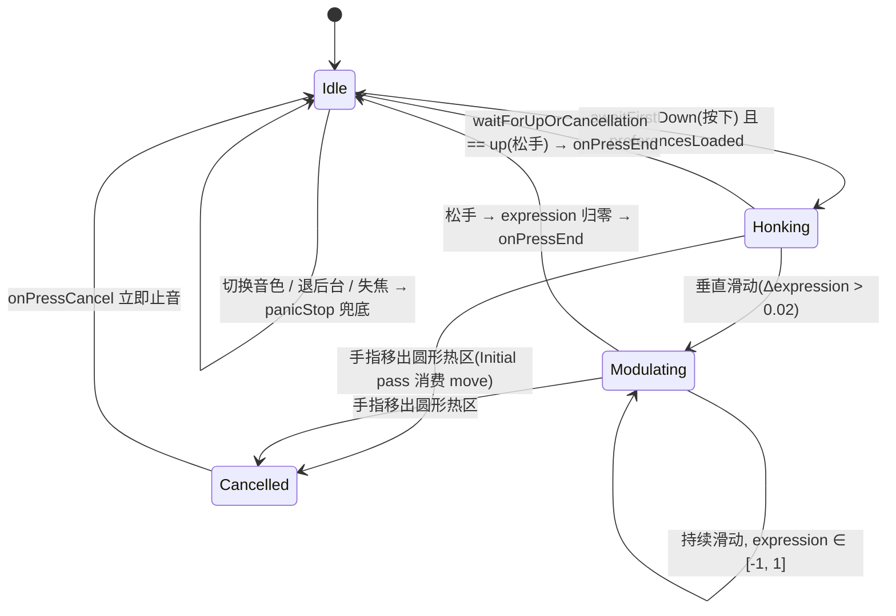
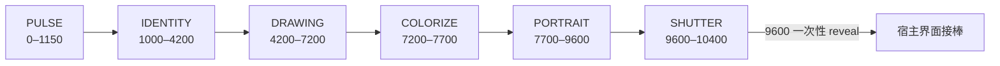
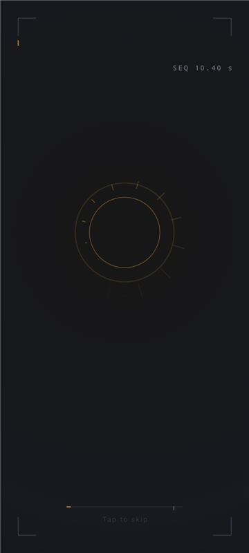
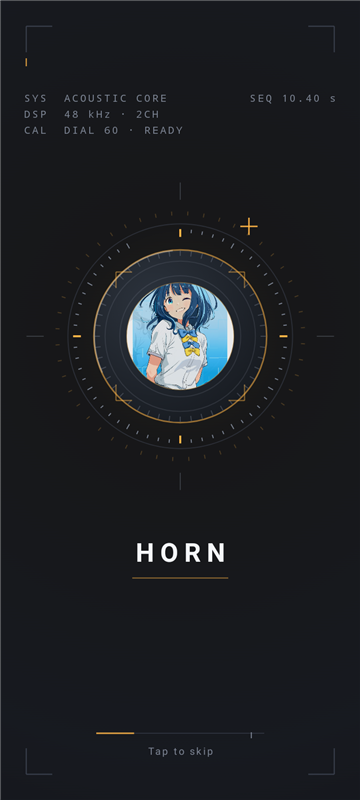
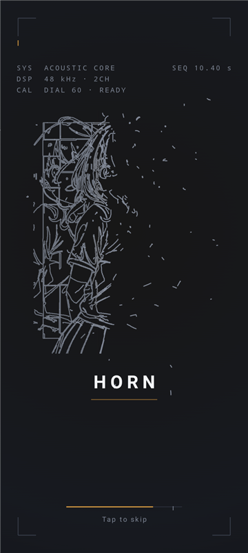
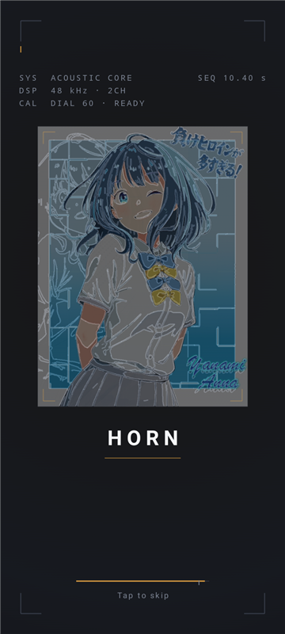
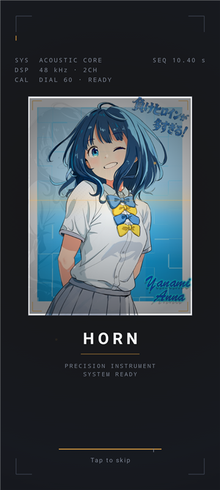
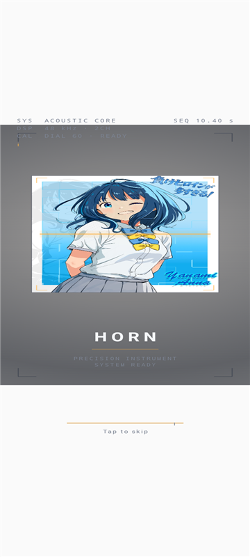
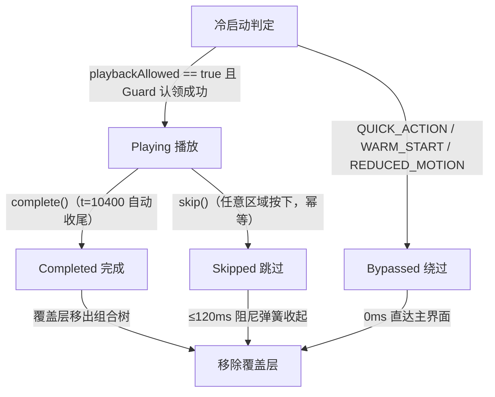

# 03 · 交互状态机、座舱视觉规范与触觉规约

- 状态：Living Spec
- 日期：2026-11-23

> 关联 ADR：[ADR-0011 精密汽车座舱：材质、仪表几何与主题三挡](adr/ADR-0011-precision-automotive-cockpit.md)
> （取代 [ADR-0008](adr/ADR-0008-apple-glass-design-system-and-spring-motion.md)，状态 Superseded）
>
> 本文约束 `:feature:horn` 的手势与安全交互、`:core:designsystem` 的座舱设计 Token 与仪表几何、
> `:core:haptic` 的触觉指纹。修改任一契约 MUST 同步更新本文与相关测试。

## 1. 主按钮指针手势状态机

实现：`feature/horn/src/main/java/com/industrial/horn/ui/HornInstrumentPad.kt`（`awaitEachGesture` + 双 `pointerInput`）。
圆形热区判定为几何圆（`isInsideCircle`），透明角落 MUST NOT 触发鸣笛。



硬性契约：

- 按下 MUST 同步 `onPressStart` + `onExpressionChanged(0f)`（起音从中性表达开始）。
- 垂直位移映射：`expression = clamp((centerY - y) / (0.38 × height), -1, 1)`，增量小于 0.02 MUST NOT 产生事件（去抖）。
- 横向/任意方向移出圆 MUST 立即 `onPressCancel`（由 `waitForUpOrCancellation` 返回 null 触达），MUST NOT 等到抬手。
- 一切终止路径（含协程取消/组合销毁）MUST 走 `finally` 兜底：`onPressCancel` + 状态复位（防"幽灵卡音"）。
- 松手 MUST 先归零 expression 再止音，避免尾音弯音残留。

## 2. Expression 连续调制契约

实现：`core/audio/src/main/java/com/industrial/horn/audio/dsp/ExpressionModulator.kt`。

| 参数 | 范围/系数 | 说明 |
|---|---|---|
| 表达输入 | `-1f .. +1f`，默认 `0f` | 手势层钳制 |
| 音高弯音 | `±8%`（`MAX_PITCH_BEND = 0.08`） | `pitchScale = 1 + current × 0.08` |
| 饱和驱动 | `+35%`（`DRIVE_RANGE = 0.35`） | 上限方向增强谐波亮度 |
| 气流噪声 | `+60%`（`NOISE_RANGE = 0.6`） | 阀门通气量的听感近似 |
| 激波铜管亮度（v3.6） | `beta = 0.05 + 0.30·max(0,e)` | Brassiness 幅度依赖分数延迟驱动度 |
| 激波不对称度（v3.6） | `alpha = 0.10 + 0.15·max(0,e)` | 带限非对称整形预级 |
| 平滑系数 | `SMOOTHING = 0.0025`/采样 | 逐采样指数平滑，禁 zipper 噪声 |

> v3.6 起，Expression 同时驱动**气压（音高微滑）**与**激波铜管亮度（Brassiness）**：上滑＝踩下气阀，
> 音色随气压上升变亮、变陡（见 `docs/spec/research/01-horn-physical-modeling.md` §3 与冻结契约 §3 常量表）。

## 3. 防呆与护耳交互规范

实现：`core/audio/src/main/java/com/industrial/horn/audio/AudioSafetyState.kt`（`AudioSafetyPolicy` 纯策略）、
`core/audio/src/main/java/com/industrial/horn/audio/AndroidAudioSafetyMonitor.kt`、
`feature/horn/src/main/java/com/industrial/horn/ui/SafetyUi.kt`、
`feature/horn/src/main/java/com/industrial/horn/presentation/HornViewModel.kt`。

1. **零音量智能引导**：按压时媒体音量 == 0 → 状态轨下方展开 `zero_volume_prompt` 警示条（文案见
   `feature/horn/src/main/res/values/strings.xml`），一键 `AudioSafetyPolicy.sixtyPercentVolume(max)` 恢复 60%；点击或恢复后警示条即时移出组合树。
2. **耳机护耳限幅**：`earProtectionActive = headphonesConnected && volumeFraction > 0.7` 成立时，
   引擎侧下发保护增益（≈ −6 dB，`PROTECTION_GAIN`），状态轨右端展示 `ear_protection_badge` 徽章。摘下耳机 MUST 自动解除。
3. **信息优先级**（单一状态轨 + 单一警示条，禁多弹窗）：警示条（零音量）> 状态轨徽章（护耳）> 状态轨状态令牌（引擎/声场/采样率）。
4. 音量监听经 `AudioDeviceCallback`（`AndroidAudioSafetyMonitor.kt`）；策略计算纯函数化以便单测（`AudioSafetyPolicyTest`）。
5. **心理声学输出模式感知（v3.6）**：耳机检测结果 MUST 同步驱动引擎输出级——耳机连接 →
   `OutputMode.HEADPHONE_FULL_RANGE`（全频双耳宽度链），未连接 → `OutputMode.SPEAKER_VBS`
   （外放虚拟低音链）；模式经 `HornSession.setOutputMode` 下发（20–50ms 交叉淡化），并回显于
   Debug HUD（`Speaker VBS` / `Headphone Full-Range`）、遥测 `AudioTelemetry.outputMode` 与座舱遥测面板（`OUTPUT` 行）。
6. **声场四档（v3.6）**：`AcousticSpaceSelector` 为一行四个 `TactileKeycap`
   （街道 / 隧道 / 旷野 / 地库），新增 `GARAGE(storageKey="garage")`；文案键
   `acoustic_space_garage`（`values`/`values-zh`）；旧数据未知键 MUST 回落 `STREET`。

## 4. 物理音量键拦截契约

实现：`app/src/main/java/com/industrial/horn/MainActivity.kt#dispatchKeyEvent`。

- 开关关闭（默认）：MUST 完全放行 `KEYCODE_VOLUME_UP/DOWN`，系统音量行为零改变。
- 开关开启：`ACTION_DOWN && repeatCount == 0` 起音；重复 DOWN 仅消费不重触发；`ACTION_UP` 止音；其余事件放行。
- 其他按键 MUST 永远放行。开关状态由 `:core:data` 持久化（`volumeTriggerEnabled`）。

## 5. Precision Cockpit 设计 Token（`:core:designsystem`）

实现：`core/designsystem/src/main/java/com/industrial/horn/ui/theme/` 下的
`Color.kt`、`Type.kt`、`Theme.kt`、`Motion.kt`、`CockpitCanvas.kt`、`MachinedPanel.kt`、
`TactileKeycap.kt`、`InstrumentDial.kt`、`PrecisionExpressionGauge.kt`、`InstrumentSlider.kt`。

### 5.1 双材质色板（v4.0 冻结）

| Token | 语义 | Ceramic Daylight | Stealth Carbon |
|---|---|---|---|
| `canvas` | 全屏基底 | `#F3F3EE` | `#0D0F12` |
| `grid` | 工程网格刻线 | `#E2E2DA` | `#1C2027` |
| `panel` | 标准面板 | `#FFFFFF` | `#16191F` |
| `panelRaised` | 凸起面板 / 仪表中心盘 | `#FFFFFF` | `#1D2129` |
| `panelSunken` | 凹陷面板 / 滑槽 | `#EAEAE4` | `#101318` |
| `hairline` | 面板发丝边 | `#DFDFD8` | `#2C313C` |
| `hairlineStrong` | 刻度/交互键边框 | `#C4C4BC` | `#3C4250` |
| `textPrimary` | 主文本 | `#141619` | `#F4F6F9` |
| `textSecondary` | 次文本 / 刻度数字 | `#626770` | `#8C94A3` |
| `textTertiary` | 微标签 / 未点亮刻度 | `#6F747C` | `#7C8493` |
| `dialTop` / `dialBottom` | 车削盘面 | `#F0F0E9` / `#D5D5CD` | `#2C333D` / `#12151A` |
| `bezelTop` / `bezelBottom` | 表圈刻度带 | `#EDEDE6` / `#E0E0D8` | `#2A323D` / `#1E242C` |
| `fault` | 故障态 | `#C62E20` | `#FF6A5A` |
| `protection` | 护耳态 | `#8A5A00` | `#FFC24D` |

色板只在 `Color.kt` 定义一次，并通过 `LocalHornColors`（`staticCompositionLocalOf`）下发；
Material 3 `ColorScheme` 同步映射到同一组 canvas/panel 值，保证 Material 原生组件与自绘仪表同材质。

### 5.2 对比度门禁（机器执法）

`app/src/test/java/com/industrial/horn/ui/theme/CockpitPaletteTest.kt` 用 WCAG 2.2 相对亮度公式断言：

- `textPrimary` / `textSecondary` 在 canvas、panel、sunken 上 ≥ **4.5:1**；
- `textTertiary` 在面板上 ≥ 4.5:1、在 canvas 上 ≥ 3:1（微标签属于装饰性小字，但不允许低于大文本阈值）；
- 5 个音色强调色在各自面板与 canvas 上 ≥ 4.5:1；
- `fault` / `protection` 在两种表面上 ≥ 4.5:1；
- **正控**：黑/白 = 21.0:1（±0.05）；**负控**：品牌琥珀 `#FFB547` 在白底仅 1.76:1，必须被判红，
  否则「全绿」可能只是公式失效。

### 5.3 五音色仪表强调色（深浅双值）

单一中调无法同时在白面板与碳黑面板过 4.5:1，因此每个音色给出成对值，由 `InstrumentAccent.resolve(dark)` 解析：

| 音色 | Daylight | Carbon |
|---|---|---|
| Car | `#A85B00` | `#FFB547` |
| Train | `#B3201A` | `#FF8A66` |
| E-Bike | `#0F766E` | `#43E3C0` |
| Motorcycle | `#1D4ED8` | `#82B8FF` |
| Custom / Lab | `#6D28D9` | `#C9A6FF` |

映射入口：`:feature:horn` 的 `HornType.visualStyle(dark)`（保持 `:core:designsystem` 零项目依赖）。
五色在 sRGB 空间两两距离 MUST ≥ 48（`CockpitPaletteTest` 断言），避免"五个音色两个颜色"。

### 5.4 圆角与动效（`HornRadii` / `HornMotion`）

圆角是机加工尺度，不是消费级胶囊：`Plate = 16dp`、`Instrument = 12dp`、`Key = 9dp`、
`Chip = 7dp`、`Well = 5dp`；嵌套仍遵守 `R_outer = R_inner + padding`（`HornRadii.outerOf`）。

| 预设 | dampingRatio / stiffness | 用途 |
|---|---|---|
| `KeySpring` | 0.90 / 1500 | 键帽/主盘按压（短行程、无明显回弹） |
| `IndexSpring` | 0.88 / 1050 | 选择指示片位移 |
| `NeedleSpring` | 0.62 / 520 | 表针（允许一次物理过冲） |
| `PanelSpring` | 0.92 / 620 | 面板/工坊展开 |
| `RailSpring` | 1.00 / 900 | 警示条淡入淡出 |

交互态 MUST NOT 使用线性 `tween`（颜色过渡除外，颜色不是位移）。

### 5.5 仪表几何（冻结比例，`GaugeGeometry`）

| 元素 | 半径比例 | 规格 |
|---|---|---|
| 车削盘面 | `0.858 R` | 径向金属渐变 + 交替车削环 + 72 齿滚花边 + 4 颗紧固螺钉 |
| 表圈刻度带 | `0.862–0.925 R` | 240° 刻度：每 10° 一小格、每 60° 一大格 |
| 压力环 | `0.932–1.000 R` | **60 格** RMS 压力刻度，每 5 格加重；点亮格数 `= round(rms × 60)` |
| 中心盘 | `0.46 D` 直径 | 不透明，覆盖表针轴心；承载图标 / 标签 / `EXP` 读数 |
| 表针 | 尾 `-0.20 R` → 尖 `0.905 R` | 2dp 主色 + 4dp 深色描边保证浅色盘面对比 |

Expression 角度：`angle = 150° + (expression + 1)/2 × 240°`，即 0 指正上方（270°），−1 → 150°、+1 → 30°；
正向半圈带一条细强调弧（z 序在刻度之下），读数 MUST 为直连（禁指针缓动滞后于手指）。

### 5.6 组件契约

| 组件 | 行为契约 |
|---|---|
| `CockpitCanvas` | 工程网格 + 四角卡尺标记 + 暗角；网格 Path 在 `drawWithCache` 内一次构建；仅鸣笛时叠加扫描带（`State<Float>` 只被 draw 读取，不进组合层） |
| `MachinedPanel` | 1dp 高光缝 + 1dp 底缝 + 发丝边 + 四角刻度 + 可选强调索引条；`raised` / `sunken` 两态 |
| `TactileKeycap` | 键帽：选中=强调色边框 + 强调色标签 + 2dp 索引条（三重冗余，非仅颜色）；按压 0.97 行程；语义 `Role.RadioButton` + `Selected` + 每项 testTag |
| `InstrumentToggle` | 机械拨杆开关：`toggleableState` + `stateDescription`，默认关闭即系统音量键行为零改变 |
| `InstrumentDial` | 车削盘面 + 压力环 + 表圈 + 中心盘；`rmsProvider`/`expressionProvider` 只在 draw 内读取 |
| `PrecisionExpressionGauge` | 240° 动圈刻度 + 直连表针 + 正向强调弧；无自身动画 |
| `InstrumentSlider` | 凹陷滑槽 + 印刷刻度 + 硬边填充 + 滚花滑钮；拖动/点击均可赋值；数值 MUST 用 `HornText.Data`（tnum） |

### 5.7 主题三挡与系统栏极性

- `ThemeMode { SYSTEM, LIGHT, DARK }` 持久化于 DataStore，键值 `system|light|dark`（稳定字符串，
  `fromStorageKey` 对未知键回落 `SYSTEM`）；`ThemeMode.next()` 为 AUTO → DAY → NIGHT 三挡循环。
- 顶栏主题键：单击循环（`onCycleThemeMode`）；长按或 TalkBack 自定义动作打开三挡菜单
  （`onSelectThemeMode`），保证偏好不依赖隐藏手势。
- `MainActivity` 解析 `useDarkTheme` 后 MUST 同步 `WindowCompat.getInsetsController`
  的 `isAppearanceLightStatusBars` / `isAppearanceLightNavigationBars`（edge-to-edge 下系统栏透明，
  图标极性只能跟随解析后的主题，不能跟系统设置）。

## 6. 渲染基线与窗口形态

| 能力 | 全部 API 26–36 |
|---|---|
| 面板/仪表材质 | 纯色填充 + 线性/径向渐变 + 1px 描边，无模糊、无 AGSL、无 `RenderEffect` |
| 3D 观感 | 高光缝 / 底缝 / 暗角 / 车削环（几何暗示，不是真实景深） |
| 动效 | Compose spring + 单时钟 f(t)，无能力分级 |

v4.0 显式移除毛玻璃与背景虚化：视觉不再依赖 `RuntimeShader`/`RenderEffect` 探测，
同一套几何在模拟器、无头 JVM 与真机上逐像素一致，Roborazzi 基准不再因 GPU 能力分叉。

### 6.1 窗口形态断点（WindowSizeClass）

| 形态 | 布局 | 实现 |
|---|---|---|
| Compact（竖屏单手） | 顶栏（品牌 + 主题键 + 工坊键）+ 状态轨 + 仪表盘 + 底部机加工控制台 + 脚注 | `HornScreen` `compact_layout` |
| Medium / Expanded（横屏/平板/折叠展开） | 左：音色 + 声场控制台 + 遥测仪表盘；右：超大仪表盘 | `HornScreen` `expanded_layout` |

大屏 MUST 零遮挡、零挤压；1.35× 无障碍大字体 MUST 零裁切（`ScreenshotMatrixTest` 1.35x 档覆盖 80 张基准；仪表状态由 `InstrumentDialSnapshotTest` 的 6 帧覆盖）。

## 7. 触觉指纹规约（`:core:haptic`）

实现：`core/haptic/src/main/java/com/industrial/horn/haptic/HapticPattern.kt`、`AndroidHornHaptics.kt`。
波形时序 off/on 交替（首拍 off）；振幅数组仅在支持振幅控制的设备生效，否则走
`fallbackTimingsMs` 节奏降级；无马达设备为 No-Op。API 31+ 经 `VibratorManager` 取默认马达，以下走
`VIBRATOR_SERVICE` 降级。

| 车型 | 波形（ms） | 振幅 | 意图 |
|---|---|---|---|
| Car | `1,24,80,12,50,9,55,11` | 190→50 递减 | 平稳中强持续脉冲 |
| Train | `1,120,100,50,110,45,90,55` | **255**→120 | 最高振幅低频重脉冲（120ms 首拍） |
| E-Bike | `1,7,23,5,19,4,21,3` | 70→40 | 轻量 7ms 高频轻点 |
| Motorcycle | `1,18,30,10,26,8,28,6` | 150→60 | 18ms 颗粒机械脉冲 |
| Custom | `1,10,28,6,20,6,18,5` | 125→50 | 中性克制节奏 |

约束：`HapticPattern` 构造期 MUST 校验时序为正、振幅 ∈ [0,255] 且含非零脉冲（`require`）；
`HapticSignatureTest` 锁定指纹差异性。`TactileKeycap` 的选择刻度 SHOULD 使用
`CLOCK_TICK` 类细粒度反馈（由宿主 `:core:haptic` 注入）。

## 8. 零重组延迟读取规范（性能红线）

- RMS 包络、Expression 位移、按压行程、扫描带相位 MUST 经 `() -> Float` Provider 或
  `State` 在 `drawWithCache`/`drawBehind`/`graphicsLayer` 内读取；MUST NOT 在高频更新时触发重组。
- 全屏网格 Path MUST 在 `drawWithCache` 内按尺寸构建一次；动画值 MUST 以 `State<Float>` 形式传入
  draw 层（禁在组合层解包，否则 `drawWithCache` 会被逐帧重建）。
- `rememberUpdatedState` 用于保持 Provider 新鲜而稳定（`HornScreen` 的 `rmsProvider`/`expressionProvider`）。
- **稳定回调身份**：`HornScreen` 传入深层子树（`InstrumentZone`/`CockpitDeck` 等）的回调 MUST 以
  `remember { { currentTarget() } }` 包装（目标经 `rememberUpdatedState` 转发），使父级重组
  （如遥测节拍）不会因 lambda 身份变化击穿子树的可跳过性（skippability）。
- 文本（`EXP` 读数、字标字距）MUST 以 60ms 定时器采样更新：改字符串是排版操作，不属于帧时钟；
  其余纯视觉属性仍逐帧。

## 9. 非目标（Non-Goals）

- 不做自定义手势录制/宏；单按钮交互是产品灵魂，MUST NOT 复杂化。
- 不做实时 FFT 频谱显示（时域示波器已满足调试需求）。
- 不做毛玻璃 / 背景虚化 / 半透明堆叠（v4.0 明确移除，见 ADR-0011）。

## 10. 已知局限与权衡（Known Limitations & Trade-offs）

- 1px 发丝线与刻度在极低 dpi 设备上可能被渲染为 1.5–2px 灰边；以 `hairlineStrong` 与 ≥4.5:1 文本兜底可读性。
- 车削环 / 滚花 / 螺钉是几何暗示而非真实金属反射；换取零 GPU 依赖与跨设备逐像素一致。
- `FontFamily.Monospace` 在个别 OEM 字体下回退为比例数字；因此每个数值样式同时声明
  `fontFeatureSettings = "tnum"`，即使字体回退也保持等宽数字。
- Roborazzi 基准对系统字体光栅化敏感，跨平台差异 MUST 走 `update-screenshots.yml` Linux 重录 SOP（见 05 规约）。

## 11. 开屏动画与启动体验（Cold-Start Film v5.0）

> 关联决策：[ADR-0010 开屏动画：单时钟自绘与无缝交棒](adr/ADR-0010-startup-optical-wake-animation.md)、
> [ADR-0011 精密汽车座舱](adr/ADR-0011-precision-automotive-cockpit.md)。
> 方法论真源：仓库内 skill [`.agents/skills/startup-animation`](../../.agents/skills/startup-animation/SKILL.md)——
> **六幕分镜、单时钟 f(t)、线稿聚合、预热交棒、降级矩阵、帧预算验收**逐条落地。
> v5.0 起开屏是一段 **10.4 s 的品牌短片**：脉冲唤醒 → 仪表自检 → 品牌线稿聚合 → 上色 → 肖像 HUD → 遮片合拢交棒。
> v4.1 的四幕 1.04 s 版本只覆盖了 skill 分镜的**前半段**（脉冲 + 身份），缺线稿聚合与其后的三幕，故整体重做。

### 11.1 六幕时间轴（单时钟 t = elapsed ms）

总时长 **10400 ms**；一切视觉状态均为 t 的纯函数 f(t)，任意时刻可定格复现。阶段投影由
`StartupTimeline.stageOf(t)` 唯一决定（验收脚本与单测都断言它，而不是靠肉眼）。



| 时刻 | 阶段 | 元素 | 入出公式 |
| --- | --- | --- | --- |
| 0–1150 | PULSE 脉冲 | 三圈相位环 + 12 路声压喷口 + 四角 reticle | 环相位 `(t·0.00075 + i·0.33) % 1`，半径 `0.46R → 1.16R`，alpha `(1−p)²·0.55`；喷口相位 `(t/260) % 1`，第 k 路错峰 `k/12`；reticle 臂长 `smoothstep(0, 320, t)` |
| 1000–1650 | IDENTITY 身份 | 表盘点亮 | `alpha = smoothstep(1000, 1650, t)`；`scale = 0.94 + 0.06·settle(smoothstep(1000, 1900, t))` |
| 1200–2140 | IDENTITY | 三行 boot 日志 | `line_k = smoothstep(1200+400k, 1340+400k, t)`，k ∈ {0,1,2} |
| 1200–2600 | IDENTITY | 60 格刻度顺时针扫入 | `sweep = smoothstep(1200, 2600, t)`，可见格 `⌊60·sweep⌋`，每 5 格加长、每 15 格强调色 |
| 1300–1900 | IDENTITY | 48 段雷达虚线环 + 慢转 + 十字准星 | 虚线 `alpha = smoothstep(1300, 1900, t)`，`rotation = 0.010·(t−1300)°`；准星 `smoothstep(1400, 1900, t)`，臂 `1.58r → 1.78r` |
| 1700–2400 | IDENTITY | 字标擦除入场 | `title = smoothstep(1700, 2400, t)`；`clipRect(right = W·title)` + 18dp 上浮；**字距静态 6sp，禁做动画** |
| 2300–2560 | IDENTITY | 校准点 ×3 | `glint_i = smoothstep(t_i, t_i+60, t)·(1 − smoothstep(t_i+120, t_i+260, t))`，`t_i = 2300+220i` |
| t=2400 | IDENTITY | 轻触觉 ×1 | 单次轻触觉（`HAPTIC_MS = 2400`，与字标擦除完成同一帧） |
| 4000–4500 | IDENTITY→DRAWING | 24 段身份块散开 | `spread = smoothstep(4000, 4500, t)`，`alpha = 1−spread`，径向位移 `40dp·spread` |
| 4200–7200 | DRAWING 线稿聚合 | 品牌轮廓碎片 | `p = clamp((t−4200)/3000)`；归位前沿 `front = 1.5p − 0.25`；单片到达度 `arrival = smooth((front − x/W + 0.055)/0.11)`；尺寸 `0.16+0.84·arrival`；旋转 `angle·(1−arrival)`；未归位漂移 `±7dp·(1−arrival)` |
| 4200–4350 | DRAWING | 线稿显影 | `lineAlpha = 1 − smoothstep(4200, 4350, t)` 的反向权重（线稿在 150 ms 内显影） |
| 7200–7700 | COLORIZE 上色 | 线稿 → 彩图交叉淡化 | `mix = smoothstep(7200, 7700, t)`：线稿 alpha `1−mix`、彩图 alpha `mix`，**同几何对齐**；Ken Burns `scale 1 → 1.012` |
| 7700–9600 | PORTRAIT 肖像 | 字幕 / 粒子 / 一次性光扫 | 字幕 `caption_k = smoothstep(7800+600k, 7940+600k, t)`；粒子 `heartbeat(t−7700−170i, 1080)·0.55`；光扫 `smoothstep(7900, 8800, t)`；Ken Burns 续到 `1.020` |
| t=9600 | SHUTTER 遮片 | reveal 闩锁 | 一次性发出；主界面自下层接棒（错峰 40 ms 浮现） |
| 9600–10400 | SHUTTER 遮片 | 画面纵向合拢 | `collapse = smoothstep(9600, 10400, t)`；内容层 `scaleY(1−collapse)`（最低 0.001），始终绕光学轴 `0.42H` 收缩 |
| 9600–10120 | SHUTTER | 底衬溶解 | `background = 1 − smoothstep(9600, 10120, t)`：合拢的两半之间露出真实界面 |
| 9600–10400 | SHUTTER | 中线收窄 | `pinch = smoothstep(9600, 10400, t)`；中线半宽 `0.5W·(1−pinch)`，`2dp` 亮线 + `10dp` 辉光 |
| 9900–10330 | SHUTTER | 一次性闪白 | `flash = smoothstep(9900, 10050, t)·(1 − smoothstep(10050, 10330, t))`，峰值 10050 |
| 10000–10400 | SHUTTER | 残层淡出 | `alpha = 1 − smoothstep(10000, 10400, t)`；t = 10400 彻底移出组合树 |

每幕一帧定格（深色主题，取自冻结时钟；说明分镜用，**不是** Roborazzi 基准）：

| PULSE 0.7 s | IDENTITY 2.4 s | DRAWING 5.6 s |
| --- | --- | --- |
|  |  |  |

| COLORIZE 7.4 s | PORTRAIT 8.6 s | SHUTTER 9.9 s |
| --- | --- | --- |
|  |  |  |

公式语义（全部为 t 的纯函数，禁 setTimeout／多时钟排程）：

- `smoothstep(a, b, x) = s²(3−2s)`，`s = clamp((x−a)/(b−a), 0, 1)`——全片唯一缓动原语（C¹ 连续）。
- `settle(p)`：确定性解析欠阻尼阶跃（ζ=0.55、ω=9，与 `KeySpring` 同源的机加工手感），微过冲后精确收敛 1.0。
- `heartbeat(t, T) = ((1 − cos(2πt/T))/2)²`：呼吸/粒子，比正弦更「有机」。
- `% 1`：相位循环，用于脉冲环、声压喷口、粒子错峰。
- 里程碑曲线 `progress(t)`：`[时间比, 进度比] = [[0,0],[.12,.06],[.35,.41],[.56,.76],[.66,.924],[.72,.97],[.77,1],[1,1]]`，
  底部同步条与整体节奏共用一条曲线（8.0 s 时进度到 1，正好落在上色完成之后）。
- 时间轴常量与公式单点集中于 `core/designsystem/src/main/java/com/industrial/horn/ui/theme/StartupWake.kt`
  （`StartupTimeline`、`StartupStage`、`smoothstep`/`settle`/`heartbeat`/`phaseLoop`）。

### 11.1.1 素材管线：参考图 → 轮廓线稿 → 等弧长碎片 → 按 X 归位

开屏的「画」是一张参考图 `feature/horn/src/main/res/drawable-nodpi/startup_hero.png`（658 × 877）。
按 skill 的位图管线落地，边缘检测在**构建期**跑一次：

```
startup_hero.png（658×877，633 KB）
  → tools/startup-hero/extract-contours.mjs（离线）
    PNG 解码 → 灰度 → Sobel → 非极大值抑制 → 边缘行走 → 抽稀 → 归一化折线
  → assets/startup/hero_contours.bin（1000 条折线 / 24 108 点 / 96 KB，sha256 前 16 位 c5da357f4b876a75）
  → 运行时按画布尺寸映射 → 等弧长切碎片（span = max(3dp, 总弧长/900)）
  → 每片：质心 + 相对点 + 确定性散射位（sin-hash）+ 旋转角 + 漂移相位
  → 24 个纵向列：已归位列 1 条预建 Path（1 次 draw），飞行中的列合并进 1 条 scratch Path
  → 归位完成后与参考图本体交叉淡化（同几何、同 transform-origin）
```

- **重活只做一次**：边缘检测在构建期，列 Path / 三角函数表 / 笔刷在 `drawWithCache` 里按 size 构建一次；
  每帧只重写一条 scratch `Path`（`rewind()` 复用，零分配）。参考图解码与素材解析放在 IO 线程异步完成
  —— 首帧不被 633 KB 解码拖住（预热纪律），而最晚使用点是 IDENTITY（1.0 s）与 COLORIZE（7.2 s）。
- **素材可复算**：`node tools/startup-hero/extract-contours.mjs --check` 校验素材与参考图是否一致，
  脚本内部跑两次提取并逐字节比对（确定性）；`StartupContourTest` 断言素材真的打进了包。
- **确定性**：散射位用 `frac(sin(n·12.9898)·43758.5453)`，禁用随机数——scrub／replay／定格可逐位复现。
- **归位先后跟目标 X 走**：参考图左侧先落定、右侧发梢最后落定；飞行窗口收窄到 `0.11`
  （skill 的 0.32 是为更高密度线稿留的），于是任意一帧只有 ≤2 列在飞，帧预算可控。

### 11.1.2 视觉词汇（boot 序列）

| 元素 | 规格 | 为什么 |
| --- | --- | --- |
| 扫描线底 | 每 3dp 一条 1px 横线，透明度 0.04–0.05 | 让整屏读作「显示器」而不是「壁纸」 |
| 四角 reticle | 26dp 内缩、26dp 臂长、1.2dp 描边，左上角一个强调色刻度 | 取景器/仪表的固定语法，同时给出画面边界 |
| boot 日志 | 等宽 9–10sp、字距 2sp、三行错峰 400ms，公开事实（`ACOUSTIC CORE` / `48 kHz · 2CH` / `DIAL 60`） | HUD 叙事；不使用任何无法核实的「系统消息」 |
| 序列标记 | 右上 `SEQ 10.40 s` 静态文本 | 时间码若逐帧刷新会不停触发布局；静态令牌同样传达「一段固定流程」 |
| 同步进度条 | 底部 168dp，1px 轨 + 强调填充 + **9600ms 闩锁刻度** | 把「还有多久可以操作」可视化，替代不可读的百分比 |
| 雷达虚线环 | 48 段、1px、强调色 22%、`0.010°/ms` 慢速旋转 | 静态刻度 + 慢旋转＝「在扫描」，不引入噪声粒子 |
| 身份头像 | 参考图按 cover 裁成圆形压在表盘中心（直径 = 表盘半径 × 1.24） | 第 2 幕先「认出这张脸」，第 3 幕碎片散开重组成同一张画，叙事连续 |
| 字标 | 26sp 粗体、字距 6sp 静态、`clipRect` 擦除、下挂 96dp 强调细线 | 字距动画会逐帧重排版，属明确禁止项 |
| 字幕 | 两行 9sp 等宽、错峰 600ms、只改图层 alpha | 肖像幕的「字幕」词汇；零文本重排 |
| 粒子 | ≤6 个 2.2dp 点，`heartbeat` 呼吸 + 缓慢上浮 | 少量缓慢运动即可，不是越多越好 |
| 落定扫描线 | 列归位的 110 ms 内，该列线稿压一层强调色 + 一道 1dp 竖向扫描线，随后融回线稿色 | 把「归位」这一下做成可见事件，而不是静态贴图的出现 |
| 印片边框 | 参考图外沿 1dp 发丝 + 四角 7dp 内缩 / 15dp 臂长的强调刻度 | 让参考图读作「仪表上的一块印片」，与交棒遮片同一套语言 |
| 晕影与肖像扫描 | 参考图矩形内：径向晕影（中心透明 → 边缘 55% 底衬色）+ 一次自上而下的 1dp 扫描（带宽 52dp、sweep 包络 = sin(πp)） | 把注意力收回画面中心；「光扫一次性」在肖像幕落到图上而不只是全屏 || 交棒 | 内容纵向合拢（绕 0.42H 光学轴）+ 底衬溶解 + 中线收窄 + 一次性闪白 | 「关机/合拢再交棒」比淡出更像机械动作，也让真实界面从两半之间露出来 |

### 11.1.3 降级（reduce motion）

- 系统动画时长为 0 或 `LocalReducedMotion` 为真：`StartupCoordinator` 直接 `Bypassed(REDUCED_MOTION)`，覆盖层不出现。
- 覆盖层内部兜底：以 `t = 8800 ms`（已上色、字幕已起、遮片未开始）渲染**静态终帧**，无粒子、无漂移、无旋转、
  无 Ken Burns；`420 ms` 后自我收尾，绝不空占屏幕。
- 图片/素材解码失败一类问题在本实现中不存在（矢量几何无解码），因此没有 `assetError` 分支。

### 11.1.4 参考图出处与许可

| 项 | 值 |
| --- | --- |
| 文件 | `feature/horn/src/main/res/drawable-nodpi/startup_hero.png`（658 × 877，633 KB） |
| sha256 | `EDFF78721B48F5C2CD26FA97DFEDD4B91C16A4E58E032F76693275C6178A0AB4` |
| 来源 | 由项目方提供的角色插画参考图 |
| 权利 | **版权归原权利方**；本仓库仅作开屏素材示例，作者不主张任何权利 |
| 分发约束 | 对外分发、商用或再发布前 MUST 自行取得授权；不得把该文件当作可再分发的自由素材 |
| 派生素材 | `feature/horn/src/main/assets/startup/hero_contours.bin` 由该图派生，随同一约束 |

替换参考图时：同步更新本表、重新生成线稿素材（`node tools/startup-hero/extract-contours.mjs`）、
重测开屏定格帧，并确认新素材的授权同样允许入库。

### 11.2 点击跳过契约

- 触发：覆盖层任意区域按下即触发（不等抬手、不判长按）→ `StartupCoordinator.skip()` → `Skipped`。
- 收起：≤120ms 阻尼弹簧（scale 1.0→0.96 + alpha→0）后覆盖层移除；120ms 是硬上限而非目标值。
- 红线：跳过后 MUST NOT 残留任何可拦截鸣笛手势的遮罩——`horn_button` 立即可按下（Compose UI 测试锁定）。
- 幂等：`skip()` 仅 `Playing → Skipped`，重复调用与终态调用均无操作。
- 与 reveal 的关系：t=9600 闩锁发出后，跳过仅加速覆盖层收起，MUST NOT 撤销已发出的 reveal（一次性语义）。
- 提示：底部极低调「轻触跳过 / Tap to skip」，中英文文案 + TalkBack `contentDescription`；不遮挡主视觉。

### 11.3 智能绕过矩阵

| 场景 | 判定 | 结果 | 时延 |
| --- | --- | --- | --- |
| Widget / Quick Tile / DeepLink 快速入口 | `startedFromQuickAction` | `Bypassed(QUICK_ACTION)` | 0ms 直达主界面 |
| 热启动（退后台返回 / 旋转 / 主题切换 / 折叠展开） | `!coldStart`（进程守卫已置位） | `Bypassed(WARM_START)` | 0ms |
| 系统减弱动态效果 / 动画时长缩放为 0 | `LocalReducedMotion` 或 `ANIMATOR_DURATION_SCALE == 0` | `Bypassed(REDUCED_MOTION)` | 0ms |
| 冷启动且非快速入口且允许动效 | `playbackAllowed(coldStart, quickAction, reducedMotion)` 且 `StartupPlaybackGuard` 认领成功 | 播放（`Playing`） | 自 t=0 走表 |

- 优先级：QUICK_ACTION > WARM_START > REDUCED_MOTION（同时命中取高优先项归因）。
- 仅冷启动播放：进程级单次守卫 `StartupPlaybackGuard` 保证同一进程至多播放一次；播放或绕过后 MUST NOT 复播。
- **10.4 s 与紧急可达性的张力**：品牌时刻只在冷启动一次性路径出现，且三条兜底路径（快速入口 0ms、任意按下
  ≤120ms 跳过、热启动不重播）都保持可用；这是本决策显式接受的取舍（见 ADR-0010 v5.0 附录）。

### 11.4 启动状态机



- `StartupState = Playing | Completed | Skipped | Bypassed`（`StartupBypassReason = QUICK_ACTION | WARM_START | REDUCED_MOTION`）。
- API 契约：`StartupCoordinator.skip()`（幂等）、`complete()`（幂等）、`playbackAllowed(coldStart, quickAction, reducedMotion)`。
- 终态（Completed/Skipped/Bypassed）均为吸收态：不再接受跳过/完成调用，覆盖层随后移出组合树。

### 11.5 Android 12+ SplashScreen 无缝衔接

- 依赖官方 androidx.core:core-splashscreen；`MainActivity.onCreate` 首行 `installSplashScreen()`。
- `Theme.Horn.Starting`（parent `Theme.SplashScreen`、`postSplashScreenTheme=Theme.Horn`）深浅双份已落地：
  `app/src/main/res/values/themes.xml` 与 `app/src/main/res/values-night/themes.xml`；`windowSplashScreenBackground`
  对齐窗口底色，系统 Splash → Cold-Start Film 零色跳、零白闪。
- `setKeepOnScreenCondition` 仅等首帧就绪（覆盖层第 0 帧预热完成）即交棒；MUST NOT 人为拉长系统 Splash。
- 应用层时间轴自交棒时刻起算 t=0；系统 Splash 图标动画不并入六幕时间轴（两层时间轴解耦）。

### 11.6 静音红线

- 全程零音频：MUST NOT 播放任何启动音/品牌音，音频引擎 MUST NOT 因开屏启动。
- 全程仅 t=2400 一次轻触觉（轻量 CLOCK_TICK 类）；无震动马达或系统触觉关闭时静默降级。
- 触觉经 `:core:haptic` 既有安全链路下发（无马达设备 No-Op，见 §7）。

### 11.7 性能契约

- 单时钟：一切视觉 = f(t)（t = elapsed ms 唯一时钟）；MUST NOT 以 setTimeout/多动画时钟排程。
- 延迟读取（I7）：`elapsedProvider: () -> Float` 在 `DrawScope`/`graphicsLayer` 内读取，动画帧只重绘零重组；
  `rememberUpdatedState` 保持 Provider 新鲜而稳定。
- 重活一次化：几何采样/碎片切分/列 Path/渐变/三角函数表全部在 `drawWithCache` 内按 size 预计算
  （`StartupFilmScene`），逐帧只重写一条 scratch Path。
- 批量绘制：已归位列各自 1 条预建 Path（≤24 次 draw），飞行中的列合并进同一条 scratch Path（1 次 draw）。
- **文字零动画**：字标擦除用 `clipRect`、boot 日志/字幕只改图层 alpha；覆盖层内没有逐帧排版的文本。
- 移出组合树（I8 同族）：`Completed`/`Skipped`/`Bypassed` 后覆盖层 MUST 彻底移出组合树。
- 测试注入：冻结时钟经 `elapsedProvider` 注入，任意时刻定格可复现（scrub/Roborazzi 免费）。
- **指标自报**：debug 构建在动画完成时输出 `startup frames: n / median / p95 / slow(>33.4ms)`
  （`StartupFrameMeter`，环形缓冲零分配；release 不输出、不落日志）。「流畅」不是结论，这行日志才是。

### 11.8 测试与 Roborazzi 隔离

- 状态机 100% 覆盖：Playing→Completed、Playing→Skipped（`skip()` 幂等重放）、旋转不重播（WARM_START）、
  QUICK_ACTION 绕过（0ms 直达）、REDUCED_MOTION 绕过、优先级 QUICK_ACTION > WARM_START > REDUCED_MOTION。
- Compose UI 测试：任意区域按下即跳过的语义；跳过后 `horn_button` 可交互（零遮罩残留）；
  闩锁时刻为 2400（触觉）/9600（reveal）/10400（完成），并含「9600 之前 reveal 必须沉默」的负控。
- 时间轴契约测试 `StartupTimelineTest`：六幕边界与 `stageOf`、里程碑曲线、脉冲相位、身份节拍、线稿左→右归位、
  上色窗口、肖像节拍、遮片合拢与交棒、闩锁常量、降级终帧，均断言端点与单调性。
- Roborazzi 定格帧：**每幕 1 帧 × 深浅双主题 = 12 帧**（`pulse` 700 / `identity` 2400 / `drawing` 5600 /
  `colorize` 7400 / `portrait` 8600 / `shutter` 9900，`startup_wake_*` 命名空间）。
  基准 MUST 在 Linux 由 `update-screenshots.yml` 录制，Windows 本地录制严禁入库（§5.3）。
- 既有 80 张主界面基准不受影响：覆盖层挂载于 `MainActivity` 层，HornScreen 截图天然隔离（I10 零回归）。

### 11.9 Non-Goals

- 不引入 Lottie/第三方动画库（包体与确定性红线，见 ADR-0010）。
- 不做联网预热/预取：开屏期零网络请求（冷启动延迟不可控）。
- 不做启动音效/品牌音（静音红线的绝对性）。
- 不做用户可配置的开屏时长或「跳过开关」：跳过 = 一次按下，不进设置。
- 不把系统 Splash 延长充当动画：其职责仅限无缝交棒。
