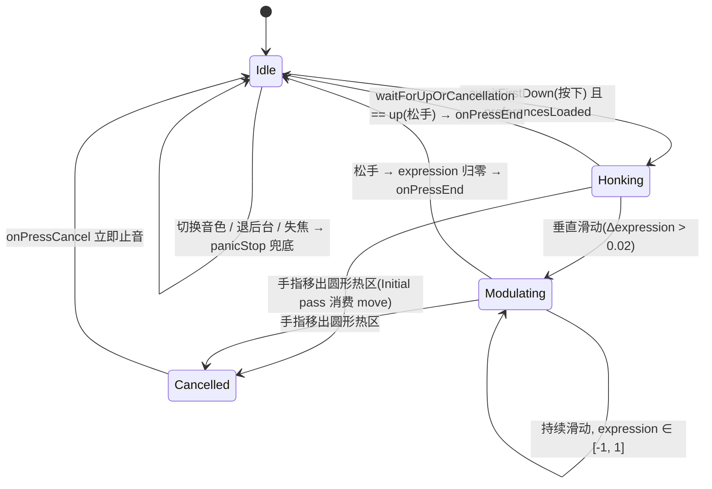

# 03 · 交互状态机、视觉降级与触觉规约

- 状态：Living Spec
- 日期：2026-11-22

> 关联 ADR：[ADR-0008 Apple Glass 设计系统与弹簧动效](adr/ADR-0008-apple-glass-design-system-and-spring-motion.md)
>
> 本文约束 `:feature:horn` 的手势与安全交互、`:core:designsystem` 的 Apple Glass 设计 Token 与渲染分级、
> `:core:haptic` 的触觉指纹。修改任一契约 MUST 同步更新本文与相关测试。

## 1. 主按钮指针手势状态机

实现：`feature/horn/src/main/java/com/industrial/horn/ui/HornButton.kt`（`awaitEachGesture` + 双 `pointerInput`）。
圆形热区判定为几何圆（`isInsideCircle`），透明角落 MUST NOT 触发鸣笛。

硬性契约：

- 按下 MUST 同步 `onPressStart` + `onExpressionChanged(0f)`（起音从中性表达开始）。
- 垂直位移映射：`expression = clamp((centerY - y) / (0.38 × height), -1, 1)`，增量小于 0.02 MUST NOT 产生事件（去抖）。
- 横向/任意方向移出圆 MUST 立即 `onPressCancel`（由 `waitForUpOrCancellation` 返回 null 触达），MUST NOT 等到抬手。
- 一切终止路径（含协程取消/组合销毁）MUST 走 `finally` 兜底：`onPressCancel` + 状态复位（防"幽灵卡音"）。
- 松手 MUST 先归零 expression 再止音，避免尾音弯音残留。

## 2. Expression 连续调制契约

实现：`core/audio/src/main/java/com/industrial/horn/audio/dsp/ExpressionModulator.kt`。

| 参数 | 范围/系数 | 说明 |
|---|---|---|
| 表达输入 | `-1f .. +1f`，默认 `0f` | 手势层钳制 |
| 音高弯音 | `±8%`（`MAX_PITCH_BEND = 0.08`） | `pitchScale = 1 + current × 0.08` |
| 饱和驱动 | `+35%`（`DRIVE_RANGE = 0.35`） | 上限方向增强谐波亮度 |
| 气流噪声 | `+60%`（`NOISE_RANGE = 0.6`） | 阀门通气量的听感近似 |
| 平滑系数 | `SMOOTHING = 0.0025`/采样 | 逐采样指数平滑，禁 zipper 噪声 |

## 3. 防呆与护耳交互规范

实现：`core/audio/src/main/java/com/industrial/horn/audio/AudioSafetyState.kt`（`AudioSafetyPolicy` 纯策略）、
`core/audio/src/main/java/com/industrial/horn/audio/AndroidAudioSafetyMonitor.kt`、
`feature/horn/src/main/java/com/industrial/horn/ui/SafetyUi.kt`、
`feature/horn/src/main/java/com/industrial/horn/presentation/HornViewModel.kt`。

1. **零音量智能引导**：按压时媒体音量 == 0 → 灵动岛横幅展示 `zero_volume_prompt`（文案见
   `feature/horn/src/main/res/values/strings.xml`），一键 `AudioSafetyPolicy.sixtyPercentVolume(max)` 恢复 60%；横幅按优先级即时收起。
2. **耳机护耳限幅**：`earProtectionActive = headphonesConnected && volumeFraction > 0.7` 成立时，
   引擎侧下发保护增益（≈ −6 dB，`PROTECTION_GAIN`），横幅展示 `ear_protection_badge` 徽章。摘下耳机 MUST 自动解除。
3. **横幅优先级**（`DynamicPillBanner`，唯一悬浮胶囊，禁多弹窗）：零音量提示 > 护耳徽章 > 引擎/声场状态。
4. 音量监听经 `AudioDeviceCallback`（`AndroidAudioSafetyMonitor.kt`）；策略计算纯函数化以便单测（`AudioSafetyPolicyTest`）。

## 4. 物理音量键拦截契约

实现：`app/src/main/java/com/industrial/horn/MainActivity.kt#dispatchKeyEvent`。

- 开关关闭（默认）：MUST 完全放行 `KEYCODE_VOLUME_UP/DOWN`，系统音量行为零改变。
- 开关开启：`ACTION_DOWN && repeatCount == 0` 起音；重复 DOWN 仅消费不重触发；`ACTION_UP` 止音；其余事件放行。
- 其他按键 MUST 永远放行。开关状态由 `:core:data` 持久化（`volumeTriggerEnabled`）。

## 5. Apple Glass 设计 Token（`:core:designsystem`）

实现：`core/designsystem/src/main/java/com/industrial/horn/ui/theme/AppleMotion.kt`、
`core/designsystem/src/main/java/com/industrial/horn/ui/theme/AppleGlass.kt`、
`core/designsystem/src/main/java/com/industrial/horn/ui/theme/AmbientMeshBackground.kt`、
`core/designsystem/src/main/java/com/industrial/horn/ui/theme/GlassComponents.kt`、
`core/designsystem/src/main/java/com/industrial/horn/ui/theme/AmbientPalettes.kt`。

### 5.1 同心圆角法则（Concentric Radii）

外层容器圆角 MUST 满足 `R_outer = R_inner + padding`（`AppleRadii.outerOf`）。常用值：
`Capsule/Orb = 50dp`、`Sheet = 28dp`、`Panel = 22dp`、`Tile = 16dp`、`Inner = 12dp`。

### 5.2 动态数值排版

所有动态数值（Hz / ms / dB / xrun / µs）MUST 启用等宽数字：`TextStyle.fontFeatureSettings = "tnum"`
（`AppleNumbers.TABULAR`），杜绝数值跳动引发的左右抖动。

### 5.3 弹簧物理预设（`AppleMotion`）

| 预设 | dampingRatio / stiffness | 用途 |
|---|---|---|
| `SnappySpring` | 0.72 / 900 | 高响应切换（胶囊滑动、开关） |
| `FluidSpring` | 0.82 / 420 | 流畅展开（横幅、BottomSheet） |
| `TactileOrbSpring` | 0.55 / 650 | 主按钮物理按压（细腻回弹） |
| `CapsuleSpring` | 0.78 / 620 | 滑动指示胶囊行程 |

交互态 MUST NOT 使用线性 `tween`。橡皮筋非线性阻尼：`AppleMotion.rubberBand(offset, limit, coefficient = 0.55)`，
越界位移渐近收敛于 `2 × limit`。

### 5.4 五车型环境光色板（深浅双主题独立精调）

| 车型 | 浅色主题 | 深色主题 | meshSoft |
|---|---|---|---|
| 汽车 Car | 钛金银 `#8A9BA8` | 深海蓝 `#2E5F86` | `#B8C4CC` |
| 火车 Train | 琥珀金 `#C98F2E` | 熔岩铜 `#B4562A` | `#E2B263` |
| 电车 E-Bike | 极光青 `#2FA8B8` | 翡翠绿 `#1F8A5C` | `#6FD6DC` |
| 摩托车 Moto | 竞速红 `#C43A32` | 炽热橙 `#D96A22` | `#E07B62` |
| 自定义 Custom | 星云紫 `#7B5FC9` | 虹彩靛 `#4B3FA8` | `#A78BE8` |

映射入口：`AmbientPalettes.of(AmbientKey)`；`HornType → AmbientKey` 由 `:feature:horn` 的
`HornType.ambientKey()` 完成（保持 `:core:designsystem` 零项目依赖）。

### 5.5 `AppleGlassSurface` 三层构造

1. **背景虚化层**：对背后 `AmbientMeshSpec` 图层做真实重绘并施加 `RenderEffect.createBlurEffect(22px)`
   （经 `GlassCapabilities.blurAvailable` 探测），MUST NOT 仅模糊自身前景；
2. **磨砂层**：半透明 frost（白/黑双层 scrim）+ **1.5% 程序化微颗粒**（固定种子 LCG，160 点，
   `drawPoints` 单次批量绘制）抗 8-bit 渐变色带；
3. **方向性镜面描边**：1dp 左上亮/右下柔线性渐变；API 33+ 且 `GlassCapabilities.agslAvailable` 时
   改用 AGSL `RuntimeShader` 边缘微折射光晕（`RIM_SHADER`）。

### 5.6 会呼吸的环境光网格（`AmbientMeshBackground`）

- 三球轨道光斑（26s 周期慢速漂移）+ 网格 + 同心参考环；鸣笛 RMS 包络驱动光斑半径膨胀（压力系数
  `1 + 0.45 × rms`）透射过玻璃面板。
- **相位帧率治理**：呼吸相位 MUST 经 `derivedStateOf` 量化（`PHASE_STEPS = 480`，约 18.75 次有效重绘/秒），
  使全屏重绘不随 60/120Hz 屏幕刷新率空转；量化值是动画时钟的纯函数，Roborazzi 确定性不受影响。
  `rememberAmbientMeshSpec` 产出的 spec MUST 同时供全屏背景与各玻璃面板虚化层共用，保证两层相位一致。
- **生命周期契约**：`ON_STOP`/不可见 MUST 停播无限动画（`resumed` 标志门控 `rememberInfiniteTransition`），
  息屏/后台零功耗。
- **无障碍**：`LocalReducedMotion == true` 时禁用呼吸动画，保留静态构图。

### 5.7 通用玻璃组件契约

| 组件 | 行为契约 |
|---|---|
| `GlassSegmentedControl` | 指示胶囊以 `CapsuleSpring` 滑移；速度形变经 `graphicsLayer` 延迟读取（`velocity`）；每次确认选择回调 `onTick()` 供 CLOCK_TICK 触觉；语义 `Role.RadioButton` + `Selected` + 每项 testTag |
| `GlassCapsuleSlider` | 玻璃槽 + 渐变填充条；拖动/点击均可赋值；越界经 `rubberBand` 橡皮筋视觉拉伸；数值 MUST 用 tnum 展示 |
| `DynamicPillBanner` | 灵动岛式悬浮胶囊；`animateContentSize` 弹簧形变切换内容；由宿主按优先级择一渲染 |

## 6. 视觉与硬件能力分级兼容矩阵

| 能力 | API 33+ | API 31–32 | API 26–30 |
|---|---|---|---|
| 玻璃背景虚化 | `RenderEffect` 22px | `RenderEffect` 22px | 半透明磨砂层（无 blur） |
| 镜面描边 | AGSL `RuntimeShader` 微折射 | 线性渐变描边 | 线性渐变描边 |
| 声压光晕 `AudioAura` | AGSL 金属光场 | Canvas 高质量降级 | Canvas 高质量降级 |
| 主按钮/玻璃组件 | 全量 | 全量 | 全量（磨砂观感） |

- 运行时 MUST 以 `GlassCapabilities`（`runCatching` 构造探测）为准，而非仅凭 SDK_INT——
  模拟器/无头 JVM 上 AGSL 或 RenderEffect 可缺失，探测失败 MUST 优雅降级且绝不崩溃。
- 测试可覆盖渲染档位：`LocalGlassRenderMode`（`AGSL`/`BLUR`/`CANVAS`），保证 Roborazzi 确定性。

### 6.1 窗口形态断点（WindowSizeClass）

| 形态 | 布局 | 实现 |
|---|---|---|
| Compact（竖屏单手） | 品牌头 + 主按钮居中 + 底部悬浮玻璃控制台 | `HornScreen` `compact_layout` |
| Medium / Expanded（横屏/平板/折叠展开） | 左：品牌 + 玻璃控制岛 + 状态脚注；右：超大玻璃鸣笛球 | `HornScreen` `expanded_layout` |

大屏 MUST 零遮挡、零挤压；200% 无障碍大字体 MUST 零裁切（`ScreenshotMatrixTest` 1.35x 档覆盖）。

## 7. 触觉指纹规约（`:core:haptic`）

实现：`core/haptic/src/main/java/com/industrial/horn/haptic/HapticPattern.kt`、`AndroidHornHaptics.kt`。
波形时序 off/on 交替（首拍 off）；振幅数组仅在支持振幅控制的设备生效，否则走
`fallbackTimingsMs` 节奏降级；无马达设备为 No-Op。API 31+ 经 `VibratorManager` 取默认马达，以下走
`VIBRATOR_SERVICE` 降级。

| 车型 | 波形（ms） | 振幅 | 意图 |
|---|---|---|---|
| Car | `1,24,80,12,50,9,55,11` | 190→50 递减 | 平稳中强持续脉冲 |
| Train | `1,120,100,50,110,45,90,55` | **255**→120 | 最高振幅低频重脉冲（120ms 首拍） |
| E-Bike | `1,7,23,5,19,4,21,3` | 70→40 | 轻量 7ms 高频轻点 |
| Motorcycle | `1,18,30,10,26,8,28,6` | 150→60 | 18ms 颗粒机械脉冲 |
| Custom | `1,10,28,6,20,6,18,5` | 125→50 | 中性克制节奏 |

约束：`HapticPattern` 构造期 MUST 校验时序为正、振幅 ∈ [0,255] 且含非零脉冲（`require`）；
`HapticSignatureTest` 锁定指纹差异性。`GlassSegmentedControl` 的选择刻度 SHOULD 使用
`CLOCK_TICK` 类细粒度反馈（由宿主 `:core:haptic` 注入）。

## 8. 零重组延迟读取规范（性能红线）

- RMS 包络、Expression 位移、环境光相位、按钮按压缩放 MUST 经 `() -> Float` Provider 或
  `State` 在 `drawWithCache`/`drawBehind`/`graphicsLayer` 内读取；MUST NOT 在高频更新时触发重组。
- 环境光动画值经 `rememberInfiniteTransition` 的 `State<Float>` 直接供 draw 层消费（禁在组合层解包），
  并经 `derivedStateOf` 量化封顶重绘频率（见 §5.6）。
- `rememberUpdatedState` 用于保持 Provider 新鲜而稳定（`HornScreen` 的 `rmsProvider`/`expressionProvider`）。
- **稳定回调身份**：`HornScreen` 传入深层子树（`HornHero`/`GlassConsole` 等）的回调 MUST 以
  `remember { { currentTarget() } }` 包装（目标经 `rememberUpdatedState` 转发），使父级重组
  （如遥测节拍）不会因 lambda 身份变化击穿子树的可跳过性（skippability）。

## 9. 非目标（Non-Goals）

- 不做自定义手势录制/宏；单按钮交互是产品灵魂，MUST NOT 复杂化。
- 不做实时 FFT 频谱显示（时域示波器已满足调试需求）。
- 不追求全机型真实物理模糊（低 API 以磨砂近似为已接受权衡）。

## 10. 已知局限与权衡（Known Limitations & Trade-offs）

- `RenderEffect` 背景虚化在低 GPU 设备有合成成本；以 22px 半径与面板级裁剪控制开销。
- AGSL 微折射为屏幕空间近似，非真实光追；换取零依赖与确定性渲染。
- 微颗粒以固定种子生成，放大看为规则噪点而非真随机；换取 Roborazzi 逐字节可复现。
- Roborazzi 基准对系统字体光栅化敏感，跨平台差异 MUST 走 `update-screenshots.yml` Linux 重录 SOP（见 05 规约）。
