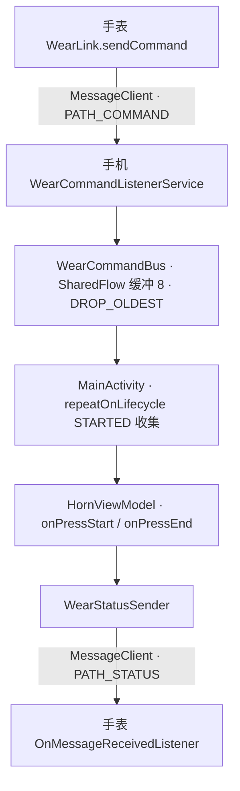
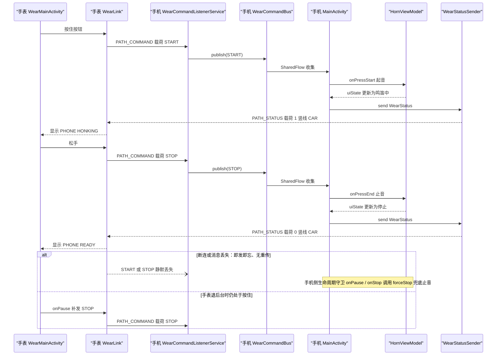

# Horn 系统规约 04：生态扩展与跨端通信协议

- 状态：Living Spec
- 日期：2026-11-22

> 关联 ADR：[ADR-0007 Wear OS MessageClient 协议](adr/ADR-0007-wear-os-message-client-protocol.md)、[ADR-0002 双音频后端](adr/ADR-0002-dual-audio-backend-oboe-and-audiotrack.md)。

## 0. 范围与效力

本规约覆盖 Horn 的三大生态出口：Android 桌面微件（Jetpack Glance）、Quick Settings Tile、Wear OS 手表遥控，以及手机与手表之间的跨端通信协议。核心音频信号链见同目录 02 号音频 DSP 规约，工程效能与 CI 门禁见 [05-dx-quality-and-ci.md](05-dx-quality-and-ci.md)。

本文使用 RFC 2119 关键词：MUST / MUST NOT / SHOULD / MAY 与必须 / 严禁 / 应当 / 可以同义。协议载荷、路径与常量以源码为唯一事实源；任何不一致 MUST 以源码为准并同步修订本文。

## 1. Jetpack Glance 桌面微件

### 1.1 组件结构

微件实现位于 `app/src/main/java/com/industrial/horn/widget/HornWidget.kt`：

- `HornWidget : GlanceAppWidget`，`sizeMode = SizeMode.Responsive(setOf(DpSize(56.dp, 56.dp), DpSize(120.dp, 120.dp)))`，即 56dp / 120dp 两档响应式尺寸；内容以 `LocalSize.current.width < 80.dp` 判定紧凑档，紧凑档仅显示 `HONK` 文本，宽档追加 `HOLD THE HORN` 副标题。
- 卡片视觉：`background(ImageProvider(R.drawable.widget_glass_bg))` + `cornerRadius(24.dp)`，圆角玻璃卡片 drawable 位于 `app/src/main/res/drawable/widget_glass_bg.xml`。
- 点击交互：整个微件区域 `clickable(actionRunCallback<WidgetHonkAction>())`。
- `WidgetHonkAction` 实现 `androidx.glance.appwidget.action.ActionCallback`，`onAction` 委托 `HornWidgetService.start(context)`；`HornWidgetReceiver : GlanceAppWidgetReceiver` 负责系统绑定。二者与 `HornWidget` 同文件定义。
- MUST NOT 在微件内直接创建音频会话：点击的所有音频行为必须经 §1.2 的前台服务路径，Glance 回调进程存活时间不可依赖。

### 1.2 WidgetHonkAction → 前台服务短鸣

`app/src/main/java/com/industrial/horn/widget/HornWidgetService.kt` 实现一次性短鸣：

- `onCreate` 立即 `startForeground(NOTIFICATION_ID, notification, ServiceInfo.FOREGROUND_SERVICE_TYPE_MEDIA_PLAYBACK)`（API ≥ Q 走类型化重载，低版本走传统重载）；通知渠道 `horn_widget`（`IMPORTANCE_LOW`），小图标 `ic_stat_horn`。
- 常量约束：`HONK_DURATION_MS = 1_200L`（短鸣 1200 ms），`NOTIFICATION_ID = 0x484F524E`。二者 MUST NOT 被静默改动；调整短鸣时长必须同步复核 Tile 复位延迟（§2）。
- `playOnce` 流程：`HornPreferencesRepositoryFactory` 读取当前音色（缺省 `HornType.CAR`）→ `HornSessionFactory.create` 建会话 → `start(type) == HornStartResult.GRANTED` 时 `delay(HONK_DURATION_MS)` 后 `stop()`。
- 并发防重入：`AtomicBoolean running` CAS；重复点击返回 `START_NOT_STICKY` 不叠加播放。结束时 `stopForeground(STOP_FOREGROUND_REMOVE)` + `stopSelf()`，通知随播放结束消失。
- 异常策略：`playOnce` 全程捕获异常并静默降级——微件点击 MUST NOT 使宿主崩溃，失败时通知直接消失。

### 1.3 微件元数据

`app/src/main/res/xml/horn_widget_info.xml` 约束：

| 属性 | 值 | 说明 |
|---|---|---|
| `targetCellWidth` / `targetCellHeight` | `1` | Android 12+ 网格占位 1×1 |
| `minWidth` / `minHeight` | `40dp` | 低版本回退尺寸 |
| `tools:targetApi` | `31` | `targetCell*` 为 API 31 语义，lint 免警 |
| `resizeMode` | `horizontal\|vertical` | 允许双向调整 |
| `updatePeriodMillis` | `0` | 纯点击触发，无轮询刷新 |
| `initialLayout` | `@layout/glance_default_loading_layout` | Glance 初始占位布局 |

### 1.4 Android 12+ 后台音频与前台服务合规

- Android 12（API 31）起后台启动受限。微件点击产生的短鸣 MUST 以前台服务承载：`app/src/main/AndroidManifest.xml` 中 `HornWidgetService` 声明 `android:foregroundServiceType="mediaPlayback"`，并声明权限 `FOREGROUND_SERVICE` 与 `FOREGROUND_SERVICE_MEDIA_PLAYBACK`（另需 `POST_NOTIFICATIONS` 以呈现前台通知）。
- 服务 MUST 在 `onCreate` 内立即 `startForeground`，以满足系统对前台服务启动时限的要求。
- 短鸣 MUST 自限于 `HONK_DURATION_MS` 并 `stopSelf`，严禁演变为常驻前台服务；`mediaPlayback` 类型是后台短时播放的合规通道，不是无限播放许可。
- 逻辑上 `WidgetHonkAction` 仅触发 `startForegroundService`；音频会话的创建与释放完全位于服务内部，与 UI 生命周期解耦。

## 2. Quick Settings Tile

实现位于 `app/src/main/java/com/industrial/horn/widget/HornTileService.kt`：

- `HornTileService : TileService`。`app/src/main/AndroidManifest.xml` 注册时 MUST 声明权限 `android.permission.BIND_QUICK_SETTINGS_TILE`，intent-filter 为 `android.service.quicksettings.action.QS_TILE`，图标 `ic_tile_horn`，标签资源 `tile_label`。
- 资源契约：`tile_label`（常态标签）、`tile_label_active`（鸣笛中标签）、`tile_subtitle`（副标题，API ≥ Q 写入 `Tile.setSubtitle`），双语见 `app/src/main/res/values/strings.xml` 与 `app/src/main/res/values-zh/strings.xml`。
- 状态机：`updateTile` 依据 `HornWidgetService.isRunning()` 写 `Tile.STATE_ACTIVE` / `Tile.STATE_INACTIVE`；`onStartListening` 时刷新一次。
- 点击路径 MUST 复用 §1.2 的前台服务：`onClick` 调 `HornWidgetService.start(this)`，随后立即置 `STATE_ACTIVE` 并把 label 切换为 `tile_label_active`，再以 `Handler.postDelayed(1_400L)` 延迟复位。1400 ms 相对 `HONK_DURATION_MS = 1_200L` 保有约 200 ms 裕量；修改短鸣时长 MUST 同步复核该值，避免 Tile 状态与播放状态错位。

## 3. 手机 ↔ 手表通信协议（关联 ADR-0007）

### 3.1 applicationId 硬约束

手机端 `app/build.gradle.kts` 与手表端 `wear/build.gradle.kts` MUST 共享同一 `applicationId = "com.industrial.horn"`。Wearable Data Layer 以 applicationId 路由消息，两端不一致将导致消息静默不可达。当前该约束由本规约与代码评审执法，尚无自动化测试（见 §6）。

### 3.2 WearProtocol 协议层

协议定义位于 `core/data/src/main/java/com/industrial/horn/data/WearProtocol.kt`，平台无关、不依赖 Google Play services：

| 项 | 值 |
|---|---|
| `PATH_COMMAND` | `/horn/command`（手表 → 手机，命令） |
| `PATH_STATUS` | `/horn/status`（手机 → 手表，状态） |
| `PATH_PREFIX` | `/horn`（manifest pathPrefix 过滤） |
| `WearCommand` | 枚举 `START`、`STOP` |
| `WearStatus` | `isHonking: Boolean` + `voice: HornType`（缺省 `HornType.CAR`） |

Payload 格式（双向均为 UTF-8 字节流）：

| 消息 | 方向 | 编码格式 | 示例 | 非法载荷 |
|---|---|---|---|---|
| 命令 | 手表 → 手机 | `WearCommand` 枚举名的 UTF-8 字节 | `START`、`STOP` | `decodeCommand` 返回 null，消息丢弃 |
| 状态 | 手机 → 手表 | `isHonking` 标志（`0` 或 `1`）、竖线 `\|`、`HornType` 枚举名 | `1` 竖线 `CAR` | 段数不等于 2 或音色名非法时 `decodeStatus` 返回 null |

约束：

- 解码 MUST NOT 抛异常：格式错误一律返回 null 由调用方丢弃（`runCatching` + `getOrNull` 语义）。
- 编解码实现（`encodeCommand` / `decodeCommand` / `encodeStatus` / `decodeStatus`）MUST 保持在 `WearProtocol` 单一对象内，严禁在 UI 或服务层手工拼接字符串。
- 新增协议字段 MUST 先扩展 `WearProtocolTest` 再改实现（§4）。

### 3.3 手表侧实现

- `wear/src/main/java/com/industrial/horn/wear/WearLink.kt`：`sendCommand` 经 `Wearable.getNodeClient(context).connectedNodes` 枚举已连接节点后用 `Wearable.getMessageClient(context).sendMessage(node.id, WearProtocol.PATH_COMMAND, payload)` 扇出；整体 `runCatching` 兜底返回 Boolean。`registerStatusListener` / `unregisterStatusListener` 以 `runCatching` 包装 `MessageClient` 监听器注册与注销。
- `wear/src/main/java/com/industrial/horn/wear/WearMainActivity.kt`：
  - 手势：`awaitEachGesture` 中 `awaitFirstDown` 触发按住（`localHolding = true` + `sendCommand(START)`），`waitForUpOrCancellation` 的 `finally` 块保证任何抬手/取消路径均发 `STOP`。
  - 防卡音兜底：`onPause` 在仍处于按住状态时补发 `STOP`，随后注销状态监听。
  - 状态接收：`MessageClient.OnMessageReceivedListener` 过滤 `PATH_STATUS`，`decodeStatus` 成功后刷新显示（`PHONE HONKING` / `PHONE READY` / 未配对时 `PAIR YOUR PHONE`）。
- 手表为配套设备：`wear/src/main/AndroidManifest.xml` 声明 `com.google.android.wearable.standalone = false`，即手表端依赖配对手机完成鸣笛。

### 3.4 手机侧实现

命令流水线：

- `app/src/main/java/com/industrial/horn/wear/WearCommandListenerService.kt`：`WearableListenerService.onMessageReceived` 过滤 `path == WearProtocol.PATH_COMMAND`，`decodeCommand` 成功后 `WearCommandBus.publish(command)`。
- `app/src/main/java/com/industrial/horn/wear/WearCommandBus.kt`：进程内交接总线，`MutableSharedFlow(extraBufferCapacity = 8, onBufferOverflow = BufferOverflow.DROP_OLDEST)`，`tryEmit` 发布。8 缓冲 + 丢最旧保证突发命令不阻塞监听服务。
- `app/src/main/java/com/industrial/horn/MainActivity.kt`：`lifecycleScope.launch { repeatOnLifecycle(Lifecycle.State.STARTED) { WearCommandBus.commands.collect { ... } } }`，`START` 驱动 `HornViewModel.onPressStart()`，`STOP` 驱动 `onPressEnd()`。命令 MUST 仅在 UI STARTED 时生效，使后台音频策略可预测。
- `app/src/main/java/com/industrial/horn/wear/WearStatusSender.kt`：best-effort 回传。`MainActivity` 在 uiState 变化时（`LaunchedEffect`）构造 `WearStatus(isHonking, voice)` 交 `WearStatusSender.send`，内部在 IO 协程经 `NodeClient.connectedNodes` + `MessageClient.sendMessage(node.id, WearProtocol.PATH_STATUS, payload)` 扇出。
- 清单契约：`app/src/main/AndroidManifest.xml` 中 `WearCommandListenerService` 的 intent-filter MUST 为 `com.google.android.gms.wearable.MESSAGE_RECEIVED` + `android:pathPrefix="/horn"`（scheme `wear`，host `*`），与 `WearProtocol.PATH_PREFIX` 保持一致。

### 3.5 时序规约与容错语义

语义约束：

- 即发即忘（fire-and-forget）：`MessageClient` 无 ACK、无重传、无持久化队列。协议 MUST NOT 自行实现重试，重试与时序歧义的代价高于丢包（ADR-0007）。
- 超时语义：协议层不存在超时重试。手表等待 `PATH_STATUS` 超时仅降级显示 `PAIR YOUR PHONE`；真正的防卡音权威是手机侧生命周期守卫（`MainActivity.onPause` / `onStop` → `HornViewModel.onHostPause` / `onHostStop` → `forceStop`），不是协议层超时。
- 状态回传是 best-effort 指示，MUST NOT 作为权威状态；手表显示可能滞后或缺失。

## 4. 离线可测试传输层抽象

协议编解码置于 `core:data` 的直接收益是可脱 Google Play services 单测。`core/data/src/test/java/com/industrial/horn/data/WearProtocolTest.kt` 为纯 JUnit 测试，覆盖三条契约：

| 用例 | 断言 |
|---|---|
| `commandsRoundTrip` | 命令枚举名 UTF-8 编解码往返一致 |
| `statusRoundTripsEveryVoice` | 全部 `HornType` 状态往返一致 |
| `malformedStatusIsRejected` | 畸形载荷返回 null 而非抛异常 |

约束：`WearProtocol` MUST NOT 引入 Android / GMS 依赖，否则该测试集失去离线意义。测试随 `./gradlew :core:data:testDebugUnitTest`（或全量 `./gradlew testDebugUnitTest`）执行。

## 5. 非目标（Non-Goals）

- 不做独立手表应用：手表端 MUST NOT 承担本地鸣笛，`standalone = false`，依赖配对手机。
- 不做 `DataClient` 状态同步：ADR-0007 已否决 `putDataItem` 路线，命令与时序一律走 `MessageClient`。
- 不做命令重传、ACK、会话恢复与断点续鸣。
- 不做微件长按持续发声：Glance 后端为 RemoteViews，不提供按住/滑动连续手势（见 §6）。
- 不做多节点路由策略：`connectedNodes` 全量扇出，不做目标节点选择。
- 不做 Tile 与微件之间的跨设备状态同步；`Tile.STATE_*` 仅反映本机 `HornWidgetService.isRunning()`。

## 6. 已知局限与权衡（Known Limitations / Trade-offs）

- 依赖配对手机与 Play services：Wearable Data Layer 在无 GMS 设备上不可用；`WearLink` 的 `runCatching` 兜底只保证不崩溃，不保证送达。
- `MessageClient` 不保证送达：断连即丢消息，无重传。权衡结果是接受偶发丢包，换取低延迟与清晰时序；安全侧由生命周期守卫兜底。
- Glance 受 RemoteViews 限制：无法实现长按持续发声，微件为 1200 ms 短鸣语义；连续表达交互 MUST 在主 App 内完成。
- 状态回传滞后：`PHONE HONKING` / `PHONE READY` 为 best-effort 指示，可能滞后真实状态。
- `applicationId` 一致性无自动化执法，仅靠本规约与代码评审。
- `WearCommandBus` 为进程内单例：若监听服务与 Activity 位于不同进程（当前并非如此），命令将丢失；进程模型变更 MUST 重新评估该交接点。
- 短鸣时长、Tile 复位延迟（1400 ms）是两处手工对齐的常量，MUST 成对修改。

## 7. 源码锚点

- 微件与动作：`app/src/main/java/com/industrial/horn/widget/HornWidget.kt`
- 前台服务：`app/src/main/java/com/industrial/horn/widget/HornWidgetService.kt`
- Quick Settings Tile：`app/src/main/java/com/industrial/horn/widget/HornTileService.kt`
- 微件元数据：`app/src/main/res/xml/horn_widget_info.xml`
- 微件背景 drawable：`app/src/main/res/drawable/widget_glass_bg.xml`
- 协议层：`core/data/src/main/java/com/industrial/horn/data/WearProtocol.kt`
- 协议单测：`core/data/src/test/java/com/industrial/horn/data/WearProtocolTest.kt`
- 手表通道封装：`wear/src/main/java/com/industrial/horn/wear/WearLink.kt`
- 手表界面：`wear/src/main/java/com/industrial/horn/wear/WearMainActivity.kt`
- 手机命令监听：`app/src/main/java/com/industrial/horn/wear/WearCommandListenerService.kt`
- 手机命令总线：`app/src/main/java/com/industrial/horn/wear/WearCommandBus.kt`
- 手机状态回传：`app/src/main/java/com/industrial/horn/wear/WearStatusSender.kt`
- 宿主 Activity：`app/src/main/java/com/industrial/horn/MainActivity.kt`
- 手机清单：`app/src/main/AndroidManifest.xml`
- 手表清单：`wear/src/main/AndroidManifest.xml`
- 手机构建脚本：`app/build.gradle.kts`
- 手表构建脚本：`wear/build.gradle.kts`
- 字符串资源：`app/src/main/res/values/strings.xml`、`app/src/main/res/values-zh/strings.xml`
