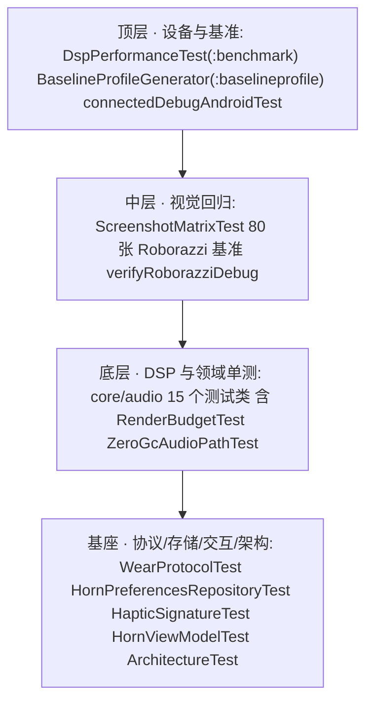

# Horn 系统规约 05：工程效能、测试金字塔与 CI/CD

- 状态：Living Spec
- 日期：2026-11-22

> 关联 ADR：[ADR-0005 编译期 Debug/Release 隔离](adr/ADR-0005-compile-time-debug-release-isolation.md)、[ADR-0006 Roborazzi 视觉回归](adr/ADR-0006-roborazzi-headless-visual-regression.md)、[ADR-0003 多模块与 Konsist](adr/ADR-0003-multi-module-build-logic-and-konsist.md)。

## 0. 范围与效力

本规约定义 Horn 的工程效能契约：Debug/Release 编译期隔离、质量门禁矩阵、Baseline Profiles、R8 混淆、测试金字塔与 GitHub Actions CI/CD。跨端协议见 [04-ecosystem-and-protocols.md](04-ecosystem-and-protocols.md)。

本文使用 RFC 2119 关键词：MUST / MUST NOT / SHOULD / MAY 与必须 / 严禁 / 应当 / 可以同义。所有工具版本以 `gradle/libs.versions.toml` 与根构建脚本为唯一事实源；版本变更 MUST 同步修订本文的门禁矩阵。

## 1. Debug/Release 编译期隔离（关联 ADR-0005）

### 1.1 同名 API 双实现

DSP 调试浮层以同名 Composable API `DebugAudioOverlayHost`（签名 `accent: Color`、`telemetry: AudioTelemetry`、`readWaveform: (FloatArray) -> Int`、`modifier`）在两个源码集提供实现，使主源码集调用处零分支：

| 源码集 | 文件 | 行为 |
|---|---|---|
| `src/debug` | `feature/horn/src/debug/java/com/industrial/horn/ui/DebugAudioOverlay.kt` | 真实 DSP HUD |
| `src/release` | `feature/horn/src/release/java/com/industrial/horn/ui/DebugAudioOverlay.kt` | NoOp 空实现 |

Debug 实现的硬约束：

- 遥测展示 MUST 来自真实 `AudioTelemetry`（`engineName`、`rms`、`latencyMs`、`xrunCount`、`renderTimeMicros`、`isPlaying`），严禁合成装饰数据。
- 示波器 MUST 消费真实波形环形缓冲：`FloatArray(256)` 采样，`LaunchedEffect` 以 33 ms 周期调用 `readWaveform(scratch)` 拉取并拷贝渲染，MUST NOT 伪造波形。
- 测试锚点 MUST 稳定：容器 `testTag("debug_audio_overlay")`，展开按钮 `testTag("debug_overlay_toggle")`。
- 数值行 MUST 使用等宽数字：`fontFeatureSettings = AppleNumbers.TABULAR`（`"tnum"`，定义见 `core/designsystem/src/main/java/com/industrial/horn/ui/theme/AppleMotion.kt`），防止数值刷新跳动。

Release 实现 MUST 为空实现：不引入状态、不消费遥测、不分配内存，保证调试面在编译期即从 release 产物中消失（系统不变量 I6）。

### 1.2 buildConfig=false

约定插件 MUST 统一关闭 BuildConfig 生成，杜绝以 `BuildConfig.DEBUG` 之类的运行时分支绕开源码集隔离：

- `build-logic/convention/src/main/kotlin/horn.android.application.gradle.kts`
- `build-logic/convention/src/main/kotlin/horn.android.library.gradle.kts`
- `build-logic/convention/src/main/kotlin/horn.android.wear.gradle.kts`

以上文件均含 `buildFeatures.buildConfig = false`。新增模块 MUST 复用上述约定插件，严禁在模块构建脚本内重开 buildConfig。

## 2. 质量门禁矩阵

| 门禁 | 工具/版本 | 命令 | 卡点 |
|---|---|---|---|
| 格式与排版 | Spotless 8.9.0 + ktlint 1.8.0 | `./gradlew spotlessApply`（本地）/ `./gradlew spotlessCheck`（CI） | CI `static-analysis` job 失败即拒合 |
| Kotlin 静态分析 | Detekt 1.23.8 | `./gradlew detekt` | `buildUponDefaultConfig` + `config/detekt/detekt.yml`，`jvmTarget = 17`，违规即红 |
| Android Lint | AGP Lint（`app/lint.xml`） | `./gradlew lintDebug` | `abortOnError = true`、`warningsAsErrors = true` |
| 架构约束 | Konsist 0.17.3 | `./gradlew :app:testDebugUnitTest`（ArchitectureTest） | 4 条规则任一违反即红 |
| DSP 声学/性能断言 | JUnit 4（JVM） | `./gradlew :core:audio:testDebugUnitTest` | 15 个测试类；渲染预算与零分配断言 |
| 视觉回归 | Roborazzi 1.79.0 + Robolectric 4.18.1 | `./gradlew verifyRoborazziDebug` / `./gradlew recordRoborazziDebug` | 80 张基准逐像素一致 |
| DSP 性能基准 | `:benchmark` DspPerformanceTest | `./gradlew :benchmark:assembleBenchmark` + `./gradlew testDebugUnitTest` | 五音色渲染显著快于实时 |

### 2.1 Spotless + ktlint

根 `build.gradle.kts` 配置三类目标：

- `kotlin`：`target("**/*.kt")`，ktlint 1.8.0；
- `kotlinGradle`：`target("**/*.gradle.kts")`，ktlint 1.8.0；
- `format("misc")`：`target("**/*.md", "**/*.yml", "**/*.yaml", "**/*.xml", "**/*.toml", "**/*.pro")`，仅做 `trimTrailingWhitespace()` + `endWithNewline()`。

三类目标均排除 `**/build/**` 与 `**/.gradle/**`。本 Markdown 文档同样受 misc 目标约束：UTF-8 无 BOM、LF 换行、无行尾空格、文件末尾恰好一个换行；违反者 MUST 由 `spotlessApply` 修复后才允许提交。

### 2.2 Detekt

`subprojects` 统一应用 Detekt 1.23.8：`buildUponDefaultConfig = true`，配置文件 `config/detekt/detekt.yml`，源码范围覆盖 `src/main|test|androidTest` 的 java/kotlin 目录，`Detekt` 任务 `jvmTarget = "17"`，报告输出 html/xml/txt。架构级约束不进 Detekt，由 Konsist 执法（§2.4）。

### 2.3 Android Lint

模块级 lint 约定（约定插件 `build-logic/convention/src/main/kotlin/horn.android.application.gradle.kts` / `build-logic/convention/src/main/kotlin/horn.android.library.gradle.kts`）设置 `abortOnError = true`、`warningsAsErrors = true`；`app/build.gradle.kts` 额外指定 `lintConfig = file("lint.xml")`，即 `app/lint.xml`。

### 2.4 Konsist 架构测试

`app/src/test/java/com/industrial/horn/architecture/ArchitectureTest.kt` 固化 4 条规则，随 `:app:testDebugUnitTest` 执行：

1. `feature:horn` 与 `core:designsystem` 的 import 严禁以 `android.media.` 开头；
2. `core:audio` 的 import 严禁以 `androidx.compose.` 开头；
3. 所有 `*ViewModel` 类必须位于 `..presentation..` 包；
4. `core:audio` 严禁出现顶层 `var` 属性。

新增架构约束 MUST 以测试形式加入，严禁只写进文档。

### 2.5 DSP 声学/性能断言

`core/audio/src/test/java/com/industrial/horn/audio/` 下共 15 个测试类（另有测量工具对象 `core/audio/src/test/java/com/industrial/horn/audio/DspMeasurement.kt`，不计入），重点锚点：

- `core/audio/src/test/java/com/industrial/horn/audio/RenderBudgetTest.kt`：`FRAMES_PER_BLOCK = 128`、`REALTIME_BUDGET_MILLIS = 2.66`——128 帧 @ 48 kHz 的硬截止预算为 2.66 ms，JVM 平均渲染耗时 MUST 低于该预算。
- `core/audio/src/test/java/com/industrial/horn/audio/ZeroGcAudioPathTest.kt`：以 `ThreadMXBean.getCurrentThreadAllocatedBytes` 审计实时渲染路径，多块稳态渲染分配 MUST 低于 64 KB 预算（回归即红）。
- 其余覆盖包络（`AttackReleaseEnvelopeTest`）、安全策略（`AudioSafetyPolicyTest`）、遥测缓冲（`AudioTelemetryBufferTest`）、五音色合成（`DualToneHornSynthTest`、`TrainHornSynthTest`、`EBikeHornSynthTest`、`MotorcycleHornSynthTest`、`CustomHornSynthTest`）、渲染器（`HornRendererTest`、`PcmRendererTest`）、混响（`SpatialReverbTest`）、合成器契约（`HornSynthesizerContractTest`）与 `HornTypeTest`。

`:benchmark` 模块的 `benchmark/src/test/java/com/industrial/horn/benchmark/DspPerformanceTest.kt` 断言十秒五音色音频渲染显著快于实时（`tenSecondsOfFiveVoiceAudioRendersManyTimesFasterThanRealTime`），随全量 `./gradlew testDebugUnitTest` 执行；`./gradlew :benchmark:assembleBenchmark` 提供专用 benchmark 构建产物。

### 2.6 视觉回归（Roborazzi + Robolectric）

`app/src/test/java/com/industrial/horn/ui/ScreenshotMatrixTest.kt` 的矩阵契约：

- 维度：5 音色（`HornType` 全枚举）× 2 主题（dark/light）× 2 语言（en/zh）× 2 字号（1.0 / 1.35）× 2 布局（compact `w360dp-h800dp-xhdpi` / expanded `w840dp-h800dp-xhdpi`）= 80 张基准。
- 运行器：`RobolectricTestRunner` + `@Config(sdk = [35])` + `@GraphicsMode(GraphicsMode.Mode.NATIVE)`，`captureRoboImage` 写入 `app/src/test/screenshots/`，命名 `{voice}_{dark|light}_{en|zh}_{font1_0|font1_35}_{compact|expanded}.png`。
- 任务语义：`./gradlew recordRoborazziDebug` 录制基准；`./gradlew verifyRoborazziDebug` 逐像素验证。
- 跨平台约束：字体光栅化在 Windows 与 Linux 存在像素级差异，基准 MUST 以 Linux 渲染为准；重录 MUST 通过 `.github/workflows/update-screenshots.yml` 在 Linux 执行（§5.3）。Windows 本地录制的基准严禁直接入库。

## 3. Baseline Profiles

- 内置规则：`app/src/main/baseline-prof.txt` 随 APK 分发，安装期由 profileinstaller 消费。
- 依赖：`androidx.profileinstaller 1.4.1`（版本源 `gradle/libs.versions.toml`，装配见 `app/build.gradle.kts` 的 `implementation(libs.androidx.profileinstaller)`）。
- 生成模块：`:baselineprofile`（`baselineprofile/build.gradle.kts`）使用 `com.android.test` 插件、`targetProjectPath = ":app"`、`experimentalProperties["android.experimental.self-instrumenting"] = true`，即自插桩针对 `:app` 采集。
- 生成器：`baselineprofile/src/main/java/com/industrial/horn/baselineprofile/BaselineProfileGenerator.kt` 的 `generateHornStartupProfile` 以 `BaselineProfileRule.collect(packageName = "com.industrial.horn", includeInStartupProfile = true)` 覆盖冷启动路径（pressHome → startActivityAndWait → 等待主界面文本 → waitForIdle）。
- 执行约束：生成 MUST 在连接真机/模拟器上执行（`connectedAndroidTest` 语境），不在 CI 内自动化（见 §8）。

## 4. Release R8 混淆与保活

Release 构建 MUST 开启代码与资源压缩：`app/build.gradle.kts` 的 release 构建型设置 `isMinifyEnabled = true`、`isShrinkResources = true`，规则文件为 `getDefaultProguardFile("proguard-android-optimize.txt")` + `app/proguard-rules.pro`。

`app/proguard-rules.pro` 的契约：

```text
# 入口与 JNI 保活
-keep class com.industrial.horn.MainActivity { *; }
-keep class com.industrial.horn.HornApplication { *; }
-keep class com.industrial.horn.audio.OboeHornAudioEngine { *; }
-keepclasseswithmembernames,includedescriptorclasses class * {
    native <methods>;
}

# Release 日志剥除：v / d / i 三级
-assumenosideeffects class android.util.Log {
    public static *** v(...);
    public static *** d(...);
    public static *** i(...);
}

# 可读堆栈：保留源文件与行号
-keepattributes SourceFile,LineNumberTable,*Annotation*,Signature,InnerClasses
-renamesourcefileattribute SourceFile
```

约束：

- `MainActivity`、`HornApplication`、`OboeHornAudioEngine` MUST 保活：前两者是清单入口，后者是 JNI 桥，Oboe 原生入口的符号必须稳定。
- `keepclasseswithmembernames` 保活全部 native 方法声明。
- `Log.v/d/i` MUST 剥除以杜绝 release 日志泄露；`Log.w/e` 保留用于故障定位。
- `SourceFile` / `LineNumberTable` MUST 保留，保证线上堆栈可映射。

## 5. GitHub Actions CI/CD

### 5.1 ci.yml

`.github/workflows/ci.yml` 触发于 push（main、develop）、pull_request 与 workflow_dispatch；`permissions: contents: read`；非 main 分支的过期运行会被 concurrency 取消。公共环境：JDK 21（temurin）、`android-actions/setup-android@v3` + 固定 NDK 27.0.12077973 与 CMake 3.22.1、`gradle/actions/setup-gradle@v4`、`GRADLE_OPTS: -Dorg.gradle.daemon=false`。

| job id | 显示名 | 核心命令 | 失败/产物行为 |
|---|---|---|---|
| `static-analysis` | Code Quality Gate | `./gradlew spotlessCheck detekt lintDebug` | 失败上传 `quality-reports`（detekt/lint 报告，7 天） |
| `unit-and-arch-tests` | Unit & Architecture Tests | `./gradlew testDebugUnitTest` | `always()` 上传 `unit-test-reports` |
| `visual-regression` | Visual Regression Tests | `./gradlew verifyRoborazziDebug` | 失败写 `$GITHUB_STEP_SUMMARY` 指引并上传 `roborazzi-diffs` |
| `release-build-and-size` | Release R8 Build & APK Size Report | `./gradlew :app:assembleRelease :wear:assembleRelease` | `$GITHUB_STEP_SUMMARY` 输出 APK 体积表；上传 `release-apks`（5 天） |
| `docs-integrity` | Docs Link Integrity | `python .github/scripts/check_docs_links.py` | 死链/幽灵路径非零退出即红 |
| `ci-gate` | ci-gate（聚合门禁） | 汇总上述 5 个 job 结果 | `if: always()`；任一前置非 success 即失败 |

说明：

- 五个检查 job 并行运行；`ci-gate` 聚合门禁 `needs` 全部五个 job 并以 `if: always()` 汇总——分支保护 MUST 仅配置 `ci-gate` 一个必过检查项（见 §8）。
- `docs-integrity` 校验所有 README 与 `docs/**/*.md` 的相对链接及反引号源码路径必须真实存在，本文档全部锚点均受其执法。
- 视觉回归失败时的处置流程 MUST 为：确认改动是否为有意变更 → 以 `.github/workflows/update-screenshots.yml` 在 Linux 重录基准 → 提交刷新后的基准，严禁在本地（Windows）录制基准混入。

### 5.2 release.yml

`.github/workflows/release.yml` 触发于 tag `v*.*.*` 与 workflow_dispatch，单 job `release`（Build, Sign & Publish）：

1. 全量验证门：`./gradlew spotlessCheck detekt testDebugUnitTest`；
2. 构建：`./gradlew :app:assembleRelease :wear:assembleRelease`；
3. 签名优雅降级：Secret `ANDROID_KEYSTORE_BASE64` 存在时解码为 `release.jks` 并标记 `signed=true`；缺失时 MUST NOT 失败，标记 `signed=false` 并在 `$GITHUB_STEP_SUMMARY` 声明未签名发布；
4. 暂存 APK 至 `dist/` 并生成 checksums.txt（sha256 校验和），经 `softprops/action-gh-release@v2` 发布，正文按 `signed` 标记标注签名状态。

### 5.3 pr-hygiene.yml 与 update-screenshots.yml

- `.github/workflows/pr-hygiene.yml`：`title-check` 以 `amannn/action-semantic-pull-request@v5` 校验 Conventional Commits 标题（types：feat/fix/perf/refactor/ui/audio/docs/test/build/ci/chore）；`label` 以 `actions/labeler@v5`（配置 `.github/labeler.yml`，`sync-labels: true`)自动打标。
- `.github/workflows/update-screenshots.yml`：workflow_dispatch 手动触发（可选 ref），job `record`（Record Linux Baselines）在 ubuntu-latest 运行 `./gradlew recordRoborazziDebug`，上传 `roborazzi-baselines-linux` 产物（14 天），维护者下载覆盖 `app/src/test/screenshots/` 后本地 `verifyRoborazziDebug` 复核再提交。该流程是跨平台字体差异的唯一合法基准刷新通道。

## 6. 测试金字塔



层级职责：

- 基座与底层（JVM 毫秒级，`testDebugUnitTest`）：协议编解码、DataStore 偏好、触觉指纹、ViewModel 交互、Konsist 架构规则、DSP 声学与预算断言。数量最大、反馈最快，是 PR 门禁的主力。
- 中层（JVM 秒级，`verifyRoborazziDebug`）：80 组合视觉矩阵逐像素回归，捕获主题/语言/字号/布局维度的渲染回归。
- 顶层（设备分钟级，本地执行）：`:benchmark` DSP 性能基准、`:baselineprofile` 冷启动基线、`connectedDebugAndroidTest` 设备交互验证。它们需要真机/模拟器，不在 CI 内运行。

## 7. 非目标（Non-Goals）

- 不在 CI 内运行 `connectedAndroidTest`、模拟器或真机测试；设备级验证为本地/手工流程（`docs/VERIFICATION.md` 保留执行记录）。
- 不引入代码覆盖率卡点（无 JaCoCo 门禁）。
- 不做自动合并：CI 全绿后仍由人工评审合并。
- 不做 nightly 长稳/monkey 测试与性能趋势监控服务。
- 不支持 Windows 本地录制视觉基准作为入库来源（见 §2.6）。
- 不做多 JDK 矩阵构建；CI 固定 JDK 21。

## 8. 已知局限与权衡（Known Limitations / Trade-offs）

- Roborazzi 跨平台字体差异：字体光栅化随操作系统变化，Windows 本地与 Linux CI 渲染不逐像素一致。权衡结果是基准一律 Linux 录制（`.github/workflows/update-screenshots.yml`），代价是基准刷新需走手动工作流。
- `connectedAndroidTest` 需真机/模拟器，CI 仅覆盖 JVM 测试；设备独有行为（音频路由、触觉、生命周期）的回归依赖本地执行记录。
- `RenderBudgetTest` / `ZeroGcAudioPathTest` 在 JVM 上测量，反映相对预算而非真机实时线程行为；真机 xrun 与延迟以运行时遥测为准。
- R8 断言缺失：`app/proguard-rules.pro` 的正确性目前由 release 构建成功与人工抽查验证，无 mapping 自动比对测试。
- 签名链路为预留：当前构建脚本未配置 AGP signingConfig，`.github/workflows/release.yml` 解码的 keystore 尚未被构建消费，发布产物实为未签名 APK；Secrets 就绪后 MUST 补齐 signingConfig 并复核发布产物。
- 分支保护若未绑定 `ci-gate` 而逐个绑定 5 个 job id，漏配单个 job 会留出绕过窗口；推荐只绑 `ci-gate`。
- Baseline Profile 无 CI 自动生成：`generateHornStartupProfile` 需手工在设备上跑，规则文件可能滞后于 UI 结构变化。
- 质量门禁并行运行，无统一失败归因；`static-analysis` 与 `release-build-and-size` 的 NDK/CMake 安装重复，冷启动耗时高于必要下限。

## 9. 源码锚点

- Debug 源码集实现：`feature/horn/src/debug/java/com/industrial/horn/ui/DebugAudioOverlay.kt`
- Release NoOp 实现：`feature/horn/src/release/java/com/industrial/horn/ui/DebugAudioOverlay.kt`
- tnum 常量：`core/designsystem/src/main/java/com/industrial/horn/ui/theme/AppleMotion.kt`
- 约定插件：`build-logic/convention/src/main/kotlin/horn.android.application.gradle.kts`、`build-logic/convention/src/main/kotlin/horn.android.library.gradle.kts`、`build-logic/convention/src/main/kotlin/horn.android.wear.gradle.kts`
- 根构建脚本（Spotless/Detekt）：`build.gradle.kts`
- 版本目录：`gradle/libs.versions.toml`
- Detekt 配置：`config/detekt/detekt.yml`
- Lint 配置：`app/lint.xml`
- 架构测试：`app/src/test/java/com/industrial/horn/architecture/ArchitectureTest.kt`
- 视觉矩阵测试：`app/src/test/java/com/industrial/horn/ui/ScreenshotMatrixTest.kt`
- 视觉基准目录：`app/src/test/screenshots`
- DSP 测试目录：`core/audio/src/test/java/com/industrial/horn/audio`
- 协议单测：`core/data/src/test/java/com/industrial/horn/data/WearProtocolTest.kt`
- DSP 性能基准：`benchmark/src/test/java/com/industrial/horn/benchmark/DspPerformanceTest.kt`
- 基线生成器：`baselineprofile/src/main/java/com/industrial/horn/baselineprofile/BaselineProfileGenerator.kt`
- 基线模块脚本：`baselineprofile/build.gradle.kts`
- 内置基线规则：`app/src/main/baseline-prof.txt`
- R8 规则：`app/proguard-rules.pro`
- 应用构建脚本：`app/build.gradle.kts`
- CI 工作流：`.github/workflows/ci.yml`
- 发布工作流：`.github/workflows/release.yml`
- PR 工作流：`.github/workflows/pr-hygiene.yml`
- 基准重录工作流：`.github/workflows/update-screenshots.yml`
- 文档链路检查器：`.github/scripts/check_docs_links.py`
- 本地验收记录：`docs/VERIFICATION.md`
