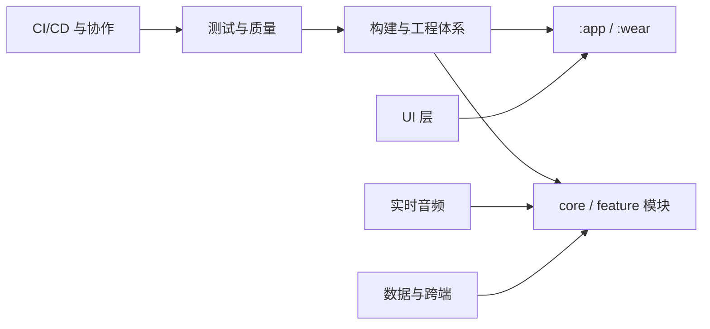

# 06 · 关键技术全景（Key Technologies）

- 状态：Living Spec
- 日期：2026-11-22

> 本文是 Horn 工程的**技术选型总账**：按域记录全项目开发中使用的每一项关键技术、其版本、用途、
> 选型权衡与源码锚点。本文不引入新契约，也不修改任何不变量；一切裁决以
> [01](01-system-architecture.md)~[05](05-dx-quality-and-ci.md) 规约、
> [research/00 冻结契约](research/00-stereo-pipeline-contract.md) 与 [adr/](adr/) 为准。
> 版本号以 `gradle/libs.versions.toml` 与 CI 工作流为唯一真源；本文与之不一致时以实况为准并回改本文。

技术域与承载模块的对应关系：

## 1. 构建与工程体系

| 技术/工具 | 版本 | 在本项目中的用途 | 选型理由/权衡 | 源码锚点 |
|---|---|---|---|---|
| Gradle Wrapper | 8.13 | 全仓库构建编排；`checkAll` 聚合任务宿主 | Wrapper 锁版本保证全员/CI 构建一致；代价是升级需显式 PR | `gradle/wrapper/gradle-wrapper.properties`、`build.gradle.kts` |
| Android Gradle Plugin（AGP） | 8.13.2 | Android 应用/库/Wear 三类模块构建、R8、Lint、Baseline Profile | 与 Gradle 8.13、Kotlin 2.2.21 处于同一验证过的兼容矩阵 | `gradle/libs.versions.toml` |
| Kotlin | 2.2.21 | 全部 JVM/Android 源码语言；Compose Compiler 插件随语言版本分发 | K2 编译器与 Compose 稳定组合；`allWarningsAsErrors` 要求语言版本收敛 | `gradle/libs.versions.toml` |
| Version Catalog | Gradle 内建 | 依赖与插件版本单一真源（`libs.versions.toml`） | 集中升级、可被 Dependabot 识别并分组；代价是别名变更需全仓同步 | `gradle/libs.versions.toml` |
| build-logic 复合构建 | Gradle 内建 | `includeBuild("build-logic")` 承载约定插件，与业务构建隔离 | 约定插件可独立编译缓存、避免根脚本膨胀 | `settings.gradle.kts` |
| Convention Plugins ×4 | 本仓库自研 | `horn.android.application` / `horn.android.library` / `horn.android.compose` / `horn.android.wear` 统一 compileSdk 36、minSdk 26（Wear 30）、JVM 17、告警即错 | 一处修改全模块生效；比 buildSrc 更利于配置缓存 | `build-logic/convention/src/main/kotlin/horn.android.application.gradle.kts`、`build-logic/convention/src/main/kotlin/horn.android.library.gradle.kts`、`build-logic/convention/src/main/kotlin/horn.android.compose.gradle.kts`、`build-logic/convention/src/main/kotlin/horn.android.wear.gradle.kts` |
| Konsist | 0.17.3 | 4 条架构守护测试（依赖方向、包归属、顶层可变态禁令） | 把架构约束写成可执行测试，比文档约定更硬 | `app/src/test/java/com/industrial/horn/architecture/ArchitectureTest.kt` |
| Spotless + ktlint | 8.9.0 / 1.8.0 | `spotlessCheck` 格式门禁（Kotlin 与 Kotlin DSL 两套规则） | 格式零争论、本地与 CI 同一命令；ktlint 版本与 Spotless 显式钉死 | `build.gradle.kts` |
| Detekt | 1.23.8 | 静态分析（复杂度/异味/潜在缺陷），配置收敛于 detekt.yml | Kotlin 生态事实标准，规则可按项目裁剪 | `build.gradle.kts`、`config/detekt/detekt.yml` |
| Android Lint | AGP 内建 | 平台 API 误用检查；`warningsAsErrors` + `checkReleaseBuilds` 全量严格 | 只有它懂 Android 语义（API 级别、权限、无障碍） | `app/lint.xml` |
| JDK / JVM target | CI Temurin 21 / target 17 | CI 构建用 JDK 21，字节码目标 JVM 17 | AGP 8.13 要求 JDK 17+；CI 取 LTS 21 兼顾构建性能 | `build-logic/convention/src/main/kotlin/horn.android.application.gradle.kts`、`.github/workflows/ci.yml` |

## 2. UI 层

| 技术/工具 | 版本 | 在本项目中的用途 | 选型理由/权衡 | 源码锚点 |
|---|---|---|---|---|
| Jetpack Compose | BOM 2025.06.01 | 手机端与 Wear OS 全部 UI | 声明式单代码库；BOM 统一 Compose 家族版本避免矩阵漂移 | `gradle/libs.versions.toml` |
| Material 3 | BOM 2025.06.01 | 基础组件与主题骨架（在 Apple Glass Token 之下） | 成熟可访问性基线；视觉层被自研设计系统覆盖 | `core/designsystem/src/main/java/com/industrial/horn/ui/theme/Theme.kt` |
| WindowSizeClass | material3-window-size-class | compact/expanded 双布局断点（360dp / 840dp 视觉基准） | 断点驱动而非机型硬编码，折叠屏/平板自动受益 | `app/src/main/java/com/industrial/horn/MainActivity.kt` |
| Apple Glass 设计系统（AppleGlassSurface 三层玻璃） | 自研 | 霜面 + 1.5% 微颗粒 + 定向高光三层玻璃质感 | iOS 级质感须自绘；三层可分别降级 | `core/designsystem/src/main/java/com/industrial/horn/ui/theme/AppleGlass.kt` |
| AGSL RuntimeShader | Android API 33+ | 玻璃边缘折射与金属光场（Audio Aura） | GPU 逐像素质感，渲染成本恒定；能力探测失败自动降级 | `core/designsystem/src/main/java/com/industrial/horn/ui/theme/AppleGlass.kt`、`core/designsystem/src/main/java/com/industrial/horn/ui/theme/AudioAura.kt` |
| RenderEffect 背景虚化 | Android API 31+ | backdrop blur 真背景虚化（自模糊不可替代） | API 31+ 平台原生；31 以下降级为渐变高光 | `core/designsystem/src/main/java/com/industrial/horn/ui/theme/AppleGlass.kt`、`feature/horn/src/main/java/com/industrial/horn/ui/HornScreen.kt` |
| 微颗粒抗色带 | 自研 | 固定种子 LCG 生成 1.5% 确定性微颗粒 | 消除 8-bit 渐变色带，同时保证 Roborazzi 截图字节稳定 | `core/designsystem/src/main/java/com/industrial/horn/ui/theme/AppleGlass.kt` |
| AppleMotion 弹簧物理 | 自研（Compose spring 体系） | 全局动效预设（按压缩放、滑移、切换） | 统一物理参数，手感一致；比关键帧动画更耐打断 | `core/designsystem/src/main/java/com/industrial/horn/ui/theme/AppleMotion.kt` |
| 延迟读取零重组（Deferred Read） | Compose graphicsLayer / drawWithCache | RMS 包络、按压缩放、气压位移等高频视觉状态只重绘不重组 | 重组风暴是帧率杀手；延迟读取把状态变化限制在 draw 阶段（不变量 I7） | `feature/horn/src/main/java/com/industrial/horn/ui/HornVisuals.kt`、`feature/horn/src/main/java/com/industrial/horn/ui/HornScreen.kt` |
| derivedStateOf 帧率治理 | Compose runtime | 环境光网格相位量化（约 18.75 effective fps 才失效重绘） | 连续动画量化为离散档位，静止画面零无效化 | `core/designsystem/src/main/java/com/industrial/horn/ui/theme/AmbientMeshBackground.kt` |
| Glance 微件 | 1.1.1 | 桌面微件一键短鸣 | Compose 式 API 但运行于 RemoteViews，开发体验统一 | `app/src/main/java/com/industrial/horn/widget/HornWidget.kt` |
| TileService | 平台 API | Quick Settings Tile 快捷开关 | 系统级入口、免解锁路径 | `app/src/main/java/com/industrial/horn/widget/HornTileService.kt` |
| Wear OS Compose | BOM 2025.06.01 | 手表端遥控 UI | 与手机共享 Compose 技能栈与主题 Token | `wear/src/main/java/com/industrial/horn/wear/WearMainActivity.kt` |

## 3. 实时音频

| 技术/工具 | 版本 | 在本项目中的用途 | 选型理由/权衡 | 源码锚点 |
|---|---|---|---|---|
| C++17 | CMake 3.22.1 / NDK 27.0.12077973 | 原生 DSP 核心（激励器/滤波/限幅镜像实现） | 原生码在音频线程上延迟确定性最高；代价是双端镜像维护成本 | `core/audio/src/main/cpp/CMakeLists.txt` |
| Google Oboe | 1.9.3 | AAudio 主引擎（Gradle Prefab 引入原生库） | Android 低延迟音频事实标准，自动兼容回退 AAudio/OpenSL | `core/audio/src/main/cpp/native_engine.cpp`、`gradle/libs.versions.toml` |
| AAudio Exclusive / LowLatency / Float32 | Oboe 底层 | 流配置：Exclusive 优先、失败退 Shared；LowLatency 性能模式 | Exclusive 绕过混音器获得最小缓冲；退 Shared 保可用性 | `core/audio/src/main/cpp/native_engine.cpp` |
| JNI 桥（13+2 符号） | — | 13 个 JNI 入口直通引擎参数；冻结契约再增 2 个（`nativeSetOutputMode` 与 `nativeReadWaveformStereo`） | 参数直传零拷贝，符号表可审计 | `core/audio/src/main/cpp/native_jni.cpp` |
| 16 KB 页对齐 | 链接器选项 | `-Wl,-z,max-page-size=16384` 保证 ELF 段对齐 | Android 15+ arm64 设备硬性要求 | `core/audio/src/main/cpp/CMakeLists.txt` |
| Kotlin 零 GC AudioTrack 兜底 | 平台 | `ENCODING_PCM_FLOAT` + `CHANNEL_OUT_STEREO` + `PERFORMANCE_MODE_LOW_LATENCY` 的纯 JVM 后端 | Oboe 不可用（模拟器/冷门 ROM）时仍可发声；全程预分配保 Zero-GC | `core/audio/src/main/java/com/industrial/horn/audio/SynthAudioTrackEngine.kt` |
| FallbackHornAudioEngine 参数镜像 | 本仓库自研 | 双引擎组合器，一切参数在原生/兜底引擎间镜像同步 | 后端切换对上层无感；镜像遗漏是双引擎最大风险，由契约约束 | `core/audio/src/main/java/com/industrial/horn/audio/HornAudioEngineFactory.kt` |
| 物理声源建模（动态带限波表、PolyBLEP、Brassiness、气阀 ODE） | 算法层 | 五大音色程序化合成：动态带限 `N_max = floor(0.45·fs/f_max)`、PolyBLEP 抗混叠、Brassiness 幅度依赖分数延迟、气阀 ODE 音高 sag | 程序化 DSP 无采样素材（ADR-0001），参数可连续调制；实现复杂度高于采样回放 | `core/audio/src/main/java/com/industrial/horn/audio/TrainHornSynth.kt`、`core/audio/src/main/java/com/industrial/horn/audio/dsp/HarmonicWavetable.kt`、`docs/spec/research/01-horn-physical-modeling.md` |
| 立体声场（ISM 镜像源、正交 FDN、ISO 9613-1） | 算法层（冻结契约） | 早反射 ISM（Allen-Berkley）、晚混响正交 FDN（Hadamard/Householder 混合矩阵）、大气吸声 ISO 9613-1 | 参数化近似替代 RIR 卷积，内存/CPU 可预算；矩形房间近似是已知局限 | `docs/spec/research/00-stereo-pipeline-contract.md`、`docs/spec/research/02-spatial-scene-acoustics.md`、`core/audio/src/main/java/com/industrial/horn/audio/SceneEngine.kt` |
| 心理声学（VBS 复合 NLD、ISO 226 等响、ITU-R BS.1770-5） | 算法层 | 外放链 Virtual Bass（整流主导复合 NLD）/ 耳机全频双模式；等响校准 Makeup Gain；K 加权与真峰值测量仅 QA/遥测 | 移动微扬声器低频靠谐波欺骗补足；实时响度归一化被 ADR-0004 否决（防 pumping） | `docs/spec/research/03-psychoacoustics-transducer-adaptation.md`、`core/audio/src/main/java/com/industrial/horn/audio/AudioTelemetry.kt` |
| 无锁遥测 | 本仓库自研 | 原子槽（RMS/相关系数/xrun/延迟）+ 双声道波形环 + Pearson 相关系数 | 渲染线程零锁零分配（不变量 I2），观察端可随时读快照 | `core/audio/src/main/java/com/industrial/horn/audio/AudioTelemetry.kt` |
| OnePoleSmoother 防拉链 | 本仓库自研 | `y[n] = y[n-1] + a·(x − y[n-1])` 平滑一切控制参数 | 参数阶跃产生可闻拉链噪声；一阶平滑成本 O(1)/样本 | `core/audio/src/main/java/com/industrial/horn/audio/dsp/OnePoleSmoother.kt` |
| 防次正规数（FTZ + 零吸附） | 数值策略 | C++ 置 FPCR Flush-to-Zero + 块级零吸附；Kotlin 零吸附 + DC 偏置，双端一致 | ARM 次正规运算可慢 10–100 倍，是断流隐蔽来源 | `docs/spec/research/00-stereo-pipeline-contract.md`、`docs/spec/research/01-horn-physical-modeling.md` |
| 实时性能预算 | 测试层 | 128 帧 @48 kHz 块 2.66 ms 硬截止，JVM 端远低于预算即通过 | 把"实时性"变成机器可断言的数字 | `core/audio/src/test/java/com/industrial/horn/audio/RenderBudgetTest.kt` |

## 4. 数据与跨端

| 技术/工具 | 版本 | 在本项目中的用途 | 选型理由/权衡 | 源码锚点 |
|---|---|---|---|---|
| DataStore Preferences | 1.2.1 | 设置与自定义音色持久化；string key schema、未知键回退默认值 | 异步无 ANR、事务原子；比 SharedPreferences 安全，比 Room 轻 | `core/data/src/main/java/com/industrial/horn/data/HornPreferencesRepository.kt` |
| Wearable Data Layer（MessageClient） | 19.0.0 | 手机↔手表 `/horn/command`、`/horn/status` 消息协议 | 低延迟消息通道优于 DataClient 同步（ADR-0007）；状态回传 best-effort | `core/data/src/main/java/com/industrial/horn/data/WearProtocol.kt` |
| 传输层抽象（离线可测） | 本仓库自研 | 监听/发送接口与 Play Services 解耦 | 协议语义可脱 Play Services 单测（不变量 I9） | `wear/src/main/java/com/industrial/horn/wear/WearLink.kt` |
| 手动 DI（AppContainer + by lazy） | 本仓库自研 | 全部依赖装配，无 Hilt/Koin | 编译快、依赖图显式可读；规模扩大后需重新评估 | `app/src/main/java/com/industrial/horn/di/AppContainer.kt` |
| 前台服务短鸣 | 平台 | 微件/Tile 触发的前台服务鸣笛与状态回传 | 满足 Android 12+ 后台音频启动限制 | `app/src/main/java/com/industrial/horn/widget/HornWidgetService.kt`、`app/src/main/java/com/industrial/horn/wear/WearStatusSender.kt` |

## 5. 测试与质量

| 技术/工具 | 版本 | 在本项目中的用途 | 选型理由/权衡 | 源码锚点 |
|---|---|---|---|---|
| JUnit4 | 4.13.2 | 全仓单测基座 | Android 测试生态默认选择，Robolectric/Roborazzi 兼容最好 | `gradle/libs.versions.toml` |
| Robolectric | 4.18.1 | JVM 无头运行 Android 测试（SDK 35 模拟） | 无需设备，秒级反馈；平台渲染细节以能力探测兜底 | `app/src/test/java/com/industrial/horn/ui/ScreenshotMatrixTest.kt` |
| Roborazzi | 1.79.0 | 视觉回归：80 张基准矩阵（5 音色 × 2 主题 × 2 语言 × 2 字号 × 2 布局） | 像素级回归替代人眼验收；跨平台字体差异走 Linux 重录 SOP | `app/src/test/screenshots/`、`app/src/test/java/com/industrial/horn/ui/ScreenshotMatrixTest.kt` |
| Konsist 架构守护（4 条） | 0.17.3 | feature/designsystem 禁 android.media、core:audio 禁 Compose、ViewModel 归 presentation 包、实时音频模块禁顶层可变态 | 架构约束测试化，违规即红 | `app/src/test/java/com/industrial/horn/architecture/ArchitectureTest.kt` |
| DSP 声学/频谱 QA | 本仓库自研 | RMS、峰值、谱重心、过零率、幅度谱、detuned-pair 等测量工具驱动逐音色断言 | 声学结论全部可机器复算 | `core/audio/src/test/java/com/industrial/horn/audio/DspMeasurement.kt` |
| 立体声/混响 QA | 本仓库自研 | 单声道折叠安全（能量损失 <3 dB、200 Hz–2 kHz 陷波 <6 dB）、混响有界性测试；RT60 偏差 ±15% 为契约验收口径 | 折叠红线可测化 | `core/audio/src/test/java/com/industrial/horn/audio/HornSynthesizerContractTest.kt`、`core/audio/src/test/java/com/industrial/horn/audio/SceneEngineTest.kt`、`docs/spec/research/02-spatial-scene-acoustics.md` |
| RenderBudgetTest | 本仓库自研 | 2.66 ms 实时预算断言 | 实时性红线数字化 | `core/audio/src/test/java/com/industrial/horn/audio/RenderBudgetTest.kt` |
| ZeroGcAudioPathTest | 本仓库自研 | 音频路径零分配审计 | 执法不变量 I1 | `core/audio/src/test/java/com/industrial/horn/audio/ZeroGcAudioPathTest.kt` |
| 参数平滑契约测试 | 本仓库自研 | OnePoleSmoother 收敛/时间常数断言 | 执法不变量 I12 | `core/audio/src/test/java/com/industrial/horn/audio/dsp/OnePoleSmootherTest.kt` |
| Baseline Profile | benchmark 1.3.4 / profileinstaller 1.4.1 | 启动与关键路径 AOT 预热（`:baselineprofile` 模块） | 首帧/首启 Jank 治理的标准手段 | `baselineprofile/src/main/java/com/industrial/horn/baselineprofile/BaselineProfileGenerator.kt`、`benchmark/src/test/java/com/industrial/horn/benchmark/DspPerformanceTest.kt` |

## 6. CI/CD 与协作

| 技术/工具 | 版本 | 在本项目中的用途 | 选型理由/权衡 | 源码锚点 |
|---|---|---|---|---|
| GitHub Actions（checks 合并 job） | ubuntu-latest / JDK 21 | `spotlessCheck + detekt + lintDebug + testDebugUnitTest + verifyRoborazziDebug` 单次 Gradle 调用 + 文档链接检查 | 编译一次跑完所有门禁，反馈快、账单低 | `.github/workflows/ci.yml` |
| release-build-and-size | NDK 27.0.12077973 / CMake 3.22.1 | Release R8 构建（含 Oboe NDK）+ APK 体积预算写入 step summary | 唯一需要 NDK 的 job，隔离慢步骤；体积是持续监控项 | `.github/workflows/ci.yml` |
| ci-gate 聚合 job | — | 分支保护唯一 required check，聚合 checks 与 release-build-and-size | 新增门禁不必改分支保护配置 | `.github/workflows/ci.yml` |
| release.yml 优雅签名 | tag `v*.*.*` | keystore secrets 存在则签名发布，缺省明示输出未签名产物 | 无 secrets 的 fork 也能完整跑通发布流水线，不硬失败 | `.github/workflows/release.yml` |
| 本地优先 checkAll + pre-push 钩子 | — | `./gradlew checkAll` 与文档链接检查在 push 前本地执行 | CI 降级为复验而非第一道防线；紧急逃生口 `git push --no-verify` | `.githooks/pre-push`、`build.gradle.kts` |
| 文档完整性门禁 | Python 3 | 死链/死锚点检查（含反引号源码路径）与 Mermaid 引号自检 | 文档即契约，链接必须零死链；检查器自带正/负控制 | `.github/scripts/check_docs_links.py`、`.github/scripts/mermaid_sanity.py` |
| Dependabot 分组 | 配置驱动 | Gradle 依赖、build-logic、GitHub Actions 三目录周更，Compose/测试等分组开 PR | 分组降低 PR 噪音；上限 5 个并发 PR | `.github/dependabot.yml` |
| Roborazzi Linux 基准重录 SOP | workflow_dispatch | update-screenshots.yml 在 Linux 记录基准并输出提交步骤 | 跨平台字体渲染差异是视觉回归最大噪声源，基准统一产自 Linux | `.github/workflows/update-screenshots.yml` |

## 7. 技术雷达与演进方向

以下条目均为 **Non-Goal 级展望**，不构成排期承诺；任何一条进入实施 MUST 先出 ADR 并修订对应规约。

1. **HRTF 真双耳渲染与头部追踪**：当前耳机宽度仅 M/S + ITD 微延（≤0.6 ms）；完整 HRTF 卷积的 CPU 与个性化成本未验证，且与产品单手操作场景收益不匹配（见 `docs/spec/research/02-spatial-scene-acoustics.md` Non-Goals）。
2. **AAC/Opus 编码导出**：当前输出链只交付交错 Float32 PCM，编码输出意味着引入媒体编码器与新功耗面；若有"保存鸣笛"需求再评估。
3. **真实 RIR 采样卷积选项**：ADR-0001 坚持程序化 DSP；真实房间脉冲响应卷积仅可能作为离线实验/调试对照，不进入实时链。
4. **ISO 9613-2 完整传播与气象参数化**：温度/湿度/气压现为常量（20 °C / 50 % / 101.325 kPa）；气象感知的收益在手持设备上低于复杂度。
5. **8× 真峰值过采样与在线 K 加权遥测**：现为 4× 多相 FIR（BS.1770-5 附件 2 同口径）且 K 加权仅 QA/Debug；更高过采样与在线响度遥测待 CPU 预算有余量再议。
