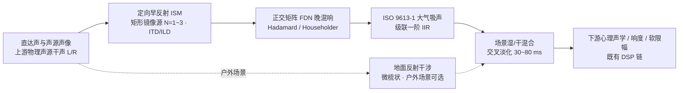

# 02 · 3D 立体声场与场景传播研究

- 状态：Research Spec
- 日期：2026-11-22

> 本文是 `:core:audio` 立体声化重构的声学数学规约，面向「2 声道交错 Float32 / 48 kHz / 128 帧块」
> 新管线，下游接既有心理声学处理与软限幅（见 `docs/spec/02-audio-dsp-engine.md` §2）。
> 本文只定义数学模型、离散时间实现、参数表与稳定性/兼容性约束；不修改任何现有代码或规约。
> 关键词遵循 RFC 2119：MUST（必须）/ MUST NOT（严禁）/ SHOULD（应当）/ MAY（可以）。
>
> 红线继承：`docs/spec/README.md` 不变量 I1（音频路径 Zero-GC）、I4（±0.98 硬边界），
> 以及本文 §5 的「单声道折叠安全」约束——立体声增强 MUST NOT 破坏 (L+R)/2 单声道可用性。

## 1. 文献综述

下表为本文全部学术依据。核实方式：Crossref DOI 元数据核对、标准组织页面核对、
或两个独立二手来源交叉核对（标注于「核实方式」列）。未能核实者如实标注。

| # | 文献 | 核实状态 | 核实方式 / DOI / 稳定 URL | 与本文关系 |
|---|---|---|---|---|
| R1 | J. B. Allen & D. A. Berkley, "Image method for efficiently simulating small-room acoustics", J. Acoust. Soc. Am. 65(4), 943–950, 1979 | 已核实 | Crossref：DOI [10.1121/1.382599](https://doi.org/10.1121/1.382599)（卷期页码 65(4):943–950） | §3.1 镜像源法 ISM |
| R2 | J.-M. Jot & A. Chaigne, "Digital delay networks for designing artificial reverberators", Proc. 90th AES Convention, Paris, Feb. 1991, Preprint 3030 | 已核实（二手交叉） | Välimäki 等 2012 参考文献表（ref85）与 Jot/Chaigne 专利 [US5491754](https://patents.google.com/patent/US5491754) 引用列表双重核对；预印本号 3030 为单源，AES E-Library 永久链接未核 | §3.2 正交矩阵 FDN |
| R3 | V. Välimäki, J. D. Parker, L. Savioja, J. O. Smith, J. S. Abel, "Fifty Years of Artificial Reverberation", IEEE Trans. Audio Speech Lang. Process. 20(5), 1421–1448, 2012 | 已核实 | Crossref：DOI [10.1109/TASL.2012.2189567](https://doi.org/10.1109/TASL.2012.2189567) | §3.2 综述与 RT60/FDN 设计依据 |
| R4 | ISO 9613-1:1993, "Acoustics — Attenuation of sound during propagation outdoors — Part 1: Calculation of the absorption of sound by the atmosphere" | 已核实 | [EVS-ISO 9613-1:2020](https://www.evs.ee/en/evs-iso-9613-1-2020)（等同采用 ISO 9613-1:1993，ISO 目录号 17426；范围原文核对） | §3.3 大气吸声 |
| R5 | R. S. Woodworth & H. Schlosberg, "Experimental Psychology" (rev. ed.), Holt, Rinehart & Winston, New York, 1954（Woodworth 球头 ITD 公式，原著 1938） | [待核实]（页码与版本） | 书目为通行经典；公式 ITD≈(a/c)(θ+sinθ) 经二手来源核实（[Manchester Woodworth Model 演示](https://personalpages.manchester.ac.uk/staff/richard.baker/WebDemonstrations/BinauralCues/ITDwoodworth.html)、Kuhn 1977 讨论） | §3.1 ITD 双耳化 |
| R6 | G. F. Kuhn, "Model for the interaural time differences in the azimuthal plane", J. Acoust. Soc. Am. 62(1), 157–167, 1977 | 已核实 | Crossref：DOI [10.1121/1.381498](https://doi.org/10.1121/1.381498) | §3.1 球头 ITD 严格模型（R5 的现代替代） |
| R7 | J. C. Middlebrooks & D. M. Green, "Sound Localization by Human Listeners", Annual Review of Psychology 42, 135–159, 1991 | 已核实 | Crossref：DOI [10.1146/annurev.ps.42.020191.001031](https://doi.org/10.1146/annurev.ps.42.020191.001031) | §3.1 ILD/HRTF 简化依据 |
| R8 | M. R. Schroeder & B. F. Logan, ""Colorless" artificial reverberation", IRE Trans. Audio AU-9(6), 209–214, 1961 | 已核实 | Crossref：DOI [10.1109/TAU.1961.1166351](https://doi.org/10.1109/TAU.1961.1166351) | Schroeder/Freeverb 拓扑出处（v3.6 起由 `core/audio/src/main/java/com/industrial/horn/audio/SceneEngine.kt` 的正交 FDN 继承演进） |

交付前自检：**已核实 7 / [待核实] 1**。R5 书目真实存在但页码/版本未逐一核对，凡引用其公式处
SHOULD 以 R6（Kuhn 1977）为可核查的严格替代。凡本文未在上表出现的公式，均为标准推导，不引文献。

## 2. 管线总架构

输入为上游物理声源给出的干声 L/R（2 声道交错 Float32、48 kHz、块长 128 帧）；
输出交下游心理声学/响度/软限幅链（既有 DSP 链，其 ±0.98 硬边界与护耳增益不变）。



逐级契约：

| 级 | 输入 → 输出 | 契约 |
|---|---|---|
| 直达声与声源声像 | 干声单声道 → L/R | 幅度声像（cos/sin），等延迟；MUST NOT 对直达声施加 ITD（见 §5） |
| 定向早反射 ISM | 干声历史 → L/R 早反射 | 每场景独立房间参数表（§4）；通道间延迟差 MUST ≤ 0.66 ms |
| 正交矩阵 FDN | 早反射和 → L/R 晚混响尾 | 单一 FDN（M=4/8）+ 双输出抽头矩阵，宽度 W ≤ 0.7（§5） |
| ISO 9613-1 大气吸声 | L/R → L/R | 级联一阶 shelf；对 L/R 系数 MUST 相同（公共滤波，见 §5 约束 C4） |
| 场景湿/干混合 | 干 + 早反射 + 尾 + 地面 → L/R | `dry×(1−w/2) + wet×w`，w 为场景 wetMix；场景切换 30–80 ms 交叉淡化 |

## 3. 通用组件数学

通用约定：采样率 fs = 48000 Hz；声速 c = 343 m/s（20 °C）；全部延迟量以整数采样数冻结，
分数延迟一律线性插值；所有缓冲预分配、逐样本零分配（§6）。
本文第 5 组件（单声道折叠安全）单独成章，见 §5。

### 3.1 定向早反射 ISM（镜像源法，Allen-Berkley [R1]）

**连续时间模型。** 矩形房间尺寸 Lx×Ly×Lz，声源 s = (sx, sy, sz)、听者 r = (rx, ry, rz)。
镜像源 n = (n1, n2, n3)（ni ∈ Z）的位置与到听者距离：

```
x_n1 = 2*n1*Lx + (-1)^n1 * sx        (y、z 轴同理)
R_n  = |r_n - r|                      [m]
t_n  = R_n / c                        [s]
k_n  = |n1| + |n2| + |n3|             (墙面反射次数)
```

截断规则：仅取「恰一个分量非零」且 |ni| ≤ N 的镜像源，M(N) = 6N 个（N = 1/2/3 → 6/12/18 个），
与工程预算一致；直达声 (0,0,0) 由上游干声直接给出，不计入。

**增益与频响。** 每镜像源增益（参考距离 r0 = 1 m）：

```
g_n = rho^k_n * (r0 / R_n)
```

rho 为墙面反射系数（按墙/轴独立，§4）。入射角相关高频吸收用一阶低通近似：
入射角 theta_inc 越大（掠射）高频吸收越小，拐点频率随角度线性映射：

```
f_c(theta_inc) = f_min + (f_max - f_min) * cos(theta_inc)     [Hz]
alpha          = exp(-2*pi*f_c/fs)                            (一极系数)
y[m]           = (1 - alpha) * x[m] + alpha * y[m-1]           (一阶低通)
```

**离散时间实现。** 每镜像源一个分数延迟读游标 d_n = t_n·fs，线性插值：

```
D     = floor(d_n);  f = d_n - D
tap_n = (1 - f) * hist[idx - D] + f * hist[idx - D - 1]
out  += g_n * LP_n(tap_n)
```

`hist` 为干声环形历史缓冲（48 ms，§6），每镜像源独立 LP 状态。

**L/R 双耳化（简化，非完整 HRTF）。**
ITD 用 Woodworth 球头公式 [R5, 严格版见 R6]，头半径 a = 0.0875 m：

```
ITD(theta) = (a/c) * (theta + sin(theta))       [s], theta 为方位角（弧度，|theta| <= pi/2）
```

标定值（a = 0.0875 m、c = 343 m/s，机器复算）：

| theta | 0° | 30° | 45° | 60° | 90° |
|---|---|---|---|---|---|
| ITD | 0 | 0.261 ms | 0.381 ms | 0.488 ms | 0.656 ms |

ITD MUST NOT 超过 0.66 ms（90° 上限），且 ≤ 1.5 ms 崩溃临界的 44%（§5）。
ILD 用一阶高频搁架（拐点 1.5 kHz、2–4 kHz 处 ±3~6 dB 倾斜，按 theta 线性映射），
依据 [R7]：高频以 ILD 为主、低频以 ITD 为主；衍射与耳廓谱不建模。

**立体声差异化。** 左/右墙（±x 轴镜像）的 rho、距离、延迟 MUST 独立配置，
形成 12~48 ms 窗口内不对称早反射簇（街谷两侧立面、隧道两侧墙、车库柱列）；
±y/±z 轴镜像（前后/上下）取两耳均值公共分量。

### 3.2 正交矩阵 FDN 晚混响（Jot-Chaigne [R2]，综述见 [R3]）

**结构。** M 条延迟线（M = 4 或 8），每线：延迟 T_i → 一阶阻尼低通 g(z) → 增益 g → 正交反馈矩阵 A
→ 回写。输出经 M×2 抽头矩阵 C = [c_L; c_R] 取得 L/R 尾。

**延迟长度（素数互质，48 kHz 整数采样；两两互质由全部取相异素数保证，机器复算通过）：**

| 表 | 用途 | 采样数（ms @48 kHz） | 平均 T̄ |
|---|---|---|---|
| 表 A（M=8 长） | 隧道 | 1901(39.60) 1973(41.10) 2039(42.48) 2099(43.73) 2161(45.02) 2221(46.27) 2281(47.52) 2341(48.77) | 45.35 ms |
| 表 B（M=8 紧凑） | 车库 | 1103(22.98) 1181(24.60) 1259(26.23) 1361(28.35) 1433(29.85) 1511(31.48) 1583(32.98) 1657(34.52) | 28.88 ms |
| 表 C（M=4） | 街道 / 旷野 | 1301(27.10) 1433(29.85) 1567(32.65) 1697(35.35) | 31.24 ms |

**反馈矩阵（正交 → 能量守恒 → 稳定）。**
Hadamard 构造（M = 2^m）：

```
H2 = [1  1 ; 1  -1];   H_{2k} = [H_k  H_k ; H_k  -H_k];   A = H_M / sqrt(M)
```

Householder 构造（任意 M）：

```
A = I - 2*v*v^T/(v^T*v),  v = (1,1,...,1)^T   即   A = I - (2/M)*J  (J 为全 1 矩阵)
```

两者均满足 A^T*A = I（正交），故 ||A x||_2 = ||x||_2（无损混音）。
令 G(z) = diag(g_i·G_i(z))，G_i 为阻尼一极、直流增益 1。回路矩阵 L(z) = A·G(z)·g 满足：

```
rho(L(e^jw)) <= ||L(e^jw)||_2 <= g * max_i |G_i(e^jw)| <= g < 1     (谱半径严格小于 1)
```

即系统 BIBO 稳定、每绕行一周能量严格衰减。工程约束：**g ≤ 0.999**、阻尼极点 d ∈ [0, 0.95]。

**阻尼滤波（每线一阶，语义与现有 `SpatialReverb` 的 `state = delayed×(1−damping) + state×damping` 一致）：**

```
G_i(z) = (1 - d) / (1 - d*z^-1)       (直流增益 1，高频增益 (1-d)/(1+d))
```

高频 RT60 与阻尼系数关系（r = g_HF/g，机器复算）：

```
r = g_HF/g = 10^(-3*T̄*(1/RT60_HF - 1/RT60_LF));    d = (1 - r)/(1 + r)
```

**能量衰减 → RT60 与 g 反推。** 幅度每绕行（平均周期 T̄）乘 g，故幅度衰减 g^(t/T̄)；
RT60 定义为幅度降 10^(−3)：

```
g^(RT60/T̄) = 10^(-3)   =>   RT60 = -3*T̄ / log10(g)   <=>   g = 10^(-3*T̄/RT60)
```

各场景 g（T̄ 取对应延迟表均值，机器复算）：

| 场景 | T̄ | RT60 目标 | g | RT60 区间对应 g 区间 |
|---|---|---|---|---|
| STREET | 31.24 ms | 0.38 s | 0.567 | 0.25~0.5 s → 0.422~0.650 |
| TUNNEL | 45.35 ms | 3.5 s | 0.914 | 2.5~4.5 s → 0.882~0.933 |
| OPEN_HIGHWAY | 31.24 ms | 0.22 s | 0.375 | 0.15~0.3 s → 0.237~0.487 |
| GARAGE | 28.88 ms | 1.25 s | 0.853 | 0.9~1.6 s → 0.801~0.883 |

**输出抽头矩阵。** c_L、c_R 取归一化 Hadamard 的两行（近正交、和差分离），
以 M/S 约束折算宽度 W（§5）；抽头系数冻结为常量，运行时仅随 W 缩放。

**防次正规数。** 回路状态钳 ±4（继承现有 `coerceIn(-4, 4)` 约定）；
状态 |x| < 2^-126 时强制写 0（FTZ 守卫，防 ARM 次正规数降速与 DC 积沉）；
FDN 输出后可选 10 Hz 一阶隔直（极点 0.997）。

### 3.3 大气吸声（ISO 9613-1 [R4]）

**标准要点（范围原文核对）：** 纯音衰减系数 alpha(f, T, RH, p0) 以 dB/km 给出，
频率 50 Hz~10 kHz、温度 −20~+50 °C、相对湿度 10~100 %、气压 101.325 kPa（1 atm）；
含经典吸收与 O2/N2 振动弛豫（湿度相关）；宽带以倍频程中带值计算（谱积分法见其附录 D）；
只计大气吸收，地面反射/折射归 ISO 9613-2。总衰减 A(f, d) = alpha(f)·d/1000 [dB]（d 单位 m）。
工程取值点：T = 20 °C、RH = 50 %（常量，无气象 UI）；alpha 随频率单调升（2~8 kHz 为主要作用带），
落地 MUST 以标准表 1 数值离线校准，禁止在实现内手抄近似值。

**距离→频谱斜率映射。** 距离 20~300 m 映射到 2~8 kHz 衰减斜率：
A₂ = alpha₂·d/1000（2 kHz）、A₈ = alpha₈·d/1000（8 kHz），每场景距离档见 §4。

**滤波器拟合（二阶 = 两级一阶 shelf 级联）。** 单级一阶高频 shelf 模拟原型（直流增益 1、高频增益 G）：

```
H_a(s) = (G*s/w0 + 1) / (s/w0 + 1)
```

双线性变换步骤（fs = 48000，T_s = 1/fs）：

```
1. 预畸变:  w0' = 2*fs*tan(pi*f0/fs)          (f0 为拐点频率)
2. 代换:    s = 2*fs*(1 - z^-1)/(1 + z^-1),  记 k = 2*fs
3. 系数:    b0 = (G*k + w0') / (k + w0')
            b1 = (w0' - G*k) / (k + w0')
            a1 = (w0' - k)   / (k + w0')
4. 差分方程: y[n] = b0*x[n] + b1*x[n-1] - a1*y[n-1]
```

稳定性：|a1| < 1 对一切 w0' > 0 成立（|w0'−k| < |k+w0'|），极点恒在单位圆内；
直流增益恒 1（(b0+b1)/(1+a1) = 1，代入可验）。两级级联分别取 (G1, f1 = 2 kHz)、(G2, f2 = 8 kHz)，
G1、G2 由两点拟合 |H(2k)| = 10^(−A₂/20)、|H(8k)| = 10^(−A₈/20) 离线解出（2×2 单调求解），
按距离档冻结常量表（20/40/…/300 m），运行时对 G1、G2 线性插值并逐块 one-pole 平滑（§6）。
系数 MUST 对 L/R 相同（公共滤波，§5 约束 C4）。

### 3.4 地面反射干涉（户外微梳状）

一次地面反射几何（声源高 h_s、听者高 h_r、水平距 D）：

```
r_d = sqrt(D^2 + (h_s - h_r)^2)       (直达)
r_g = sqrt(D^2 + (h_s + h_r)^2)       (地面反射)
Δr  = r_g - r_d;   Δt = Δr / c
H(f) = 1 + rho_g * L(f) * exp(-j*2*pi*f*Δt)        (L(f) 为地面一阶低通)
```

陷波位于 f_k = (2k+1)/(2Δt)（梳状间隔 1/Δt）；近场垂直极限 Δr → 2h（h = min(h_s, h_r)）
时间隔 → c/(2h)，即任务给定的陷波基频。标定值（c = 343 m/s，机器复算）：

| h | 0.75 m | 1.2 m | 2.2 m | 2.4 m | 2.6 m |
|---|---|---|---|---|---|
| c/(2h) | 228.7 Hz | 142.9 Hz | 78.0 Hz | 71.5 Hz | 66.0 Hz |
| 2~5 次模态 | 457~1143 | 286~715 | 156~390 | 143~357 | 132~330 |

实现：分数延迟线（线性插值，D = Δt·fs）+ 衰减 rho_g + 一阶低通（地面高频吸收）：

```
y = x + rho_g * LP(x delayed by D)
```

rho_g：沥青 0.3~0.5、混凝土 0.85~0.95（线性幅度比，非 dB）。该滤波器 MUST 为公共（mono）
处理或对 L/R 使用相同 D、rho_g——通道差异化只允许来自 ISM 与 FDN 抽头（§5 C4）。
车库层高 2.2~2.6 m 的地面/天花板梳状即上表 h=2.2~2.6 行：基频 66~78 Hz，
2~5 次模态 132~390 Hz，与「120~400 Hz 轻微驻波染色」一致（§4.4）。

## 4. 四场景参数表

每场景参数分五组：ISM 房间几何/反射系数/延迟窗、FDN、大气吸声距离、干湿比、声像宽度。
全部数值为常量表（双端镜像，§6），W 为 FDN 输出 M/S 宽度（§5）。

### 4.1 城市街道 Urban Street（storageKey: "street"）

| 组 | 参数 |
|---|---|
| ISM 几何 | 街道峡谷 12(宽)×40(长)×15(高) m；听者距左立面 6.5 m / 右立面 5.5 m（非对称）；声源前 8 m、高 0.75 m |
| ISM 反射 | 左立面 rho_L 0.62 / 右立面 rho_R 0.70（一阶低通拐点 3.2 kHz，中高频软吸声）；地面沥青 rho_g 0.40 |
| ISM 阶数/窗 | N=2（12 镜像源）；早反射簇 12~48 ms；单反射 ≤ −10 dB 相对直达 |
| 地面微梳状 | h=0.75 m，c/(2h) ≈ 229 Hz 上限；按实际 Δr 计算 |
| FDN | M=4（表 C）；g=0.567（RT60 0.38 s，容许 0.25~0.5）；d=0.204（RT60_HF 0.22 s） |
| 大气吸声 | 距离档 15~60 m，2~8 kHz 轻衰减 |
| 干湿比 | wetMix w=0.10（保持既有 STREET 手感）；preDelay 8 ms；尾音 60 ms |
| 声像宽度 | W=0.5 |

### 4.2 混凝土隧道 Concrete Tunnel（storageKey: "tunnel"）

| 组 | 参数 |
|---|---|
| ISM 几何 | 等效矩形 8(宽)×40(长)×5.5(高) m（拱顶等效）；听者偏左 3.4 m；声源前 10 m、高 0.75 m |
| ISM 反射 | 拱顶 rho 0.94 / 侧墙 0.90 / 地面 0.88（一阶低通拐点 5 kHz，硬反射高亮）；拱顶强反射密集拍打簇 4~35 ms（N=2，12 镜像源） |
| 隧道染色 | 侧墙 flutter 梳状周期 2W/c ≈ 46.6 ms（21.4 Hz 间隔 → 低中频轰鸣），公共滤波实现（§5 C4） |
| FDN | M=8（表 A）；g=0.914（RT60 3.5 s，容许 2.5~4.5）；d=0.262（RT60_HF 0.5 s，高频滚降） |
| 大气吸声 | 距离档 20~120 m（高湿弱衰减） |
| 干湿比 | wetMix w=0.38（保持）；preDelay 18 ms；尾音 1200 ms |
| 声像宽度 | W=0.7（湿声宽，上限值） |

### 4.3 旷野公路 Open Highway（storageKey: "open_road"）

| 组 | 参数 |
|---|---|
| ISM 几何 | 开阔地；远山/路侧屏障等效镜像面距 60~150 m；声源高 0.75 m、听者高 1.2 m |
| ISM 反射 | 稀疏远距回声 80~220 ms 交错（地面 + 远山两路），增益 −18~−30 dB（远山等效 rho 0.08~0.16）；N=1（6 镜像源） |
| 地面微梳状 | h=0.75 m，c/(2h) ≈ 229 Hz 上限；沥青 rho_g 0.35 |
| FDN | M=4（表 C）；g=0.375（RT60 0.22 s，容许 0.15~0.3）；d=0.225（RT60_HF 0.15 s） |
| 大气吸声 | 距离档 50~300 m，严格 ISO 9613-1 映射（本场景为主要消费方） |
| 干湿比 | wetMix w=0.22（保持）；preDelay 34 ms；尾音 400 ms |
| 声像宽度 | W=0.4 |

### 4.4 地下车库 Underground Garage（storageKey: "garage"，新增第 4 档）

| 组 | 参数 |
|---|---|
| ISM 几何 | 低矮层高 2.2~2.6 m（标称 2.4 m）；柱网 8.4 m、柱距 2.8 m；听者中车道、声源前 6 m、高 0.75 m |
| ISM 反射 | 混凝土/涂料硬墙 rho 0.85~0.95（顶 0.92 / 墙 0.90 / 地面 0.88），一阶低通拐点 6 kHz（中高频反射高亮）；立柱密集早反射 4~25 ms（N=2，12 镜像源） |
| 层高染色 | 地面/天花板梳状基频 c/(2h) = 66~78 Hz，2~5 次模态 132~390 Hz（120~400 Hz 轻微驻波染色，公共滤波） |
| FDN | M=8（表 B 紧凑高密度）；g=0.853（RT60 1.25 s，容许 0.9~1.6）；d=0.141（RT60_HF 0.45 s） |
| 大气吸声 | 距离档 10~40 m（室内弱） |
| 干湿比 | wetMix w=0.30（新增）；preDelay 12 ms；尾音 800 ms |
| 声像宽度 | W=0.6 |

### 4.5 与现有 AcousticSpace 三档的对应/迁移

现有枚举（`AcousticSpace.kt`）与新模型映射（旧 feedback 等效 RT60 按旧梳状 T̄ = 27.98 ms 折算，机器复算）：

| 旧参数 | STREET | TUNNEL | OPEN_ROAD | 新模型语义与迁移 |
|---|---|---|---|---|
| wetMix | 0.10 | 0.38 | 0.22 | 保留为场景 w，混音公式不变 `dry×(1−w/2)+wet×w` |
| feedback | 0.58 | 0.84 | 0.66 | 映射为 FDN g；等效 RT60 = 0.35 / 1.11 / 0.47 s |
| （新 g 目标） | 0.567 | 0.914 | 0.375 | STREET 同量级；TUNNEL 尾巴延长至 3.5 s；OPEN_ROAD 缩短至 0.22 s |
| damping | 0.35 | 0.22 | 0.52 | 语义连续（一极插值系数），新 d = 0.204 / 0.262 / 0.225（按 RT60_HF 重标定） |
| preDelayMillis | 8 | 18 | 34 | 保留为直达-早反射窗基准 |
| tailBlocks（240 帧/块） | 12 / 240 / 80 | | | 改为尾音毫秒 60 / 1200 / 400（GARAGE 800），消除 C++ `msPerBlock = 3` 折算偏差（`docs/spec/02` §8） |

**优雅扩展第 4 档（GARAGE）：**

- Kotlin：`AcousticSpace` 末位追加 `GARAGE(storageKey = "garage", ...)`，ordinal = 3；
  既有 STREET/TUNNEL/OPEN_ROAD 的 ordinal 与 storageKey MUST 不变（持久化与 JNI `nativeSetSpace(int)` 兼容）。
- C++：`Reverb::setSpace(int)` 增加 `case 3`，缺省分支保持 STREET 行为不变。
- 前后兼容：`fromStorageKey` 未知键回退 STREET（既有行为）——旧版本 App 读到 `"garage"` 优雅降级；
  新版本读到旧三键行为不变，DataStore schema 无需版本迁移（存字符串键）。
- UI：第 4 档展示名「地下车库」，排在既有三档之后。

## 5. 单声道折叠安全分析（红线）

折叠定义：`m[n] = (l[n] + r[n]) / 2`，传递函数 `H_m(z) = (H_L(z) + H_R(z)) / 2`。
设计目标（可测）：折叠能量损失 < 3 dB；200 Hz~2 kHz 无 > 6 dB 陷波；
通道相关系数 rho_LR 落在目标区间。约束分四条：

**C1 直达声纯幅度声像。** `g_L = cos(phi)`、`g_R = sin(phi)`，等延迟、无 ITD
→ 直达路径 H_m 恒为 `(g_L+g_R)/2`，严格无梳状。声像定位优先靠幅度（任务红线：幅度声像优先）。

**C2 ITD 反射增益与延迟预算。** 通道间延迟差 MUST ≤ 0.66 ms（Woodworth 90° 上限），
远低于 ~1.5 ms 崩溃临界；每条 ITD 化早反射相对直达增益比 k ≤ 0.316（−10 dB），
多条反射相干和 MUST ≤ 0.333（−9.5 dB）。单延迟+单反射的最坏单声道凹陷（反相点）：

```
dip = 20*log10((1 + k) / (1 - k))    [dB]
```

机器复算：k = 0.2 → 3.5 dB；k = 0.316 → 5.7 dB；k = 0.4 → 7.4 dB。
取 k ≤ 0.316 保证 200 Hz~2 kHz 内最深凹陷 ≤ 5.7 dB < 6 dB（红线满足）。
ITD 反相频率 f = (2q+1)/(2Δt) 由 Δt ≤ 0.66 ms 推出首反相 ≥ 758 Hz，
叠加 C1 后残余凹陷进一步被直达声稀释。

**C3 FDN 近单声道去相关。** 输出用 M/S 形式：`w_L = S + W*D'`、`w_R = S − W*D'`，
W ≤ 0.7。折叠后 `m = S`（side 分量精确抵消），Mid/Side 去相关（延迟素数互质保证宽带去相关，
无窄带陷波）。能量（E_D' = E_S 时）：

```
mono 能量损失 = 10*log10(1 + W^2)            W=0.5 -> 0.97 dB; W=0.7 -> 1.73 dB  (< 3 dB)
rho_LR = (1 - W^2) / (1 + W^2)               W=0.5 -> 0.60;  W=0.7 -> 0.34
```

**C4 公共滤波原则。** 大气吸声、地面反射微梳状、隧道 flutter 染色 MUST 为公共（mono）处理
或对 L/R 施加完全相同系数——公共传递函数在 `(H_L+H_R)/2` 中原样通过，不产生通道差；
立体声差异只允许来自 ISM 墙参数（C2）与 FDN 抽头矩阵（C3）。

**可测验收目标（测试用例规格）：**

| 指标 | 目标 | 测法 |
|---|---|---|
| 折叠能量损失 | < 3 dB | 粉噪 5 s，10*log10(E_stereo/E_mono)，逐场景 |
| 200 Hz~2 kHz 陷波深度 | < 6 dB | 1/6 倍频程扫描，相对通带中值 |
| 通道相关系数 rho_LR | 0.35~0.80 | 互相关/能量比，200 Hz~8 kHz 带内，逐场景 |
| 最大通道延迟差 | ≤ 0.66 ms | 参数表静态断言 + 脉冲响应测 |
| 折叠后频谱着色 | 与干声单调偏差 < 2 dB（200 Hz~2 kHz） | 折叠谱 vs 干声谱比对 |

## 6. 工程约束

### 6.1 逐样本零分配与内存预算

全部延迟线/缓冲构造期一次性预分配；渲染路径 MUST 符合 `docs/spec/README.md` 不变量 I1
（零分配、零锁、零日志、零 I/O），`ZeroGcAudioPathTest` 64 KB 分配预算口径不变。

| 缓冲 | 规格 | 容量 |
|---|---|---|
| ISM 干声历史 L/R | 2 × 2304 采样（48 ms）float32 | 18.0 KB |
| ISM 抽头游标/增益/一极态 | 18 镜像源 × 6 float | 0.5 KB |
| 地面反射延迟 L/R | 2 × 960 采样（20 ms）float32 | 7.5 KB |
| FDN 延迟线（表 A 上限 2341 采样） | 8 × 2341 float32 | 73.2 KB |
| FDN 阻尼态/抽头矩阵/蝶形暂存 | 8×2 + 2×8 + 8 float | 0.3 KB |
| 大气吸声（2ch × 2 级一阶） | 状态 + 冻结系数 | 0.2 KB |
| 块交织缓冲（入/出各 128 帧 × 2ch） | 2 × 256 float32 | 2.0 KB |
| 参数平滑/交叉淡化 | ~64 float | 0.3 KB |
| 合计 | | ≈ 102 KB（预算上限 128 KB） |

### 6.2 逐块复杂度（128 帧 @48 kHz，周期 2.667 ms）

逐样本约 340 FLOP：ISM 36 抽头 × 6、FDN 读 8 + 阻尼 32 + Hadamard 蝶形 24 + 抽头 16、
大气 16、地面 8、混合/平滑 20。单块 ≈ 44 K FLOP（0.044 MFLOP），
在现代 ARM 核上约 20~50 µs，< 2% 的 2.667 ms 预算；`RenderBudgetTest` 的 2.66 ms 断言可直接沿用。
Hadamard 用蝶形（M log2 M 加法）而非 8×8 乘法；Householder 用秩一形式 `A x = x − (2/M)·(1^T x)·1`（M 加 + M 乘）。

### 6.3 参数平滑与场景切换

- 标量参数（g、d、w、rho、G1/G2）逐块 one-pole 平滑：`x += alpha*(target − x)`，
  `alpha = 1 − exp(−1/(tau*fs))`，tau = 20 ms（杜绝拉链噪声，延续 `ExpressionModulator` 约定）。
- 场景切换 30~80 ms 交叉淡化（防爆音）：`g_old = cos(pi*t/(2T))`、`g_new = sin(pi*t/(2T))`（等功率），
  T ∈ [30, 80] ms；切换期间延迟线内容 MUST 保留（不 reset），参数经平滑过渡；
  FDN 延迟长度按场景固定表切换时走等功率淡化，MUST NOT 突变跳读游标。
- 尾音渲染按毫秒计（§4.5），由 `tailBlocks` 换算时 MUST 双端用同一换算（见 6.5）。

### 6.4 稳定性条件汇总

| 条件 | 约束 | 理由 |
|---|---|---|
| FDN 回路 | g ≤ 0.999 且 ρ(A·G(z)) ≤ g < 1 | A 正交 ⇒ ‖A‖₂ = 1，谱半径受 g 严格控制（§3.2） |
| 阻尼极点 | d ∈ [0, 0.95] | 一极 |p| = d < 1 |
| shelf 极点 | |a1| < 1 | 双线性构造天然成立（§3.3） |
| 分数延迟 | 线性插值 | 增益 ≤ 1，无过冲 |
| 数值 | 状态钳 ±4；|x| < 2^-126 写 0 | 防溢出/次正规数（FTZ 守卫） |
| 交叉淡化 | 等功率（非相关）/等增益（相关） | 无电平阶跃 |
| 全链 | 经既有软限幅 ±0.98 硬边界 | 不变量 I4 |

### 6.5 Kotlin / C++ 双端镜像对齐

`docs/spec/02` §8 已知偏差 MUST 在新实现中消除或对拍覆盖：

| 既有偏差 | 新实现要求 |
|---|---|
| 梳状延迟取整：Kotlin `toInt` 截断 1214 vs C++ 四舍五入 1215 | 统一 round-half-up；延迟表以整数采样常量冻结（§3.2 表 A/B/C），两端 MUST 字面量一致 |
| 预延迟缓冲容量 2176 vs 2400 采样 | 统一容量常量（ISM 历史 2304 / 地面 960），两端同值 |
| tailBlocks 折算：5 ms/块 vs `msPerBlock = 3` | 尾音以毫秒定义，块数换算两端同一公式 |
| Custom 谐波权重写法差异 | 参数常量表单源化（见下） |

对齐机制：场景参数常量表（§4 全部数值）MUST 单源定义（如共享 JSON 生成 Kotlin object 与 C++ constexpr，
或同 PR 双写 + 校验测试）；新增双端对拍测试：固定种子噪声 128 帧 × N 块，
四场景各跑一遍，逐样本容差 ≤ 1e-5（float32 舍入级），入 CI 门禁。

## 7. Non-Goals

- 不做完整 HRTF 卷积、头相关个性化与头部追踪；ITD/ILD 为简化模型（§3.1）。
- 不做真实房间脉冲响应（RIR）采样卷积（ADR-0001）；ISM 矩形房间 + FDN 为参数化近似。
- 不做非矩形房间、衍射、散射与大气折射（后者归 ISO 9613-2，本文不实现）。
- 不做气象参数 UI；温度/湿度/气压为常量（20 °C / 50 % / 101.325 kPa）。
- 不承诺 Kotlin 与 C++ 逐位（bit-exact）一致；以 ≤ 1e-5 对拍容差为验收线。
- 不改变既有 DSP 链位置：本文模型位于软限幅一之后、软限幅二之前（对应 `docs/spec/02` §2 的 REV 级）；
  心理声学/响度/护耳策略不在本文范围。
- 不做插件式效果器链、动态 EQ、多段压缩（与 `docs/spec/02` §7 一致）。
- 输出后端格式升级（Oboe 流改立体声）属后续工程任务，本文只约束 DSP 数学。

## 8. Known Limitations

- ISM 为矩形房间近似：真实车库柱网、隧道拱顶为非矩形结构，其染色以等效矩形 + 梳状近似（§3.4），
  与实测 RIR 会有偏差。
- Woodworth 公式（R5）在 > 1.5 kHz 逐渐失效（球头无衍射/耳廓谱）；高频定位主要靠 ILD（R7），
  本文不建模其误差。
- ISO 9613-1 只计大气吸收；远山回声、地面干涉为几何近似，未实现 ISO 9613-2 的完整传播模型。
- RT60 公式为扩散场统计近似；FDN 早期反射密度有限，RT60 实测值 MAY 与目标偏差 ±15 %。
- 单声道折叠保证（§5）是设计约束 + 测试目标，非形式化证明；多反射相干和的最坏相位对齐为构造性假设。
- 双端镜像依赖常量单源化与对拍测试，无自动形式化验证；`docs/spec/02` §8 的人工同步风险部分保留。
- 次正规数防护（FTZ 守卫）为保守实现；个别 SoC 的 FTZ/DAZ 行为差异 MAY 导致尾部噪声底差异。
- 耳机护耳（−6 dB）与外放场景的主观响度差异不属本模型范围（ADR-0004）。
