# 03 · 心理声学与移动扬声器适配研究

- 日期：2026-11-22
- 状态：Research Spec（研究规约；结论落地前须经 ADR 评审后并入 Living Spec）

> 作用域：上游 2 声道交错 Float32 48 kHz 立体声管线（物理声源 + ISM + FDN）之后、软限幅之前的
> 设备自适应输出处理链。本链消费上游立体声，输出交予尾段软限幅与硬边界。
>
> 上游不变量继续有效（见 [02-audio-dsp-engine.md](../02-audio-dsp-engine.md)、
> [ADR-0004](../adr/ADR-0004-equal-loudness-calibration-and-ear-protection.md)）：
> Peak ≤ 0.98；护耳 `PROTECTION_GAIN = 0.501`（−6.0 dB，触发条件
> `AudioSafetyPolicy.evaluate`：耳机已连接且媒体音量分数 > 0.7）；等响校准 Makeup Gain
> 0.47 / 0.52 / 0.18 / 0.30 / 0.22；两级 `tanh` 软限幅
> （`PcmRenderer.LIMITER_DRIVE 1.1`、`HornRenderer.REVERB_LIMITER_DRIVE 1.0`，均后接 ±0.98 硬边界）。
> 本文 §2.4 对两级限幅提出合并建议；建议落地前 MUST 维持现状。
>
> 关键词遵循 RFC 2119：MUST / MUST NOT / SHOULD / MAY。

## 0. 文档定位

- 读者：实现设备自适应输出链（VBS / 双模式 / 响度对齐 / 真峰值限幅）的 DSP 工程师。
- 所有系数公式 MUST 由代码常量生成，MUST NOT 手抄数值入运行时路径；本文公式可直接复算。
- 数学以纯文本 / 代码块给出（离散时间差分方程），量纲：增益为线性倍数，括注 dB 处为
  `20*log10(倍数)`；频率 Hz；时间常数 ms 或样本（48 kHz 下 1 样本 ≈ 20.833 µs）。
- 本文不修改任何现有规约；与 02 冲突处以 02 为准并在 §6 登记。

## 文献综述

下表为本规约引用的全部外部文献。核实方式：web 检索 + 权威来源页面（标准组织 / 图书馆编目 /
出版商 / 作者主页 / 学术索引 API）逐条核对书目。核实日期 2026-11-22。
**核实统计：已核实 9 条；[待核实] 6 条（含部分核实条目）。** 标注 [待核实] 的字段 MAY 引用，
但实施引用前 MUST 二次核对；MUST NOT 以未核实的卷期页号对外发表。

| # | 文献 | 要点 | 本规约用途 | 核实状态 |
|---|---|---|---|---|
| R1 | E. Larsen & R. M. Aarts, *Audio Bandwidth Extension: Application of Psychoacoustics, Signal Processing and Loudspeaker Design*, John Wiley & Sons, Chichester, 2004, ISBN 0470858648 | 虚拟低音 / NLD 谐波生成 / 小扬声器带宽扩展的系统性论述 | §2.1 VBS 总体方法 | 已核实（瑞典国家图书馆 Libris 编目 <https://libris.kb.se/5ngg7wjh24vhq05>） |
| R2 | ISO 226:2023(E), *Acoustics — Normal equal-loudness-level contours* | 自由场正入射等响曲线族（含 40–70 phon） | §2.2 等响校准依据 | 已核实（ISO 226:2023-03 版；取代 ISO 226:2003。DIN/AFNOR/ANSI 在售目录互证） |
| R3 | H. Fletcher & W. A. Munson, "Loudness, Its Definition, Measurement and Calculation", *J. Acoust. Soc. Am.* 5(2): 82–108, 1933 | 等响曲线奠基实验 | §2.2 背景 | 已核实（AIP / Wiley 记录 <https://pubs.aip.org/asa/jasa/article-abstract/5/2/82/651031/>） |
| R4 | ITU-R BS.1770-5 (11/2023), *Algorithms to measure audio programme loudness and true-peak audio level* | 附件 1：K 加权响度测量；附件 2：真峰值（4× 过采样）测量指南 | §2.3 / §2.4 | 已核实（ITU 官网，2023-11-22 批准，现行；BS.1770-4 (10/2015) 已被取代。<https://www.itu.int/rec/R-REC-BS.1770-5-202311-I/en>） |
| R5 | EBU R 128, *Loudness normalisation and permitted maximum level of audio signals* | −23 LUFS 目标、Short-term 3 s / Integrated 门限测量、真峰值上限 | §2.3 / §4 | 部分核实：官方 PDF 存在（<https://tech.ebu.ch/docs/r/r128.pdf>），初版 2010-08、最近修订 2023-11（二次来源互证）；修订版本号（v4.0 之类）[待核实] |
| R6 | EBU Tech 3341 (2016), *Loudness metering: 'EBU Mode' metering to supplement EBU R 128* | 短期 / 瞬时 / 积分表头定义 | §2.3 遥测口径 | 已核实（EBU 官方出版物条目与 2016 修订公告） |
| R7 | R. Bristow-Johnson, *Cookbook formulae for audio EQ biquad filter coefficients*（Audio EQ Cookbook） | RBJ 双二阶（LP/HP/BP/shelf）系数公式 | §2.1 / §2.2 全部 biquad 系数 | 已核实（稳定镜像 <https://webaudio.github.io/Audio-EQ-Cookbook/Audio-EQ-Cookbook.txt>；原件为 musicdsp.org 归档） |
| R8 | D. Giannoulis, M. Massberg & J. D. Reiss, "Digital Dynamic Range Compressor Design—A Tutorial and Analysis", *J. Audio Eng. Soc.*, 2012 | 压缩 / 限幅器包络、attack/release、前瞻结构的系统分析 | §2.4 前瞻软限幅包络设计 | 部分核实：题录（作者 / 标题 / JAES / 2012）已核实（作者主页 PDF <https://www.eecs.qmul.ac.uk/~josh/documents/2012/GiannoulisMassbergReiss-dynamicrangecompression-JAES2012.pdf>）；卷期页 60(6):399–408 [待核实] |
| R9 | B. C. J. Moore, *An Introduction to the Psychology of Hearing*, 6th ed., Brill, Leiden, 2012, ISBN 978-90-04-25242-4 | 听觉门限、掩蔽、响度与虚拟音高的现代综述 | §2.2 / §2.1 背景 | 已核实（题名 / 版次 / ISBN 经图书销售与 Google Books 记录互证；出版社与年份多来源一致） |
| R10 | R. M. Aarts, E. Larsen & D. Schobben, "Improving percieved bass and reconstruction of high frequencies for band limited signals", 2002 | NLD 虚拟低音与高频重建（题名原文含拼写 percieved） | §2.1 VBS 文献支撑 | 部分核实（Semantic Scholar 记录：作者 / 年份 / 题名已核实；会场或刊物出处 [待核实]；PDF 存于作者主页 <https://www.sps.tue.nl/rmaarts/RMA_papers/aar02n4.pdf>） |
| R11 | R. M. Aarts, "Perceiving low pitch through small loudspeakers", 2000 | 小扬声器低音感知（虚拟低音早期会议论文） | §2.1 VBS 文献支撑 | 部分核实（PDF 存于作者主页 <https://www.sps.tue.nl/rmaarts/RMA_papers/aar00c.pdf>，Google Scholar 有题录；年份与会场 [待核实]，按作者主页文件命名惯例推断为 2000） |
| R12 | J. F. Schouten, "The residue, a new component in subjective sound analysis", Proc. Kon. Ned. Akad. Wet., 1938 | 残差 / 基音缺失（missing fundamental）现象的经典来源 | §2.1 感知基础 | 部分核实（荷兰皇家科学院档案 PDF <https://dwc.knaw.nl/DL/publications/PU00017418.pdf> 存在；卷期页 [待核实]） |
| R13 | H. Haas, "Über den Einfluss eines Einfachechos auf die Hörsamkeit von Sprache", *Acustica* 1: 49–58, 1951 | 单回声（≤ ~1 ms 级微延）对定位与响度的影响（Haas 效应） | §1 耳机宽度增强 | 二次来源核实（多部德语声学工具书 / 高校教材引证该题录；原刊页未直接核对，卷期页 [待核实]） |
| R14 | "A hybrid virtual bass system for optimized steady-state and transient performance", IEEE 会议论文 | 稳态与瞬态折中的混合虚拟低音 | §2.1 候选对比旁证 | 存在性已核实（IEEE Xplore 文档 5606489 <https://ieeexplore.ieee.org/abstract/document/5606489>）；作者 / 年份 / 会场 [待核实] |
| R15 | "A Phase-Matched Exponential Harmonic Weighting for Improved Sensation of Virtual Bass", AES 会议论文 | 谐波加权改善虚拟低音听感 | §2.1 谐波配比旁证 | 存在性已核实（AES E-Library elib 18242 <https://aes.org/publications/elibrary/elibrary-page/?id=18242>）；作者 / 年份 [待核实] |

说明：线索文献中的 Deutsch "Octave Illusion" 与本主题（双耳错觉）不相关，按题意不引。
以上所有文献均为真实存在条目；未能核实的字段一律显式标注 [待核实]，MUST NOT 猜测补齐。

## 1. 双模式输出链架构

输入为上游立体声（2 声道交错 Float32 48 kHz）。公共段先做等响度 / 感知校准，随后按输出模式分叉；
公共尾段做感知响度对齐、真峰值软限幅与硬边界。模式判定复用 `AndroidAudioSafetyMonitor`
（`AudioDeviceCallback` + `ContentObserver`）与纯函数 `AudioSafetyPolicy.evaluate`：
耳机已连接且媒体音量分数 > 0.7 时置 `earProtectionActive = true`（→ `PROTECTION_GAIN 0.501`）。

```mermaid
flowchart LR
    IN["上游立体声 L/R<br/>Float32 48kHz 交错"]
    EQ["等响度/感知校准<br/>ISO 226 简化增益 查表插值"]
    MODE{"输出模式判定<br/>AndroidAudioSafetyMonitor"}
    SPEAK["Speaker VBS 外放模式"]
    HEAD["Headphone Full-Range 耳机模式"]
    HPF["保护性高通<br/>fc 90Hz 2~4 阶 Butterworth"]
    BPF1["低频抽取带通<br/>80~280Hz"]
    NLD["带限 NLD 谐波发生器<br/>2/3/4 次"]
    BPF2["谐波带限<br/>250~900Hz"]
    ALIGNP["相位对齐 群延迟补偿"]
    MONO["单声道核混音<br/>轻度立体声化"]
    VBYP["VBS 旁路<br/>完整低频保留"]
    WIDE["双耳宽度优化<br/>M/S 0.8~1.0 ILD 倾斜 ITD 微延 0.6ms"]
    EAR["护耳 -6dB<br/>PROTECTION_GAIN 0.501"]
    XF["模式交叉淡化<br/>20~50ms 等功率"]
    LAD["感知响度对齐增益<br/>5 音色 x 4 场景 x 2 模式"]
    TP["真峰值检测<br/>4x 多相 FIR 过采样"]
    LIM["前瞻软限幅<br/>attack 1~2ms release 50~120ms"]
    SAT["tanh 软饱和<br/>softSaturate d 1.0"]
    HB["硬边界 ±0.98"]
    OUT["输出 至后端"]

    IN --> EQ
    EQ --> MODE
    MODE -->|"无耳机"| SPEAK
    MODE -->|"耳机/外设"| HEAD
    SPEAK --> HPF --> BPF1 --> NLD --> BPF2 --> ALIGNP --> MONO
    HEAD --> VBYP --> WIDE --> EAR
    MONO --> XF
    EAR --> XF
    XF --> LAD --> TP --> LIM --> SAT --> HB --> OUT
```



分支契约：

| 段 | 模块 | 契约 |
|---|---|---|
| 公共 | 等响度 / 感知校准 | §2.2；静态增益 + one-pole 平滑；MUST 在分叉前完成 |
| 外放 | 保护性高通 | fc 90 Hz（SHOULD 80–100 可配），Butterworth 2~4 阶；切除小型扬声器无法重放且易过载的 <100 Hz 能量 |
| 外放 | 低频抽取 + NLD + 带限 + 对齐 | §2.1；以单声道核 M = (L+R)/2 处理（手机双扬声器常为伪立体声） |
| 外放 | 单声道兼容混音 | L' = M + e·S，R' = M − e·S，e ∈ [0.1, 0.2]；单声道折叠后恒等于 M（折叠安全） |
| 耳机 | VBS 旁路 | 完整低频直通；不做 <100 Hz 切除 |
| 耳机 | 双耳宽度 | M/S 宽度 w ∈ [0.8, 1.0]（S' = w·S）；ILD 高频倾斜：S 通道 2 kHz 高架 +1~3 dB；ITD 微延仅施加于 S 通道 Δt ≤ 0.6 ms（≤ 28 样本，Haas 类宽度增强 [R13]）；L+R = 2M 不变 → 单声道折叠安全 |
| 耳机 | 护耳 | `earProtectionActive` 时 ×0.501（−6.0 dB）；扬声器模式 MUST NOT 触发 |
| 公共尾 | 响度对齐 → 真峰值软限幅 → 硬边界 | §2.3 / §2.4 / §4；尾段是增益与非线性的唯一出口（不变量 I4） |

模式切换：耳机插拔 / 路由变化由 `AudioDeviceCallback` 上报，双分支输出等功率交叉淡化 20~50 ms
（`g_a = cos(pi*t/(2T))`、`g_b = sin(pi*t/(2T))`，T ∈ [20, 50] ms）防爆音；切换期间全部参数
one-pole 平滑（§2.5）。

## 2. 组件数学

以下差分方程均以 48 kHz 采样率书写；`x[n]` 输入、`y[n]` 输出、`z` 为滤波器状态。
biquad 统一采用 Direct Form I transposed（与 `core/audio/src/main/java/com/industrial/horn/audio/dsp/BiquadFilter.kt` 一致）：

```
y[n] = b0 * x[n] + z1
z1   = b1 * x[n] - a1 * y[n] + z2
z2   = b2 * x[n] - a2 * y[n]
```

### 2.1 Virtual Bass（NLD 谐波法）

#### 2.1.1 保护性高通（<100 Hz）

目的：手机微扬声器对 <100 Hz 位移过大，重放失真且消耗余量；外放模式在低频抽取前 MUST 先切除。
设计：Butterworth 高通，fc = 90 Hz（SHOULD 在 80~100 Hz 按机型可配）：

- 2 阶：单节 biquad，Q = 1/sqrt(2) ≈ 0.7071；
- 3 阶：一阶实极点级联 2 阶节（biquad Q = 0.5）；
- 4 阶：两个 biquad 级联，Q = 0.5412 与 Q = 1.3066。

RBJ 高通系数公式 [R7]（`w0 = 2*pi*fc/fs`，`alpha = sin(w0)/(2*Q)`）：

```
b0 =  (1 + cos(w0)) / 2
b1 = -(1 + cos(w0))
b2 =  (1 + cos(w0)) / 2
a0 =  1 + alpha
a1 = -2 * cos(w0)
a2 =  1 - alpha
（全部系数除以 a0 归一化）
```

推荐缺省：3 阶（fc = 90 Hz）。截止与 Q MUST 由上述公式生成；MUST NOT 手抄系数。

#### 2.1.2 低频抽取带通（80~280 Hz）

两级级联（推荐，通带平坦）：RBJ 高通 fc = 80 Hz（Q 0.707）+ RBJ 低通 fc = 280 Hz（Q 0.707）。
低通系数公式 [R7]：

```
b0 = (1 - cos(w0)) / 2
b1 =  1 - cos(w0)
b2 = (1 - cos(w0)) / 2
a0 =  1 + alpha
a1 = -2 * cos(w0)
a2 =  1 - alpha
```

单节替代方案（资源紧张时 MAY）：带通 f0 = sqrt(80*280) ≈ 149.7 Hz，Q = f0/200 ≈ 0.75，
RBJ 常数 0 dB 峰值带通：`b0 = alpha, b1 = 0, b2 = -alpha, a0 = 1+alpha, a1 = -2*cos(w0), a2 = 1-alpha`。

#### 2.1.3 带限非线性谐波发生器（NLD）与选型

设低频抽取信号为 `x[n]`（单频分析取 `x = A*cos(theta)`，A ≤ 0.95 预限幅）。候选与谐波产物：

| 候选 NLD | 2 次 | 3 次 | 4 次 | DC | 互调（多频时） | 有界性 | 单次成本 |
|---|---|---|---|---|---|---|---|
| `x + k*x^2`（去直流） | k*A^2/2（随 A^2） | 无 | 无 | k*A^2/2，与 2 次绑定，须阻断 | 和差频 f1±f2 | 多项式无界，须预限幅 | 低 |
| `tanh(d*x)` [DspMath.softSaturate 同族] | 无 | d^3*A^3/12（随 A^3） | 无 | 无 | 奇阶互调 | 天然有界 | 中 |
| 全波整流 `|x|`（去直流） | 0.424*A（随 A 线性） | 无 | 0.085*A（随 A 线性） | 2*A/pi ≈ 0.637*A，须阻断 | 和差频 | 线性有界 | 低 |
| `x*|x|` | 无 | 0.170*A^2（= 8/(15*pi)*A^2），伴随基频 8/(3*pi)*A^2 | 无 | 无 | 和差频 | 二次有界 | 低 |

精确谐波系数（可复算）：`|cos(t)| = 2/pi - (4/(3*pi))*cos(2t) + (4/(15*pi))*cos(4t) - ...`；
`cos(t)*|cos(t)| = (8/(3*pi))*cos(t) - (8/(15*pi))*cos(3t) - ...`。
2/3/4 次谐波落入 250~900 Hz 注入带的基频覆盖：2 次对应 125~450 Hz、3 次对应 83~300 Hz、
4 次对应 62~225 Hz 的基频成分；带限后自动完成"按落带选谐波"。

**选型结论：整流主导复合 NLD**：

```
m[n]   = m[n-1] + mu * (|x[n]| - m[n-1])        # |x| 均值估计，mu = 1 - exp(-2*pi*8/fs) 量级
y_raw  = w_e * (|x[n]| - m[n]) + w_o * x[n]*|x[n]|
y[n]   = HP20(y_raw)                             # 一阶高通 fc 20 Hz 双重 DC 阻断
```

- 偶次通道 `|x|`（去均值）产出 2 次 0.424*A 与 4 次 0.085*A，谐波幅度随 A 线性缩放，
  在 4~65 ms 起音包络的宽动态下谐波配比不漂移；
- 奇次通道 `x*|x|`（C1 连续）产出 3 次 0.170*A^2；
- 参数范围（k 语义 = 各通道权重）：`w_e ∈ [0.5, 0.9]`（缺省 0.70）、`w_o ∈ [0.1, 0.4]`（缺省 0.25）。
  落选说明：`x + k*x^2` 的 DC 与 2 次谐波由同一 k 绑定、且随 A^2 缩放（瞬态配比漂移），
  降为备选；`tanh` 型仅奇次、缺 2/4 次，仅当调音只要 3 次时 MAY 替换奇次通道。

有界性（MUST 验收）：`|x| <= 0.95` 预限幅 ⇒ `|y_raw| <= w_e*0.95 + w_o*0.9025 <= 1.11`；
带限后峰值不增（BPF 峰值增益 0 dB），尾段软限幅 + 硬边界保证输出 |y| <= 0.98。

防次正规数（denormal）：DC 阻断器与均值估计器状态 MUST 逐块检查
`|state| < 1e-20 -> state = 0.0`（JVM 无 flush-to-zero；C++ 侧 SHOULD 同用状态钳制以保证双端一致，
MAY 另开 FPCR FZ 位）。MUST NOT 依赖 `-ffast-math` 实现该行为。

#### 2.1.4 谐波带限（250~900 Hz）

RBJ 带通 f0 = sqrt(250*900) ≈ 474.3 Hz、Q = f0/650 ≈ 0.73（或级联 RBJ 高通 250 Hz + 低通 900 Hz）。
作用：只保留 2/3/4 次谐波中落入小扬声器可重放频带的部分，抑制 NLD 互调带外产物。

#### 2.1.5 相位对齐与群延迟补偿

NLD 支路与干声混合前 MUST 做群延迟对齐，否则干声自带谐波（如 CAR 400+500 Hz 的 2 次、
TRAIN 低八度）与注入谐波梳状干涉。推荐方案：谐波带限用线性相位 FIR（窗函数法，
N = 63 抽头，Blackman 窗），恒定群延迟 `tau = (N-1)/(2*fs) = 31 样本 ≈ 0.646 ms`，
干声支路延迟同样本数；带内相位严格线性，混合不产生额外梳状。
资源紧张时 MAY 用 2.1.4 的 IIR + 一阶全通近似匹配群延迟，代价为带内相位纹波。
验收：对齐误差 < 1/8 周期（@900 Hz ≈ 0.14 ms）时混合凹陷 < 1 dB。
已知残余：NLD 输出相位不锁定于干声内生谐波的相位（§6 登记）。

#### 2.1.6 混合增益与单声道核

```
M[n]  = (L[n] + R[n]) / 2                       # 单声道核
Mv[n] = M[n] + g_mix * y_aligned[n]             # 注入
L'[n] = Mv[n] + e * (L[n] - R[n]) / 2           # e ∈ [0.1, 0.2] 轻度立体声化
R'[n] = Mv[n] - e * (L[n] - R[n]) / 2
```

- 混合增益 `g_mix ∈ [0.2, 0.5]`，按机型扬声器上限取值（缺省上限 0.45）；
- 单声道折叠：`(L' + R')/2 = Mv`，与注入信号一致，折叠安全；
- VBS 注入量按音色静态标定（§4）：CAR / EBIKE / MOTORCYCLE 基频均 > 280 Hz、低频抽取带无能量，
  注入为 0；TRAIN（低八度 123.47 / 155.56 Hz）与 CUSTOM（主频 < 280 Hz 时）为满注入。

### 2.2 等响度与感知校准

ISO 226:2023 [R2] 40~70 phon 曲线要点（自由场、正入射；phon = 1 kHz 处 SPL 数值）：

- 低频需远高于 1 kHz 的 SPL 才等响：约数为 100 Hz 处 40 phon 曲线高出 1 kHz 约 +20 dB 以上，
  70 phon 时差距收窄至约 +10 dB 量级（精确值 MUST 以 ISO 226:2023 表格为准，本文不复抄表值）；
- 3~4 kHz 邻域最灵敏（曲线最低处）——这正是 EBIKE 2.7 kHz 双发射器的 Makeup Gain 被压到 0.18、
  而 TRAIN 和弦能量虽大却给 0.52 的依据（与 `HornVoice.kt` 类注释、ADR-0004 一致）；
- 曲线间距随电平非均匀（低电平曲线更陡）：响度对齐 MUST 按目标电平选曲线段，
  而不是单一斜率外推 [R3][R9]。

实时简化实现（二选一，均离线设计、在线只做查表 + 平滑）：

1. 查表插值（推荐）：离线将 5 音色合成谱按 1/3 倍频程分解，对照 ISO 226 目标 phon
   求每音色频段增益修正；在线以音色索引查表 + 一阶线性插值，输出 2 段 shelving 参数
   （低架 fc 200 Hz、高架 fc 3 kHz）。
2. 3~5 段 shelving：RBJ 低架 / 高架公式 [R7]（`A = 10^(G/40)`，`w0 = 2*pi*fc/fs`，
   `alpha = sin(w0)/(2*Q)`）：

```
b0 =    A*( (A+1) + (A-1)*cos(w0) + 2*sqrt(A)*alpha )
b1 = -2*A*( (A-1) + (A+1)*cos(w0) )
b2 =    A*( (A+1) + (A-1)*cos(w0) - 2*sqrt(A)*alpha )
a0 =        (A+1) - (A-1)*cos(w0) + 2*sqrt(A)*alpha
a1 =    2*( (A-1) - (A+1)*cos(w0) )
a2 =        (A+1) - (A-1)*cos(w0) - 2*sqrt(A)*alpha
（低架把 b1/a1 取反、b2/a2 交换即可；全部除以 a0 归一化）
```

与现有 5 音色 Makeup Gain 的合成关系（总增益乘法链，全前馈）：

```
G_total(v, s, m, p) = makeup[v] * g_scene[s] * g_mode[v][m] * (p ? 0.501 : 1) * 0.9
makeup: CAR 0.47 / TRAIN 0.52 / EBIKE 0.18 / MOTORCYCLE 0.30 / CUSTOM 0.22
p = AudioSafetyPolicy.evaluate(...).earProtectionActive
```

- `makeup[v]` 是等响校准的"音色维"（ADR-0004 不变量 MUST 保持：EBIKE RMS ≤ 0.65×CAR、
  TRAIN RMS ≤ 1.35×CAR）；
- 本文新增"场景维 × 模式维"修正 `g_scene` / `g_mode`（§4），与 makeup 相乘、不重构其标定；
- 等响校准与护耳 MUST 在限幅前施加（02 §2 契约不变）。

### 2.3 响度测量（仅 QA 与 Debug 遥测）

实时路径 MUST NOT 做响度归一化（ADR-0004 已否决实时 LUFS/AGC）；BS.1770 测量仅用于
离线标定复算与 Debug 遥测（可在观察端线程离线计算）。

K 加权（ITU-R BS.1770-5 附件 1 [R4]）= 高架预滤波 + RLB 高通级联：

- 高架：f0 = 1681.97 Hz、G = +4 dB、Q = 0.7072（模拟原型参数，工程通用值）；
- RLB 高通：f0 = 38.135 Hz、Q = 0.5003；
- 系数生成用 §2.2 的 RBJ 高架公式与 §2.1.1 的 RBJ 高通公式；
- 48 kHz 预置系数（工程抄录，实施时 MUST 与 BS.1770-5 附件 1 系数表逐位核对后使用）：

```
stage 1 (high shelf):  b = [ 1.53512485958697, -2.69169618940638,  1.19839281085285]
                       a = [ 1.0             , -1.69065929318241,  0.73248077421585]
stage 2 (high pass) :  b = [ 1.0             , -2.0             ,  1.0             ]
                       a = [ 1.0             , -1.99004745483398,  0.99007225036621]
```

窗与门限（口径对齐 EBU R 128 [R5] / Tech 3341 [R6]）：

- Short-term：3 s 滑动矩形窗，`L_st = -0.691 + 10*log10(sum_i G_i * z_i)`；
- Integrated：门限法（绝对门限 −70 LUFS + 相对门限 −10 LU），块 400 ms、重叠 75%；
- 真峰值口径见 §2.4（dBTP）。

验收断言（离线）：同场景同模式下 5 音色 Integrated Loudness 两两差 ≤ 1.0 LU（§4）。

### 2.4 真峰值软限幅

现状（02 §2）：两级 `tanh` 软限幅（`softSaturate(v, drive) = tanh(v*drive)/tanh(drive)`，
drive 1.1 / 1.0）+ 各级 ±0.98 硬边界。本节定义替代的单级真峰值前瞻软限幅。

#### 2.4.1 真峰值检测（4× 过采样）

按 BS.1770-5 附件 2 [R4]：48 kHz → 192 kHz 4× 多相 FIR 内插，4 相 × 12 抽头（共 48 抽头）。
标准系数表见 BS.1770-5 附件 2 表 1（实施时 MUST 自标准抄录）；本文给出等价用途的
自设计窗函数 sinc 多相表（设计式：`h[k] = sinc((k-23.5)/4) * blackman_harris(k)`，
每相归一化 DC 增益 = 1，可由该式复算）：

```
phase 0: -0.000001,  0.000173, -0.001877,  0.009869, -0.035760,  0.122550,
          0.971976, -0.087638,  0.026472, -0.006817,  0.001130, -0.000077
phase 1: -0.000017,  0.000840, -0.007212,  0.033709, -0.115904,  0.440968,
          0.766135, -0.155723,  0.046777, -0.011066,  0.001562, -0.000068
phase 2: -0.000068,  0.001562, -0.011066,  0.046777, -0.155723,  0.766135,
          0.440968, -0.115904,  0.033709, -0.007212,  0.000840, -0.000017
phase 3: -0.000077,  0.001130, -0.006817,  0.026472, -0.087638,  0.971976,
          0.122550, -0.035760,  0.009869, -0.001877,  0.000173, -0.000001
```

真峰值：`tp[n] = max(|x[n]|, max_p |interp_p[n]|)`（含原始样本位置，覆盖整数相位），
`dBTP = 20*log10(tp)`。4× 内插本身是估计（BS.1770-5 附件 2 亦为 4×），非解析真峰（§6 登记）。

#### 2.4.2 前瞻平滑软限幅

```
T        = 0.98                       # 限幅阈值（MAY 按机型降为 0.95 留喇叭余量）
g_t[n]   = min(1, T / tp[n])         # 目标增益
g[n]     = g_t < g[n-1] ? a_att*g[n-1] + (1-a_att)*g_t
                        : a_rel*g[n-1] + (1-a_rel)*g_t
a_att    = exp(-1/(fs * tau_att));  tau_att = 1..2 ms
a_rel    = exp(-1/(fs * tau_rel));  tau_rel = 50..120 ms
y[n]     = g[n] * x_delayed[n]       # x_delayed = 前瞻延迟 tau_L = 1..2 ms（48..96 样本）后的信号
```

- 前瞻延迟 `tau_L` MUST 不小于攻击时间常数所需超前量（gain 须在峰值到达前已下降）；
  128 帧块 = 2.667 ms，单块内前瞻用 2 块环形缓冲实现（跨块一致）；
- 包络 attack/release 取值依据 [R8] 的动态处理器包络分析：attack 1~2 ms 抑制瞬态过冲、
  release 50~120 ms 防低频喘息（泵动）。

#### 2.4.3 软饱和与硬边界（尾段收口）

```
y2[n] = tanh(y[n] * 1.0) / tanh(1.0)        # 复用 DspMath.softSaturate，drive 1.0
y3[n] = clamp(y2[n], -0.98, +0.98)          # 硬边界，唯一出口（不变量 I4）
```

#### 2.4.4 与现有两级限幅的合并建议（推荐：单级）

| 方案 | 内容 | 优点 | 缺点 |
|---|---|---|---|
| 现状（两级 tanh） | `PcmRenderer` d=1.1 → 混响 → `writeLimitedPcm` d=1.0（C++ `applyLimiter` 镜像） | 零延迟、极简、ADR-0004 刻意多级防线 | 两级非线性串联叠加染色（混响后二次饱和）；不防采样间过冲（dBTP 可 > 0.98，DAC 后削波）；drive 归一化在大信号下的压缩量难预测 |
| 建议（单级） | 真峰值检测 + 前瞻增益 + tanh(d=1.0) + ±0.98 硬边界，置于混响之后的唯一尾段 | dBTP ≤ 0.98 可测可验收；只染色一次；混响尾不再二次饱和；增益语义清晰 | 增加前瞻延迟 1~2 ms + FIR 群延迟 ≈ 0.65 ms；需 2 块环形缓冲与包络状态（预分配）；实现量大于两级 tanh |

推荐单级方案，迁移路径（MUST 分步、每步保持 I4）：

1. 先上真峰值检测 + dBTP 遥测（只测不改），确认现网 dBTP 分布；
2. 在混响后插入前瞻增益级（先只做平滑增益，不加 tanh），与 `writeLimitedPcm` 并存一个版本；
3. 合并：删除 `PcmRenderer.LIMITER_DRIVE 1.1` 一级（其增益级语义移入响度对齐），
   尾段保留且仅保留 `tanh(d=1.0) + ±0.98` 一处；C++ `applyLimiter` 同步；
4. 回归：`RenderBudgetTest`、`ZeroGcAudioPathTest`、防削波断言、新增 dBTP ≤ 0.98 断言。

取舍说明：接受 ≤ 2.7 ms 附加延迟（与 128 帧回调周期同量级）换取可测的采样间安全；
对鸣笛类 65 ms 级起音可感性低。若产品否决延迟，回退路径为保留两级 tanh 并以 dBTP 遥测
监控（此时 MUST 在 §6 保留"采样间过冲未防护"条目）。

### 2.5 耳机检测与模式切换

- 复用 `AndroidAudioSafetyMonitor`（`AudioDeviceCallback` 设备插拔 + `ContentObserver` 音量）→
  `AudioSafetyPolicy.evaluate`（纯函数）：`earProtectionActive = headphonesConnected && fraction > 0.7`；
  由此选择 §1 分支与 `PROTECTION_GAIN 0.501`。
- 模式切换交叉淡化：20~50 ms 等功率（`g_a = cos(pi*t/(2T))`、`g_b = sin(pi*t/(2T))`），
  MUST 在切换首样本前启动、末样本后置新分支独占，防爆音。
- 参数 one-pole 平滑（防拉链 / 防跳变）：`alpha = 1 - exp(-2*pi*fc/fs)`，
  fc ∈ [20, 50] Hz（fc = 30 Hz → alpha ≈ 0.0039）；覆盖 g_mix、宽度 w、ILD 高架增益、
  交叉淡化增益、响度对齐增益。与 `ExpressionModulator.SMOOTHING 0.0025f` 同族，
  SHARED 实现 MUST 复用同一原语。
- 切换边界处置：若恰逢鸣笛活跃，交叉淡化在包络之上进行（不触发声部重建）；
  `HornRenderer.applyPendingCustomProfile` 的"静默边界重建"契约不受影响。

## 3. 数值与实时约束

- 采样率 48 kHz、块长 128 帧、2 声道交错 Float32；Oboe 回调周期 2.667 ms；
  AudioTrack 兜底路径 240 帧 = 5 ms。本链所有定义以"逐样本"书写，块长无关；
  块级缓冲 MUST 同时支持 128 / 240 帧两种块长（预分配按最大块长）。
- 逐样本 / 逐块零分配（不变量 I1）。预分配清单（全部在渲染器构造期完成）：

| 缓冲 / 状态 | 规模 | 用途 |
|---|---|---|
| 声道解交织工作区 L/R | FloatArray(maxFrames) × 2 | 立体声逐声道处理 |
| VBS 单声道核 M、NLD 中间区 | FloatArray(maxFrames) × 2 | §2.1 |
| FIR 延迟线（若选线性相位带限） | FloatArray(63) | §2.1.5 |
| TP 多相延迟线 | FloatArray(48) × 2 声道 | §2.4.1 |
| 前瞻环形缓冲 | FloatArray(2*maxFrames) × 2 声道 | §2.4.2 |
| biquad 状态 z1/z2 | Double 标量 × 2 × ~12 节 | §2.1 / §2.2 |
| 均值 / DC 估计器、包络、交叉淡化、one-pole 状态 | Double 标量 × ~12 | §2.1.3 / §2.4 / §2.5 |

- biquad 稳定性：归一化后（a0 = 1）二阶节稳定充要条件 `a2 < 1 且 |a1| < 1 + a2`
  （极点半径 `r = sqrt(a2) < 1`）。RBJ 设计在 `0 < f0 < fs/2`、`Q > 0` 下天然满足：
  `a2 = (1-alpha)/(1+alpha) < 1`（alpha > 0）且 `|a1| = 2|cos(w0)|/(1+alpha) < 2/(1+alpha) = 1+a2`
  （`|cos(w0)| < 1`）；系数由公式生成时无需额外稳定化，但 MUST 保留该断言于单测。
- NLD 有界：`|x| <= 0.95` 预限幅 ⇒ `|y_raw| <= 1.11`（§2.1.3）；尾段 ±0.98 硬边界兜底。
- 参数平滑防拉链：一切增益 / 模式 / 宽度参数经 one-pole（§2.5）；MUST NOT 在样本循环内
  直接跳变乘数。
- 防次正规数：见 §2.1.3（状态钳制 `|state| < 1e-20 -> 0`，双端一致）。
- 单帧复杂度估算（每样本、每声道摊算）：主路高通 2 biquad（~20 MAC）+ VBS 支路（4 biquad +
  NLD ~15 op + FIR 63 MAC）+ 宽度处理（2 biquad + ≤28 tap 延迟）+ TP 检测（4 相 × 12 抽头 ×
  2 声道 = 96 MAC）+ 包络与 tanh（~30 op）≈ 350 op/样本 ⇒ 128 帧 ≈ 45 K op/块。
  标量 ARM @1 GHz 量级 < 0.3 ms；Kotlin JIT 路径按 3× 裕量 < 1 ms；均在 2.66 ms 周期预算内，
  叠加现有 DSP 后 MUST 仍满足 `RenderBudgetTest`（单块均值 < 2.66 ms）。
- C++ / Kotlin 双端对齐要点：
  - 全部系数由同一公式在编译期 / 构造期生成；SHARED 常量表（fc、Q、权重、时间常数）单一事实源；
  - 处理精度：系数计算 double，样本处理沿用各端现状（Kotlin `Double`、C++ `float`），
    MUST NOT 假设 bit-exact（02 §8 既有立场）；
  - 验收以机器断言：防削波（|sample| ≤ 0.98）、dBTP ≤ 0.98、RMS / LUFS 区间断言、
    Zero-GC 与渲染预算测试；两端参数镜像沿用 `FallbackHornAudioEngine` 参数镜像机制。

## 4. 跨车型 × 场景响度对齐

维度定义（5 × 4 × 2 = 40 组合）：

- 车型（音色）v：CAR / TRAIN / EBIKE / MOTORCYCLE / CUSTOM；
- 场景 s：BASE（无混响基准）、STREET、TUNNEL、OPEN_ROAD
  （`AcousticSpace` 三档 + 基准，共 4 场景；wetMix 0.10 / 0.38 / 0.22）；
- 模式 m：SPEAKER_VBS（外放）/ HEADPHONE_FULL（耳机）。

总增益：`G_total = makeup[v] * g_scene[s] * g_mode[v][m] * (p ? 0.501 : 1) * 0.9`
（§2.2；下表为 `g_scene * g_mode` 合成修正，单位 dB，线性倍数 = 10^(dB/20)）。

**外放模式 SPEAKER_VBS（dB 修正，初始建议值）**：

| 音色 \ 场景 | BASE | STREET | TUNNEL | OPEN_ROAD |
|---|---|---|---|---|
| CAR | −0.3 | −0.5 | −1.1 | −0.8 |
| TRAIN | −1.0 | −1.2 | −1.8 | −1.5 |
| EBIKE | −0.3 | −0.5 | −1.1 | −0.8 |
| MOTORCYCLE | −0.3 | −0.5 | −1.1 | −0.8 |
| CUSTOM | −0.7 | −0.9 | −1.5 | −1.2 |

**耳机模式 HEADPHONE_FULL（dB 修正，初始建议值）**：

| 音色 \ 场景 | BASE | STREET | TUNNEL | OPEN_ROAD |
|---|---|---|---|---|
| CAR | 0.0 | −0.2 | −0.8 | −0.5 |
| TRAIN | 0.0 | −0.2 | −0.8 | −0.5 |
| EBIKE | 0.0 | −0.2 | −0.8 | −0.5 |
| MOTORCYCLE | 0.0 | −0.2 | −0.8 | −0.5 |
| CUSTOM | 0.0 | −0.2 | −0.8 | −0.5 |

表值语义：

- 场景维（列内一致）：TUNNEL 湿声能量最大（wetMix 0.38）→ −0.8 dB 基准修正；
  OPEN_ROAD −0.5、STREET −0.2、BASE 0；混响能量补偿量 MUST 以离线 LUFS 复算标定后微调；
- 模式维（外放相对耳机）：外放叠加低频切除（<100 Hz）与 VBS 注入两条相反效应；
  TRAIN / CUSTOM（低频带有内容、注入满）感知响度上抬最多 → −1.0 / −0.7；
  CAR / EBIKE / MOTORCYCLE（无 <280 Hz 内容、注入为 0）仅补偿扬声器响应差异 → −0.3；
- 表值是**前馈初始标定**，MUST 经验收断言锁定后冻结为常量。

对齐策略：**推荐前馈增益表 + 限幅；否决自适应 AGC**。

- 前馈 + 限幅：组合有限（40 组）、可离线复算、零运行时判定、无动态泵动；
  每组合静态增益 + one-pole 平滑过渡（§2.5），瞬态包络（4~65 ms 起音）不被慢环路改写。
- AGC / 实时 LUFS 归一化否决理由（与 ADR-0004 一致）：动态泵动改变鸣笛瞬态语义；
  环路时延与鸣笛短促时长（<1 s）不匹配；不可复算、难单测；对持续单音内容收益有限。

验收断言（离线，`DspMeasurement` 扩展）：

1. 同场景同模式下 5 音色 Integrated Loudness 两两差 ≤ 1.0 LU；
2. 同音色同场景下两模式差 ≤ 1.0 LU；
3. 任意相邻组合切换（含模式交叉淡化 30 ms 过程）：无样本超出 ±0.98、dBTP ≤ 0.98、
   无单样本跳变 > 0.2；
4. ADR-0004 既有断言保持：EBIKE RMS ≤ 0.65×CAR、TRAIN RMS ≤ 1.35×CAR。

## 5. Non-Goals（非目标）

- 不做实时 LUFS 自适应归一化 / AGC / 多段压缩（ADR-0004 决策延续）。
- 不做 HRTF 双耳渲染、头部追踪、真立体声声场再现；耳机宽度处理仅 M/S + 微延。
- 不做真实房间脉冲响应卷积；ISM + FDN 已属上游。
- 不做机型扬声器频响自动辨识 / 个体 EQ 学习 / 云端调音下发。
- 不做听力剂量（noise dose）计量与医学级听力保护承诺；−6 dB 护耳为工程折中。
- 不实现完整 ISO 226 响度模型（仅等响曲线要点驱动的简化校准）。
- 实时路径不做响度测量（K 加权仅 QA / Debug 离线与遥测）。
- 不新增采样素材（ADR-0001 保持）。

## 6. Known Limitations（已知局限）

- NLD 互调：`|x|` 与 `x*|x|` 在多频输入下产生和差频，带限只能约束带外；带内互调与真实谐波
  共存，单频可测、复音主观，无法完全客观化。
- 相位对齐残余：NLD 输出相位不锁定干声内生谐波，梳状干涉只能部分缓解（§2.1.5）；
  干声谐波密集音色（CAR 400+500）尤甚——该音色注入为 0，恰好规避。
- 等响简化：ISO 226 曲线族被压缩为 2~4 段 shelving + 查表，个体听感、年龄与设备频响差异未建模。
- 真峰值 4× 内插是工程估计（BS.1770-5 附件 2 同为 4×）；6×/8× 会更准但成本倍增。
- 前瞻延迟：软限幅 + FIR 群延迟共增 ≈ 1.7~2.7 ms 端到端延迟；与触觉反馈（03-ux）时间对齐
  需整体评估，超预算则走 §2.4.4 回退路径。
- 响度对齐表（§4）为初始建议值，未经真机标定；机型扬声器差异未纳入。
- 文献 [待核实] 字段共 6 处（EBU R 128 修订版本号、Giannoulis 卷期页、Aarts 2000/2002 会场、
  Schouten 卷期页、Haas 页码、两篇 virtual bass 会议论文作者年份），实施引用前 MUST 二次核对。
- Kotlin / C++ 双实现非 bit-exact（02 §8 既有立场）；本文新增滤波器与限幅器同样适用。
- 本文档为 Research Spec：与 02 的"输出为单声道"表述在上游立体声化后须整体重审，
  本链的立体声处理不改变 02 现行单声道后端契约，直至上游重构落地。
